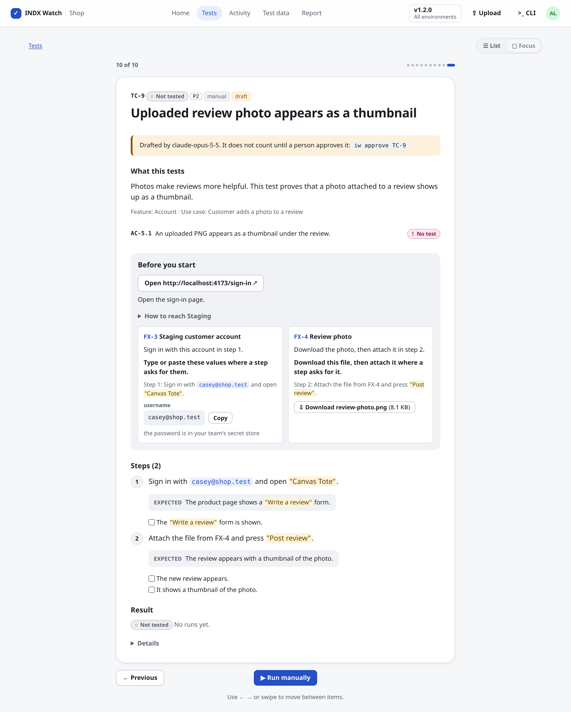
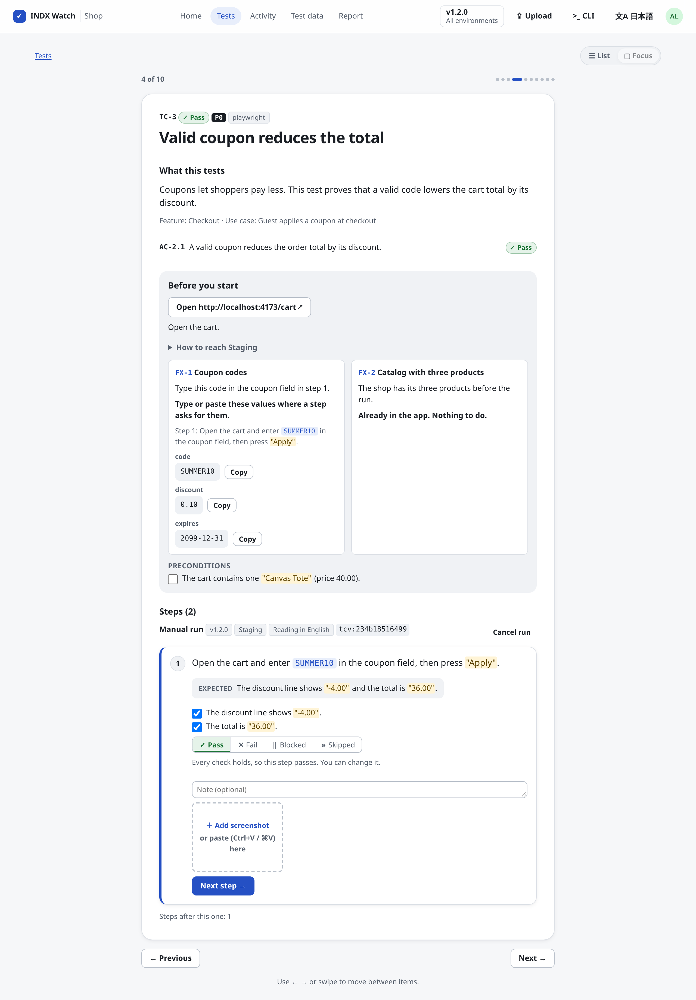
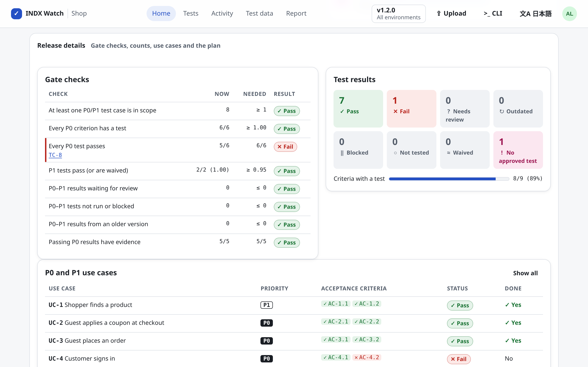
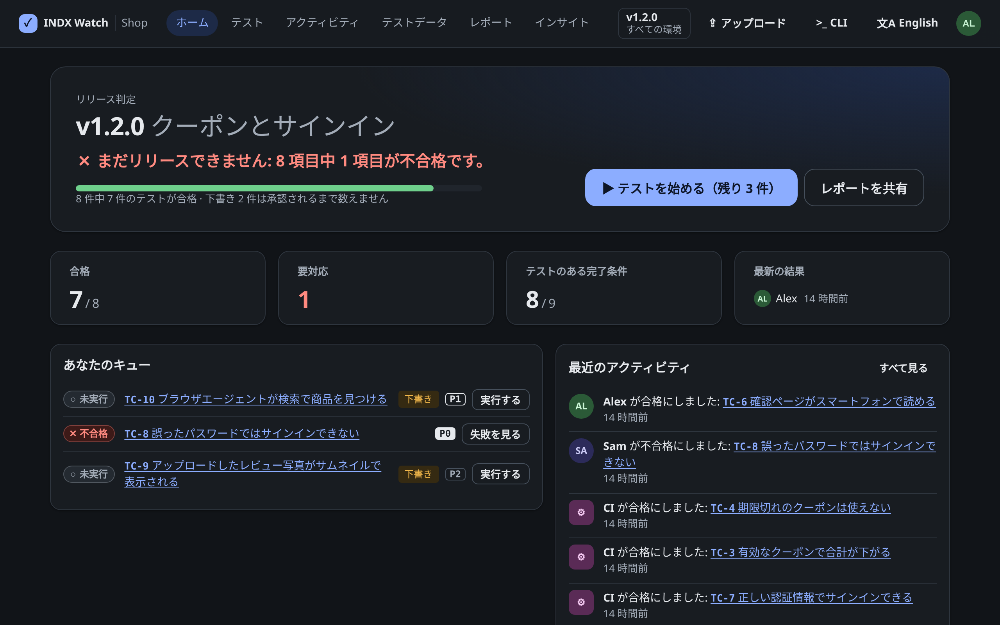

# INDX Watch

**確かめてから、リリースする。** コーディングエージェントと開発するチームのための、オープンソースのテスト管理ツールです。要件・テストケース・テストデータはコードの隣に型付きのファイルとして置き、手動・Playwright・エージェントの実行結果はひとつのモデルに集約。リリースできるかどうかは、勘ではなく結果から計算されます。

[English](README.md) · 日本語 · [简体中文](README.zh-CN.md)

[](https://github.com/INDXDev/indx-watch/actions/workflows/ci.yml)
[](https://www.npmjs.com/package/indx-watch)
[](LICENSE)

[Web サイト](https://indx-watch-site.i-248.workers.dev/ja/) · [ライブデモ](https://indx-watch-demo.i-248.workers.dev) · [ドキュメント（英語）](docs/README.md) · [クイックスタート（英語）](docs/guides/quickstart.md)


## なぜ INDX Watch か

機能はコーディングエージェントが数分で書いてくれる時代になりました。けれど、要件を整理し、E2E でテストし、何を確かめたかを毎回わかりやすく示す作業は、少しも速くなっていません。要件はチケットに、テストケースはスプレッドシートに、Playwright の結果は CI のログに、手動テストの結果はまた別の場所に。結果として、リリースは「たぶん大丈夫」で決まっています。

INDX Watch は、そのすべてに人にもエージェントにも読める置き場所を、リポジトリの中に用意します。

- **要件とテストをコードと同じように。** ユースケース、完了条件、テストケース、テストデータは `.indx-watch/` の TOML ファイル。機能と同じプルリクエストでレビューします。
- **すべての結果をひとつのモデルに。** ブラウザでの手動実行、`@TC-3` のタグを付けた Playwright テスト、エージェントの実行。どれにも、誰が・いつ・どのコミットと環境で実行したかが証拠つきで残ります。
- **リリース判定は計算で。** 設定できるゲートが、承認済みの完了条件と最新の結果から Go / No-Go を決め、理由と次に動く人まで示します。アプリでも CI でもエージェントでも同じ答えです。
- **手間のかかる作業はエージェントに。** Claude Code と Codex 用の 6 つのスキルが、テスト設計、データ準備、テスト実行、失敗の調査、進捗の報告を担当します。エージェントは下書きを書き、承認するのは人です。

## クイックスタート

Node 22.13 以上が必要です。アプリのリポジトリで:

```bash
npx indx-watch init
```

`.indx-watch/` バンドル、Claude Code（`/iw-…`）と Codex（`$iw-…`）用のスキル、`indx-watch` MCP サーバーが追加されます。コミットしたら、エージェントを開いて話しかけるだけです。

| 仕事 | Claude Code | Codex | こう話しかける |
|---|---|---|---|
| セットアップ | `/iw-setup` | `$iw-setup` | 「テスト管理をセットアップして」 |
| テスト設計 | `/iw-design` | `$iw-design` | 「チェックアウトで何をテストすべき？」 |
| データ準備 | `/iw-data` | `$iw-data` | 「テストデータを用意して」 |
| テスト実行 | `/iw-test` | `$iw-test` | 「自分の担当をテストしたい」「TC-3 を一緒にやって」 |
| 失敗の調査 | `/iw-triage` | `$iw-triage` | 「TC-8 はなぜ失敗した？」 |
| 進捗とレポート | `/iw-status` | `$iw-status` | 「1.2.0 はリリースできる？」 |

エージェントがなくても、すべての手順はコマンドで実行できます（[without an agent](docs/guides/quickstart.md#without-an-agent)）。`npx indx-watch serve --open` で Web アプリが起動します。まず触ってみるなら `npx indx-watch init demo --example` のあと `cd demo && npx indx-watch serve --open`。

## 開発者のために

すべてが diff もレビューもスクリプトもできるファイルです。サンプルのショップのテストケース:

```toml
# .indx-watch/specs/FEAT-2-checkout/UC-2-guest-applies-coupon/TC-3-valid-coupon.toml
key = "TC-3"
title = "Valid coupon reduces the total"
covers = ["AC-2.1"]
mode = "playwright"
purpose = "Coupons let shoppers pay less. This test proves that a valid code lowers the cart total by its discount."
start = "/cart"

[[fixtures]]
ref = "FX-1"
rows = ["SUMMER10"]

[[steps]]
instruction = "Open the cart and enter {{FX-1.code}} in the coupon field, then press \"Apply\"."
checks = ["The discount line shows \"-4.00\".", "The total is \"36.00\"."]
evidence = ["screenshot"]

[steps.i18n.ja]
instruction = "カートを開き、クーポン欄に {{FX-1.code}} を入力して「Apply」を押す。"
checks = ["割引行に「-4.00」と表示される。", "合計が「36.00」になる。"]
```

テストランナーは Playwright のまま。テストにキーのタグを付け、レポーターを追加します。

```ts
test('valid coupon reduces the total', { tag: ['@TC-3'] }, async ({ page }) => { /* … */ });

// playwright.config.ts
reporter: [['list'], ['indx-watch/playwright', { environment: 'staging' }]],
```

CI では GitHub Action がリリース判定のレポートをジョブサマリーに書き出し、変更が影響するテストケースをプルリクエストごとに 1 つのコメントにまとめ、必要ならマージやリリースを止めます。

```yaml
- uses: INDXDev/indx-watch@v0
  if: ${{ !cancelled() }}
  with:
    release: v1.2.0
    summary: true
    gate: true
```

すべてのコマンドが `--json`（追加のみで変わる安定した契約）に対応し、`iw status --gate` はリリースの準備ができていないと終了コード 1 を返します。`iw check` はスキーマと参照を検証し、秘密情報らしきものを拒否します。パスワードは `env:SHOP_CUSTOMER_PASSWORD` のような参照のままです。

## 役割ごとのメリット

情報源はひとつ。見え方は、チームのそれぞれに合わせて。

### 開発者

- **コードと同じようにレビュー。** 完了条件とテストケースは機能と同じプルリクエストで変わります。CODEOWNERS もブランチ保護もそのまま使えます。
- **新しいフレームワークは不要。** テストは Playwright が実行し、レポーターが手動の結果の隣に記録します。
- **ガードレールつきのエージェント。** `/iw-design` がコードを読んで足りないテストを提案し、`/iw-triage` が失敗を証拠つきで説明します。エージェントが書いたものは、人が承認するまで集計に入りません。
- **スクリプトで扱える。** すべてに `--json`、シェルのないエージェント向けの MCP サーバー、そして GitHub Action。

### テスター・QA

- **1 テスト 1 ページ。** 何を確かめるか、どこから始めるか、テストデータ、手順ごとの「はい／いいえ」の確認項目。日本語でも英語でも、PC でもスマートフォンでも。
- **テストデータがすぐそこに。** 入力するクーポンコード、サインインするアカウント、アップロードするファイルが、それを使う手順の隣にあります。
- **証拠はその場で。** 確認項目にチェックを入れ、スクリーンショットを貼るだけ。誰が、どのビルドで、どの環境で実行したかは自動で記録されます。
- **スプレッドシートではなく、キュー。** 自分の担当と残りがひと目でわかります。エージェントに頼めば、確認項目をひとつずつ案内してくれます。

### PdM・プロダクトオーナー

- **読める要件。** ユースケースと完了条件は平易な言葉で、優先度は P0 から P3。「完了」の定義を決めるのはあなたです。
- **理由つきの Go / No-Go。** 判定項目ごとに現在の値としきい値を表示。「まだです」には必ず、対象のテストケースと次に動く人が付きます。
- **すべての答えに証拠を。** どの結果も誰が実行したかがわかり、顧客への説明や監査にそのまま使えます。
- **誰でも開けるレポート。** HTML か PDF の 1 ファイル。メールアドレスやメモ、社内リンクを除いた顧客向け版も作れます。

| | | |
|---|---|---|
|  |  |  |
| **1 ページで完結するテストケース**: 目的、始める場所、テストデータ、確認項目。 | **その場で手動実行**: チェックを入れてスクリーンショットを添付。誰が・どのコミットで・どの環境でを記録。 | **計算されるリリース判定**: 判定項目ごとに値としきい値。「まだ」の理由が必ずわかります。 |

日本語の UI とダークテーマ:



## しくみ

定義は Git でやり取りし、プルリクエストでレビューします。結果は追記のみの記録として結果ストア（フォルダや S3 互換バケット）でやり取りするので、リポジトリが膨らむことはありません。中心に純粋なドメインロジックを置き、外部サービスはすべてポートの向こう側に。同じサーバーが Node でも Cloudflare Workers でも動く、ひとつの TypeScript のコードベースです。詳しくは [architecture](docs/architecture.md) と [ADR](docs/adr/README.md)（英語）を参照してください。

## 主な機能

| | |
|---|---|
| **型付きバンドル** | `.indx-watch/` の正規化された TOML。JSON Schema でエディタの補完が効く |
| **テストデータ** | データセット、初期データ、ファイル、アカウントを内容ハッシュでバージョン管理し、チームで共有。ファイルでも Web アプリのテストデータ画面でも編集できる |
| **計算されるリリース判定** | カバレッジ、ユースケースのステータス、設定できるリリースゲートを 1 つの純粋関数から |
| **Web アプリ** | 1 ページのテストケース、手動実行、実行結果の確認、テストデータ、レポート。PC でもスマートフォンでも |
| **Playwright レポーター** | テストに `@TC-3` とタグを付けるだけで、結果が手動の結果の隣に |
| **GitHub Action** | 同期、ジョブサマリー、PR コメント、リリース判定によるゲート |
| **どこでも同期** | フォルダ、AWS S3、Cloudflare R2、MinIO、GCS。サーバー不要 |
| **エージェントネイティブ** | Claude Code と Codex 用の 6 つのスキル、MCP サーバー、すべてのコマンドに `--json` |
| **レポート** | Markdown、1 ファイルの HTML、PDF。顧客向け版も |
| **セルフホスト** | `iw deploy` で Cloudflare Workers + R2 + D1（Access の背後）に、または SSO プロキシの背後の Node・Docker に |
| **ロックインなし** | 正はファイル。`iw export --full` で欠けのないアーカイブを書き出せる |

## 用語

| 用語 | 意味 |
|---|---|
| **ユースケース**（`UC-n`） | 誰が何を達成したいか。優先度は P0〜P3 |
| **完了条件**（`AC-n.m`） | ユースケースについての、観察できる「はい／いいえ」の記述 |
| **テストケース**（`TC-n`） | 1 つ以上の完了条件を確かめる手順。`manual`・`playwright`・`agent`・`hybrid` |
| **フィクスチャ／テストデータ**（`FX-n`） | テストに必要な行、初期データ、ファイル、アカウント。秘密情報は参照のみ |
| **リリースゲート** | リリースが満たすべき判定項目（P0 のテストがすべて合格、P1 が 95% 以上、確認待ちがない、など） |
| **計算される完了** | すべての完了条件が承認済みのテストケースで確かめられ、このリリースでの最新の結果が合格のとき、ユースケースは完了 |
| **下書きと承認** | 新しい項目とエージェントが書いたものはすべて下書きから始まり、人が承認するまで数えない |

## ステータスとバージョン

INDX Watch は **0.1.x（1.0 前）** です。実用でき、INDX Watch 自身のテストにも使っていますが（[`.indx-watch/`](.indx-watch)）、まだ若いプロジェクトです。ファイル形式はバージョン管理されており（`schema_version = 1`）、その中での変更は追加のみなので、今日書いたファイルは今後も読み込めます。CLI の `--json` の出力も追加のみで変わります。変更履歴は [CHANGELOG](CHANGELOG.md) と [roadmap](docs/roadmap.md) を参照してください。

## コントリビュート・セキュリティ・ライセンス

- コントリビュートは歓迎です。[CONTRIBUTING.md](CONTRIBUTING.md) と [AGENTS.md](AGENTS.md) を参照してください。コミットには DCO の署名（`git commit -s`）が必要です。
- 脆弱性は [SECURITY.md](SECURITY.md) の手順で非公開に報告してください。
- ライセンス: [Apache-2.0](LICENSE)
