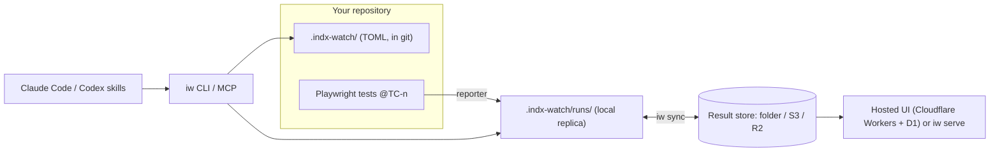

# INDX Watch

**Test management that lives in your repo.** Use cases, acceptance criteria, test cases and fixtures are typed TOML files next to your code. Results — manual, Playwright or agent — sync through any folder or S3 bucket. Release readiness is computed, never declared. Built for humans *and* coding agents.

[](https://github.com/INDXDev/indx-watch/actions/workflows/ci.yml)
[](LICENSE)

> Status: **v0.1, pre-release.** The file format is versioned (`schema_version = 1`); expect additive changes.

## Why

QA often *looks* done but is not. Test cases sit in spreadsheets and people's heads, fixtures are unversioned, Playwright and CI results are not linked to what they verify, and agents cannot read any of it. INDX Watch puts the whole picture into one typed, local, file-based model:

- **Git for definitions** — review test cases and fixtures in pull requests, next to the code they test.
- **Drive-like sync for results** — runs and evidence sync continuously through a bucket, without bloating git.
- **Computed done** — a use case is done only when every acceptance criterion is covered by test cases whose latest result passes, on this release, with evidence.

Read the [vision](docs/vision.md) for the full problem statement.

## 60-second quickstart

Requires Node 22.13+.

```bash
npx indx-watch init demo && cd demo
npx indx-watch new uc --title "Guest applies a coupon" --ac "A valid coupon reduces the total" --ready
npx indx-watch new tc --uc UC-1 --title "Valid coupon" --step "Apply SUMMER10 => Total drops by 10%" --ready
npx indx-watch check
npx indx-watch serve          # readiness dashboard + manual test runner at http://127.0.0.1:4321
npx indx-watch report --format html --out report.html
```

Everything above works offline. Install globally (`npm i -g indx-watch`) to type `iw` instead of `npx indx-watch`. More in the [quickstart guide](docs/guides/quickstart.md); try the full sample with `npx indx-watch init demo --example`.

## Features

| | |
|---|---|
| **Typed bundle** | `.indx-watch/` of canonical TOML with JSON Schemas for editor completion ([format](docs/spec/bundle-format.md)) |
| **Fixtures as data** | Datasets, seeds, files and accounts — versioned by content hash, large files as pointers, secrets as references only ([fixtures](docs/guides/fixtures.md)) |
| **Computed readiness** | Coverage, use case status and a configurable release gate from one pure function ([concepts](docs/spec/concepts.md)) |
| **Every result attributable** | Who/what ran it, when, on which commit, environment, test case version and fixture versions, with evidence |
| **Manual runner** | Step-by-step browser runner with screenshot upload, in English and Japanese |
| **Playwright reporter** | Tag a test `@TC-3`; results land next to manual ones ([Playwright](docs/guides/playwright.md)) |
| **GitHub Action** | Sync, job summary and an optional readiness gate in CI ([GitHub Actions](docs/guides/github-actions.md)) |
| **Sync anywhere** | Folder, AWS S3, Cloudflare R2, MinIO, GCS interop — no server needed ([S3 sync](docs/guides/s3-sync.md)) |
| **Agent-native** | `--json` everywhere, Claude Code / Codex skills, MCP server; AI drafts need human approval ([agents](docs/spec/agents.md)) |
| **Reports for customers** | Markdown, single-file HTML or PDF, with customer redaction ([reports](docs/spec/reports.md)) |
| **Self-host** | `iw deploy` puts the same server on Cloudflare Workers + R2 + D1 behind Access, or run it with Node/Docker |
| **No lock-in** | Files are the truth; `iw export --full` writes a lossless archive |

## Architecture



One TypeScript codebase: pure domain logic in the middle, every vendor behind a port, the same server on Node and Workers. Details: [architecture](docs/architecture.md), [decisions](docs/adr/README.md).

## How it compares

| | Spreadsheets / Drive | Classic TCM (TestRail, Xray, Kiwi) | Tests-as-code only | **INDX Watch** |
|---|---|---|---|---|
| Source of truth | Sheets | Database | Test code | **Typed files in git** |
| Manual + automated in one model | ✗ | ✓ | ✗ | **✓** |
| Fixtures versioned and linked | ✗ | ✗ | partial | **✓** |
| Works offline / self-host / no lock-in | ✓ / – / ✓ | varies | ✓ | **✓ / ✓ / ✓** |
| Agent-native (skills, MCP, `--json`) | ✗ | MCP add-ons | ✗ | **✓** |

See the [landscape research](docs/research/landscape.md) for sources and details.

## Documentation

Start at [docs/README.md](docs/README.md) — reading order for users, self-hosters, contributors and agents.

## Contributing

Contributions are welcome — see [CONTRIBUTING.md](CONTRIBUTING.md) and [AGENTS.md](AGENTS.md). This repository manages its own QA with INDX Watch in [`.indx-watch/`](.indx-watch).

## License

[Apache-2.0](LICENSE)
