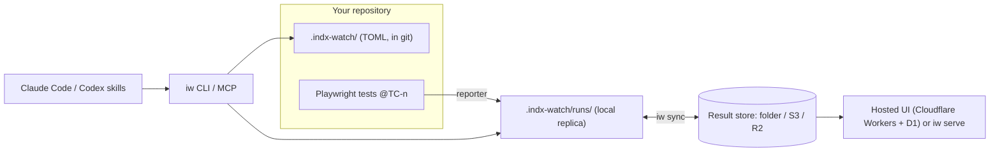

# INDX Watch

**Test management that lives in your repo.** Use cases, acceptance criteria, test cases and fixtures are typed TOML files next to your code. Results — manual, Playwright or agent — sync through any folder or S3 bucket. Release readiness is computed, never declared. Built for humans *and* coding agents.

[](https://github.com/INDXDev/indx-watch/actions/workflows/ci.yml)
[](LICENSE)

> Status: **v0.1** — try it with `npx indx-watch` ([quickstart](#quickstart-install-once-then-ask-your-agent)). The file format is versioned (`schema_version = 1`); expect additive changes.

> Live demo: <https://indx-watch-demo.i-248.workers.dev> — the web app loaded with the [`examples/shop`](examples/shop) sample, redeployed when `main` changes the app or the sample ([how it is deployed](docs/guides/self-host-cloudflare.md#demo-site-from-github-actions)). Anyone with the URL can read and write it, and visitors' runs stay until the demo is reset, so do not enter real data.

## Why

QA often *looks* done but is not. Test cases sit in spreadsheets and people's heads, fixtures are unversioned, Playwright and CI results are not linked to what they verify, and agents cannot read any of it. INDX Watch puts the whole picture into one typed, local, file-based model:

- **Git for definitions** — review test cases and fixtures in pull requests, next to the code they test.
- **Drive-like sync for results** — runs and evidence sync continuously through a bucket, without bloating git.
- **Computed done** — a use case is done only when every acceptance criterion is covered by test cases whose latest result passes, on this release, with evidence.

Read the [vision](docs/vision.md) for the full problem statement.

## Quickstart: install once, then ask your agent

Requires Node 22.13+ and Claude Code or Codex. In your app's repository:

```bash
npx indx-watch init
```

This adds the `.indx-watch/` bundle, the INDX Watch skills for Claude Code (`/iw-…`) and Codex (`$iw-…`), and the `indx-watch` MCP server. Commit it, open your agent, and talk:

| Job | Claude Code | Codex | You say |
|---|---|---|---|
| Set up | `/iw-setup` | `$iw-setup` | "Set up testing for this repo" |
| Design tests | `/iw-design` | `$iw-design` | "What should we test in checkout?" |
| Prepare data | `/iw-data` | `$iw-data` | "The review photo tests need data" |
| Run tests | `/iw-test` | `$iw-test` | "Test my features", "Walk me through TC-3" |
| Fix failures | `/iw-triage` | `$iw-triage` | "Why did TC-8 fail?" |
| Know where you are | `/iw-status` | `$iw-status` | "Can we ship 1.2.0?" |

English or Japanese (「TC-3 を一緒にやって」「リリースできる？」). The agent writes drafts and records runs; a person approves, reviews and ships. Walkthrough: [quickstart](docs/guides/quickstart.md) and [testing with Claude Code or Codex](docs/guides/testing-with-agents.md). The job skills ship in the next npm release; until then build from source ([CONTRIBUTING](CONTRIBUTING.md#development-setup)).

Prefer the terminal or the browser? Every step is also an `iw` command (`npx indx-watch serve --open` for the dashboard and manual runner), see [without an agent](docs/guides/quickstart.md#without-an-agent). Try the full sample with `npx indx-watch init demo --example`.

## Features

| | |
|---|---|
| **Typed bundle** | `.indx-watch/` of canonical TOML with JSON Schemas for editor completion ([format](docs/spec/bundle-format.md)) |
| **Fixtures as data** | Datasets, seeds, files and accounts — versioned by content hash, large files as pointers, secrets as references only ([fixtures](docs/guides/fixtures.md)) |
| **Computed readiness** | Coverage, use case status and a configurable release gate from one pure function ([concepts](docs/spec/concepts.md)) |
| **Every result attributable** | Who/what ran it, when, on which commit, environment, test case version and fixture versions, with evidence |
| **One-page test case** | What it tests, where to start, the test data and the checks on one page, with the manual run inline and screenshot upload, in English and Japanese |
| **Playwright reporter** | Tag a test `@TC-3`; results land next to manual ones ([Playwright](docs/guides/playwright.md)) |
| **GitHub Action** | Sync, job summary and an optional readiness gate in CI ([GitHub Actions](docs/guides/github-actions.md)) |
| **Sync anywhere** | Folder, AWS S3, Cloudflare R2, MinIO, GCS interop — no server needed ([S3 sync](docs/guides/s3-sync.md)) |
| **Agent-native** | Job skills for Claude Code and Codex installed by `iw init`, an MCP server and `--json` everywhere; AI drafts need human approval ([testing with agents](docs/guides/testing-with-agents.md)) |
| **Reports for customers** | Markdown, single-file HTML or PDF, with customer redaction ([reports](docs/spec/reports.md)) |
| **Self-host** | `iw deploy` puts the same server on Cloudflare Workers + R2 + D1 behind Access, or run it with Node/Docker |
| **No lock-in** | Files are the truth; `iw export --full` writes a lossless archive |

## Architecture



One TypeScript codebase: pure domain logic in the middle, every vendor behind a port, the same server on Node and Workers. Details: [architecture](docs/architecture.md), [decisions](docs/adr/README.md).

## How it compares

| | Spreadsheets / Drive | Classic TCM (TestRail, Xray, Kiwi) | Tests-as-code only | **INDX Watch** |
|---|---|---|---|---|
| Source of truth | Sheets | Database | Test code | **Typed files in git** |
| Manual + automated in one model | ✗ | ✓ | ✗ | **✓** |
| Fixtures versioned and linked | ✗ | ✗ | partial | **✓** |
| Works offline / self-host / no lock-in | ✓ / – / ✓ | varies | ✓ | **✓ / ✓ / ✓** |
| Agent-native (skills, MCP, `--json`) | ✗ | MCP add-ons | ✗ | **✓** |

See the [landscape research](docs/research/landscape.md) for sources and details.

## Documentation

Start at [docs/README.md](docs/README.md) — reading order for users, self-hosters, contributors and agents.

## Contributing

Contributions are welcome — see [CONTRIBUTING.md](CONTRIBUTING.md) (including [building the CLI from source](CONTRIBUTING.md#development-setup)) and [AGENTS.md](AGENTS.md). This repository manages its own QA with INDX Watch in [`.indx-watch/`](.indx-watch).

## License

[Apache-2.0](LICENSE)
