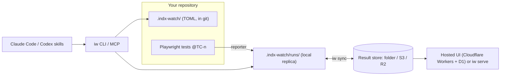

# INDX Watch

**Test management that lives in your repository, for people and coding agents.** Test cases, acceptance criteria and test data are typed files next to your code; manual, Playwright and agent results sync through any folder or S3 bucket; whether a release can ship is computed from them, never declared.

[](https://github.com/INDXDev/indx-watch/actions/workflows/ci.yml)
[](https://www.npmjs.com/package/indx-watch)
[](LICENSE)


## Who it's for

- **Teams that test by hand and with Playwright** and want both in one place, linked to the criteria they prove, instead of in spreadsheets and CI logs.
- **Teams that work with Claude Code or Codex** and want the agent to design tests, prepare data, run tests and explain failures, while people keep the approvals.
- **Leads who must answer "can we ship?"** for a release, a customer or an audit, with evidence for every answer.

## What it looks like

| | | |
|---|---|---|
|  |  |  |
| **One page per test case**: what it tests, where to start, the test data and yes/no checks. | **Manual runs in place**: tick checks, attach screenshots; who, which commit and which environment are recorded. | **Computed readiness**: each gate check with its value and threshold, so "not ready" always says why. |

Live demo (read-only): <https://indx-watch-demo.i-248.workers.dev>, the web app with the [`examples/shop`](examples/shop) sample.

## Quickstart

Requires Node 22.13+ and Claude Code or Codex. In your app's repository:

```bash
npx indx-watch init
```

This adds the `.indx-watch/` bundle, the INDX Watch skills for Claude Code (`/iw-…`) and Codex (`$iw-…`), and the `indx-watch` MCP server. Commit it, open your agent, and talk:

| Job | Claude Code | Codex | You say |
|---|---|---|---|
| Set up | `/iw-setup` | `$iw-setup` | "Set up testing for this repo" |
| Design tests | `/iw-design` | `$iw-design` | "What should we test in checkout?" |
| Prepare data | `/iw-data` | `$iw-data` | "The review photo tests need data" |
| Run tests | `/iw-test` | `$iw-test` | "Test my features", "Walk me through TC-3" |
| Fix failures | `/iw-triage` | `$iw-triage` | "Why did TC-8 fail?" |
| Know where you are | `/iw-status` | `$iw-status` | "Can we ship 1.2.0?" |

English or Japanese (「TC-3 を一緒にやって」「リリースできる？」). The agent writes drafts and records runs; a person approves, reviews and ships. Walkthrough: [quickstart](docs/guides/quickstart.md).

Prefer the terminal or the browser? Every step is also a command, see [without an agent](docs/guides/quickstart.md#without-an-agent); `npx indx-watch serve --open` starts the web app. To look around first: `npx indx-watch init demo --example`, then `cd demo && npx indx-watch serve --open`.

## From zero to "can we ship?"

1. **Install once**: `npx indx-watch init`, commit.
2. **Set up**: `/iw-setup` finds your app's URL, features and Playwright tests; a person approves.
3. **Design tests**: `/iw-design` proposes what is missing in plain words and writes drafts only for what you accept.
4. **Prepare test data**: `/iw-data` or the web app's Test data screen; secrets stay references.
5. **Run**: manual runs on the test case page or guided by `/iw-test`, Playwright tests tagged `@TC-3`, agent runs.
6. **Triage**: `/iw-triage` explains a failure with evidence and proposes a fix or an issue.
7. **Approve, review, waive**: people only.
8. **CI**: the GitHub Action syncs results, writes the job summary and can gate the release.
9. **Share**: results through a bucket, or a hosted app on Cloudflare or your own server.
10. **Decide**: `/iw-status` answers "can we ship 1.2.0?"; `iw report` writes one HTML file for stakeholders.

The full walkthrough, with who does what and what each person approves: [From zero to "can we ship?"](docs/guides/journey.md).

## Key terms

| Term | Meaning |
|---|---|
| **Use case** (`UC-n`) | Who wants to achieve what, with a priority P0–P3 |
| **Acceptance criterion** (`AC-n.m`) | One observable yes/no statement about a use case |
| **Test case** (`TC-n`) | Steps that check one or more criteria: `manual`, `playwright`, `agent` or `hybrid` |
| **Fixture / test data** (`FX-n`) | Rows, a seed, a file or an account a test needs; secrets only as references |
| **Release gate** | The checks a release must pass (every P0 test passes, P1 ≥ 95 %, nothing waiting for review, …) |
| **Computed done** | A use case is done when every criterion is covered by approved test cases whose latest result on this release passes |
| **Draft / approval** | New items, and everything an agent writes, start as drafts and do not count until a person approves them |

Definitions: [concepts](docs/spec/concepts.md).

## Features

| | |
|---|---|
| **Typed bundle** | `.indx-watch/` of canonical TOML with JSON Schemas for editor completion ([format](docs/spec/bundle-format.md)) |
| **Test data** | Datasets, seeds, files and accounts, versioned by content hash; edited as files or on the web app's Test data screen ([fixtures](docs/guides/fixtures.md)) |
| **Computed readiness** | Coverage, use case status and a configurable release gate from one pure function ([concepts](docs/spec/concepts.md#readiness-gate)) |
| **Every result attributable** | Who or what ran it, when, on which commit, environment, test case and fixture versions, with evidence |
| **Web app** | One-page test cases, a manual runner, run review, test data and reports, on a laptop or a phone ([web app](docs/guides/web-app.md)) |
| **Playwright reporter** | Tag a test `@TC-3`; results land next to manual ones ([Playwright](docs/guides/playwright.md)) |
| **GitHub Action** | Sync, job summary, PR comment and an optional readiness gate ([GitHub Actions](docs/guides/github-actions.md)) |
| **Sync anywhere** | Folder, AWS S3, Cloudflare R2, MinIO, GCS; no server needed ([S3 sync](docs/guides/s3-sync.md)) |
| **Agent-native** | Six job skills for Claude Code and Codex, an MCP server and `--json` on every command; agents write drafts, people approve ([testing with agents](docs/guides/testing-with-agents.md)) |
| **Reports** | Markdown, single-file HTML or PDF, with a customer version that leaves out internal details ([reports](docs/spec/reports.md)) |
| **Self-host** | `iw deploy` to Cloudflare Workers + R2 + D1 behind Access, or Node/Docker behind your SSO proxy |
| **No lock-in** | Files are the truth; `iw export --full` writes a lossless archive |


The app and the reports speak English and Japanese, in light and dark:


## How it works



Definitions travel through git and are reviewed in pull requests. Results are append-only records that travel through the result store, so they never bloat the repository. One TypeScript codebase: pure domain logic in the middle, every vendor behind a port, the same server on Node and Workers. Details: [architecture](docs/architecture.md), [decisions](docs/adr/README.md).

## How it compares

| | Spreadsheets / Drive | Test management apps (TestRail, Xray, Kiwi TCMS) | Tests as code only | INDX Watch |
|---|---|---|---|---|
| Source of truth | Sheets | The app's database | Test code | Typed files in git |
| Manual and automated results in one model | ✗ | ✓ | ✗ | ✓ |
| Test data versioned and linked to tests | ✗ | ✗ | partial | ✓ |
| Works offline / self-hosted | ✓ / – | varies | ✓ / ✓ | ✓ / ✓ |
| Coding agents (skills, MCP, JSON output) | ✗ | MCP in several | ✗ | ✓ |

Established test management apps offer more: mature permissions, integrations, large-team workflows. INDX Watch is narrower and file-first. Sources and details: [landscape research](docs/research/landscape.md).

## Status and versioning

INDX Watch is **0.1.x, pre-1.0**: usable, and used to test itself ([`.indx-watch/`](.indx-watch)), but young. The file format is versioned (`schema_version = 1`) and changes within it are additive, so files you write today keep loading. CLI `--json` output changes only additively. What shipped in which version: [changelog](CHANGELOG.md) and [roadmap](docs/roadmap.md).

## Documentation

- Docs: [docs/](docs/README.md), with a reading order by role. The same pages are published as a docs site with Mintlify.
- Start with [From zero to "can we ship?"](docs/guides/journey.md) or the [quickstart](docs/guides/quickstart.md).
- npm package: [`indx-watch`](https://www.npmjs.com/package/indx-watch).

## Contributing

Contributions are welcome: see [CONTRIBUTING.md](CONTRIBUTING.md) (including [building the CLI from source](CONTRIBUTING.md#development-setup)) and [AGENTS.md](AGENTS.md). Commits are signed off under the DCO.

## Security

Report vulnerabilities privately as described in [SECURITY.md](SECURITY.md). The threat model and how secrets are handled: [security](docs/spec/security.md).

## License

[Apache-2.0](LICENSE)
