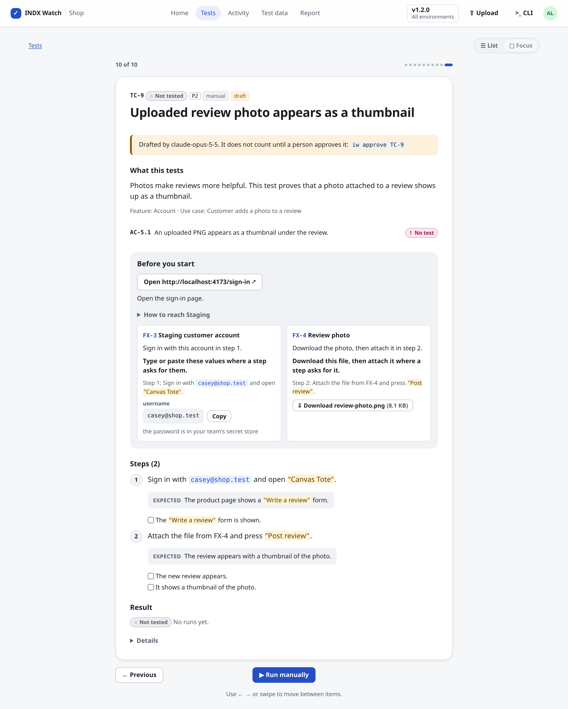
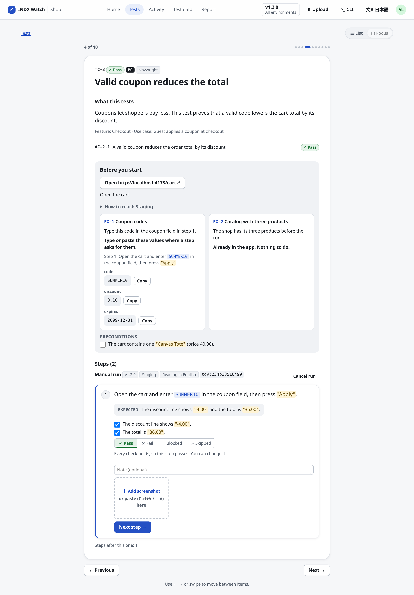
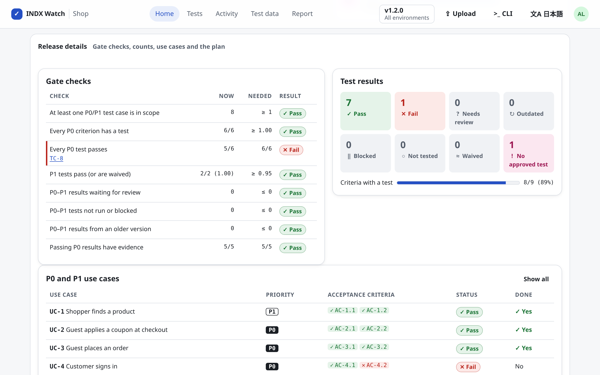
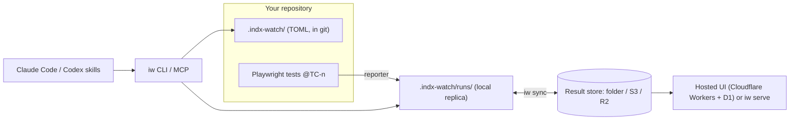

# INDX Watch

**Know it works before you ship.** Open-source test management for teams that build with coding agents. Requirements, test cases and test data are typed files next to your code; manual, Playwright and agent results land in one model; whether a release can ship is computed from them, never guessed.

English · [日本語](README.ja.md) · [简体中文](README.zh-CN.md)

[](https://github.com/INDXDev/indx-watch/actions/workflows/ci.yml)
[](https://www.npmjs.com/package/indx-watch)
[](LICENSE)

[Website](https://indx-watch-site.i-248.workers.dev) · [Live demo](https://indx-watch-demo.i-248.workers.dev) · [Docs](docs/README.md) · [Quickstart](docs/guides/quickstart.md)


## Why INDX Watch

Coding agents write features in minutes. Keeping requirements straight, testing end to end and showing what was verified has not gotten any faster: requirements live in tickets, test cases in spreadsheets, Playwright results in CI logs and manual results somewhere else. So releases ship on a feeling.

INDX Watch gives all of it one typed home in your repository, readable by people and by agents:

- **Requirements and tests as code.** Use cases, acceptance criteria, test cases and test data are TOML files in `.indx-watch/`, reviewed in the same pull request as the feature.
- **One model for every result.** Manual runs in the browser, Playwright tests tagged `@TC-3` and agent runs are attributable records: who or what ran it, when, on which commit and environment, with evidence.
- **Readiness, computed.** A configurable release gate turns approved criteria and the latest results into go or no-go, with the reason and who acts next: in the app, in CI and for your agent.
- **An agent that does the busywork.** Six skills for Claude Code and Codex design tests, prepare data, run tests, explain failures and report status. Agents write drafts; people approve.

## Quickstart

Requires Node 22.13+. In your app's repository:

```bash
npx indx-watch init
```

This adds the `.indx-watch/` bundle, the INDX Watch skills for Claude Code (`/iw-…`) and Codex (`$iw-…`), and the `indx-watch` MCP server. Commit it, open your agent, and talk:

| Job | Claude Code | Codex | You say |
|---|---|---|---|
| Set up | `/iw-setup` | `$iw-setup` | "Set up testing for this repo" |
| Design tests | `/iw-design` | `$iw-design` | "What should we test in checkout?" |
| Prepare data | `/iw-data` | `$iw-data` | "The review photo tests need data" |
| Run tests | `/iw-test` | `$iw-test` | "Test my features", "Walk me through TC-3" |
| Fix failures | `/iw-triage` | `$iw-triage` | "Why did TC-8 fail?" |
| Know where you are | `/iw-status` | `$iw-status` | "Can we ship 1.2.0?" |

English or Japanese works (「TC-3 を一緒にやって」「リリースできる？」). Walkthrough: [quickstart](docs/guides/quickstart.md).

No agent? Every step is also a command ([without an agent](docs/guides/quickstart.md#without-an-agent)), and `npx indx-watch serve --open` starts the web app. To look around first: `npx indx-watch init demo --example`, then `cd demo && npx indx-watch serve --open`.

## For developers

Everything is a file you can diff, review and script. A test case from the sample shop:

```toml
# .indx-watch/specs/FEAT-2-checkout/UC-2-guest-applies-coupon/TC-3-valid-coupon.toml
key = "TC-3"
title = "Valid coupon reduces the total"
covers = ["AC-2.1"]
mode = "playwright"
purpose = "Coupons let shoppers pay less. This test proves that a valid code lowers the cart total by its discount."
start = "/cart"

[[fixtures]]
ref = "FX-1"
rows = ["SUMMER10"]

[[steps]]
instruction = "Open the cart and enter {{FX-1.code}} in the coupon field, then press \"Apply\"."
checks = ["The discount line shows \"-4.00\".", "The total is \"36.00\"."]
evidence = ["screenshot"]
```

Playwright stays your runner. Tag the test with its key and add the reporter:

```ts
test('valid coupon reduces the total', { tag: ['@TC-3'] }, async ({ page }) => { /* … */ });

// playwright.config.ts
reporter: [['list'], ['indx-watch/playwright', { environment: 'staging' }]],
```

Gate a merge or a release in CI with the GitHub Action, which also writes the readiness report into the job summary and keeps one comment per pull request with the test cases the change affects:

```yaml
- uses: INDXDev/indx-watch@v0
  if: ${{ !cancelled() }}
  with:
    release: v1.2.0
    summary: true
    gate: true
```

Every command takes `--json` (a stable, additive-only contract), and `iw status --gate` exits 1 when the release is not ready. `iw check` validates schemas and references and refuses anything that looks like a secret; passwords stay references such as `env:SHOP_CUSTOMER_PASSWORD`.

## Built for every role

One source of truth, a different view for each person on the team.

### Developers

- **Reviewed like code.** Criteria and test cases change in the same pull request as the feature; CODEOWNERS and branch protection just work.
- **No new framework.** Playwright runs your tests; the reporter records each run next to the manual ones.
- **Agents with guardrails.** `/iw-design` reads your code and proposes the tests that are missing; `/iw-triage` explains a failure with evidence. Nothing an agent writes counts until a person approves it.
- **Scriptable.** `--json` everywhere, an MCP server for agents without a shell, and a GitHub Action.

### Testers and QA

- **One page per test.** What it checks, where to start, the test data and a yes/no check for each step, in English or Japanese, on a laptop or a phone.
- **Test data at hand.** The coupon code to type, the account to sign in with and the file to upload sit next to the step that needs them.
- **Evidence in place.** Tick the checks, paste a screenshot; who ran it, on which build and environment is recorded for you.
- **A queue, not a spreadsheet.** See what is yours and what is left, or ask your agent to walk you through a test one check at a time.

### Product managers and owners

- **Requirements you can read.** Use cases and acceptance criteria in plain language, with priorities P0 to P3. You decide what "done" means.
- **Go or no-go, with reasons.** Each gate check shows its value and threshold; "not ready" always names the test case and who acts next.
- **Evidence for every answer.** Every result is attributable, ready for a customer or an audit.
- **Reports people can open.** One HTML or PDF file, with a customer version that leaves out emails, notes and internal links.

| | | |
|---|---|---|
|  |  |  |
| **One page per test case**: what it tests, where to start, the test data and yes/no checks. | **Manual runs in place**: tick checks, attach screenshots; who, which commit and which environment are recorded. | **Computed readiness**: each gate check with its value and threshold, so "not ready" always says why. |

## How it works



Definitions travel through git and are reviewed in pull requests. Results are append-only records that travel through the result store, so they never bloat the repository. One TypeScript codebase: pure domain logic in the middle, every vendor behind a port, the same server on Node and Workers. Details: [architecture](docs/architecture.md), [decisions](docs/adr/README.md).

From install to "can we ship?", step by step and with who approves what: [From zero to "can we ship?"](docs/guides/journey.md).

## Features

| | |
|---|---|
| **Typed bundle** | `.indx-watch/` of canonical TOML with JSON Schemas for editor completion ([format](docs/spec/bundle-format.md)) |
| **Test data** | Datasets, seeds, files and accounts, versioned by content hash and shared with the team; edited as files or on the web app's Test data screen ([fixtures](docs/guides/fixtures.md)) |
| **Computed readiness** | Coverage, use case status and a configurable release gate from one pure function ([concepts](docs/spec/concepts.md#readiness-gate)) |
| **Web app** | One-page test cases, a manual runner, run review, test data and reports, on a laptop or a phone ([web app](docs/guides/web-app.md)) |
| **Playwright reporter** | Tag a test `@TC-3`; results land next to manual ones ([Playwright](docs/guides/playwright.md)) |
| **GitHub Action** | Sync, job summary, PR comment and an optional readiness gate ([GitHub Actions](docs/guides/github-actions.md)) |
| **Sync anywhere** | Folder, AWS S3, Cloudflare R2, MinIO, GCS; no server needed ([S3 sync](docs/guides/s3-sync.md)) |
| **Agent-native** | Six job skills for Claude Code and Codex, an MCP server and `--json` on every command ([testing with agents](docs/guides/testing-with-agents.md)) |
| **Reports** | Markdown, single-file HTML or PDF, with a customer version ([reports](docs/spec/reports.md)) |
| **Self-host** | `iw deploy` to Cloudflare Workers + R2 + D1 behind Access, or Node/Docker behind your SSO proxy ([Cloudflare](docs/guides/self-host-cloudflare.md), [Node](docs/guides/self-host-node.md)) |
| **No lock-in** | Files are the truth; `iw export --full` writes a lossless archive |

The app and the reports speak English and Japanese, in light and dark.

## Key terms

| Term | Meaning |
|---|---|
| **Use case** (`UC-n`) | Who wants to achieve what, with a priority P0–P3 |
| **Acceptance criterion** (`AC-n.m`) | One observable yes/no statement about a use case |
| **Test case** (`TC-n`) | Steps that check one or more criteria: `manual`, `playwright`, `agent` or `hybrid` |
| **Fixture / test data** (`FX-n`) | Rows, a seed, a file or an account a test needs; secrets only as references |
| **Release gate** | The checks a release must pass (every P0 test passes, P1 ≥ 95 %, nothing waiting for review, …) |
| **Computed done** | A use case is done when every criterion is covered by approved test cases whose latest result on this release passes |
| **Draft / approval** | New items, and everything an agent writes, start as drafts and do not count until a person approves them |

Definitions: [concepts](docs/spec/concepts.md).

## How it compares

| | Spreadsheets / Drive | Test management apps (TestRail, Xray, Kiwi TCMS) | Tests as code only | INDX Watch |
|---|---|---|---|---|
| Source of truth | Sheets | The app's database | Test code | Typed files in git |
| Manual and automated results in one model | ✗ | ✓ | ✗ | ✓ |
| Test data versioned and linked to tests | ✗ | ✗ | partial | ✓ |
| Works offline / self-hosted | ✓ / – | varies | ✓ / ✓ | ✓ / ✓ |
| Coding agents (skills, MCP, JSON output) | ✗ | MCP in several | ✗ | ✓ |

Established test management apps offer more: mature permissions, integrations, large-team workflows. INDX Watch is narrower and file-first. Sources and details: [landscape research](docs/research/landscape.md).

## Status and versioning

INDX Watch is **0.1.x, pre-1.0**: usable, and used to test itself ([`.indx-watch/`](.indx-watch)), but young. The file format is versioned (`schema_version = 1`) and changes within it are additive, so files you write today keep loading. CLI `--json` output changes only additively. What shipped in which version: [changelog](CHANGELOG.md) and [roadmap](docs/roadmap.md).

## Documentation

- Docs: [docs/](docs/README.md), with a reading order by role. The same pages are published as a docs site with Mintlify.
- Start with [From zero to "can we ship?"](docs/guides/journey.md) or the [quickstart](docs/guides/quickstart.md).
- The landing page lives in [`site/`](site/README.md); its design rules are in [site/DESIGN.md](site/DESIGN.md).
- npm package: [`indx-watch`](https://www.npmjs.com/package/indx-watch).

## Contributing

Contributions are welcome: see [CONTRIBUTING.md](CONTRIBUTING.md) (including [building the CLI from source](CONTRIBUTING.md#development-setup)) and [AGENTS.md](AGENTS.md). Commits are signed off under the DCO.

## Security

Report vulnerabilities privately as described in [SECURITY.md](SECURITY.md). The threat model and how secrets are handled: [security](docs/spec/security.md).

## License

[Apache-2.0](LICENSE)
