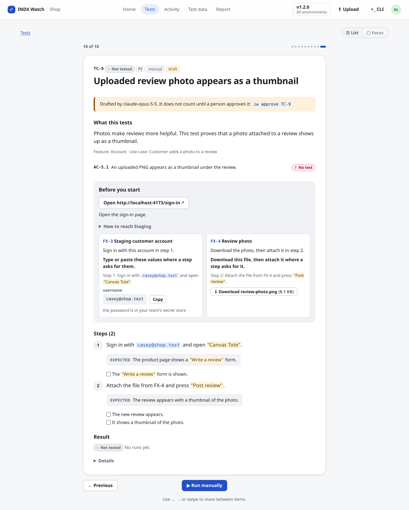
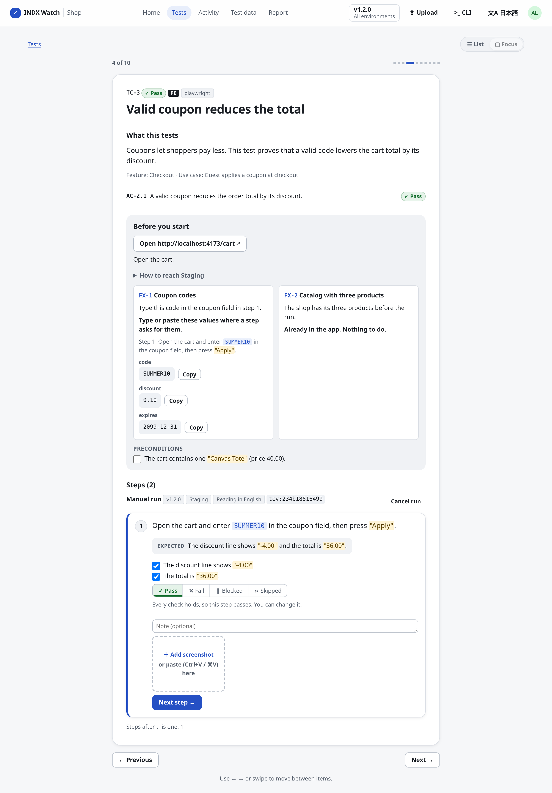
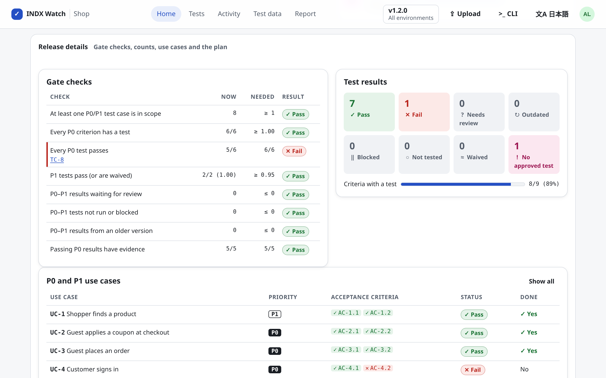

# INDX Watch

**确认可用，再发布。** 面向与编码智能体（coding agent）一起开发的团队的开源测试管理工具。需求、测试用例和测试数据以带类型的文件形式放在代码旁边；手动测试、Playwright 和智能体的运行结果汇入同一个模型；版本能否发布由结果计算得出，而不是凭感觉判断。

[English](README.md) · [日本語](README.ja.md) · 简体中文

[](https://github.com/INDXDev/indx-watch/actions/workflows/ci.yml)
[](https://www.npmjs.com/package/indx-watch)
[](LICENSE)

[官网](https://indx-watch-site.i-248.workers.dev) · [在线演示](https://indx-watch-demo.i-248.workers.dev) · [文档（英文）](docs/README.md) · [快速上手（英文）](docs/guides/quickstart.md)


## 为什么选择 INDX Watch

如今编码智能体几分钟就能写完一个功能。但整理需求、做端到端测试、每次都清楚地说明验证了什么，这些工作并没有变快：需求在工单里，测试用例在表格里，Playwright 结果在 CI 日志里，手动测试结果又在别的地方。于是发布往往只能“感觉差不多了”。

INDX Watch 在你的仓库中，为这一切提供一个人和智能体都能读懂的统一归处：

- **需求和测试即代码。** 用例（use case）、验收标准、测试用例和测试数据都是 `.indx-watch/` 中的 TOML 文件，与功能在同一个拉取请求中评审。
- **所有结果，一个模型。** 浏览器中的手动执行、带 `@TC-3` 标签的 Playwright 测试、智能体的执行，都会记录由谁执行、何时、基于哪个提交和环境，并附带证据。
- **发布就绪度由计算得出。** 可配置的发布门禁根据已批准的验收标准和最新结果给出 Go / No-Go，并说明原因和下一步由谁处理。应用、CI 和智能体看到的是同一个答案。
- **繁琐的工作交给智能体。** 面向 Claude Code 和 Codex 的 6 个技能负责测试设计、数据准备、执行测试、排查失败和汇报进度。智能体只写草稿，批准由人来做。

## 快速上手

需要 Node 22.13 及以上。在你的应用仓库中运行：

```bash
npx indx-watch init
```

它会添加 `.indx-watch/` 目录、Claude Code（`/iw-…`）和 Codex（`$iw-…`）的技能，以及 `indx-watch` MCP 服务器。提交后打开你的智能体，直接对话即可：

| 工作 | Claude Code | Codex | 你可以说 |
|---|---|---|---|
| 初始化 | `/iw-setup` | `$iw-setup` | “Set up testing for this repo” |
| 设计测试 | `/iw-design` | `$iw-design` | “What should we test in checkout?” |
| 准备数据 | `/iw-data` | `$iw-data` | “The review photo tests need data” |
| 执行测试 | `/iw-test` | `$iw-test` | “Test my features”, “Walk me through TC-3” |
| 排查失败 | `/iw-triage` | `$iw-triage` | “Why did TC-8 fail?” |
| 了解进度 | `/iw-status` | `$iw-status` | “Can we ship 1.2.0?” |

技能目前理解英语和日语。没有智能体也可以：每一步都有对应的命令（[without an agent](docs/guides/quickstart.md#without-an-agent)），`npx indx-watch serve --open` 会启动 Web 应用。想先看看效果：运行 `npx indx-watch init demo --example`，然后 `cd demo && npx indx-watch serve --open`。

## 面向开发者

一切都是可以 diff、评审和脚本化处理的文件。示例商店中的一个测试用例：

```toml
# .indx-watch/specs/FEAT-2-checkout/UC-2-guest-applies-coupon/TC-3-valid-coupon.toml
key = "TC-3"
title = "Valid coupon reduces the total"
covers = ["AC-2.1"]
mode = "playwright"
purpose = "Coupons let shoppers pay less. This test proves that a valid code lowers the cart total by its discount."
start = "/cart"

[[fixtures]]
ref = "FX-1"
rows = ["SUMMER10"]

[[steps]]
instruction = "Open the cart and enter {{FX-1.code}} in the coupon field, then press \"Apply\"."
checks = ["The discount line shows \"-4.00\".", "The total is \"36.00\"."]
evidence = ["screenshot"]
```

测试运行器仍然是 Playwright。给测试加上用例编号标签，并添加报告器：

```ts
test('valid coupon reduces the total', { tag: ['@TC-3'] }, async ({ page }) => { /* … */ });

// playwright.config.ts
reporter: [['list'], ['indx-watch/playwright', { environment: 'staging' }]],
```

在 CI 中，GitHub Action 会把就绪度报告写入作业摘要，在每个拉取请求中维护一条评论，列出本次变更影响的测试用例，并可在未就绪时阻止合并或发布：

```yaml
- uses: INDXDev/indx-watch@v0
  if: ${{ !cancelled() }}
  with:
    release: v1.2.0
    summary: true
    gate: true
```

每个命令都支持 `--json`（只做增量变更的稳定约定），版本未就绪时 `iw status --gate` 以退出码 1 结束。`iw check` 会校验 schema 和引用，并拒绝任何看起来像密钥的内容；密码只以 `env:SHOP_CUSTOMER_PASSWORD` 这样的引用形式出现。

## 不同角色的收益

同一个事实来源，为团队中的每个人提供合适的视图。

### 开发者

- **像代码一样评审。** 验收标准和测试用例与功能在同一个拉取请求中修改，CODEOWNERS 和分支保护照常生效。
- **无需新框架。** 测试仍由 Playwright 执行，报告器把每次运行记录在手动结果旁边。
- **带护栏的智能体。** `/iw-design` 阅读代码并提出缺失的测试，`/iw-triage` 结合证据解释失败原因。智能体写的内容在人批准之前不会被计入。
- **可脚本化。** 全面支持 `--json`，为没有 shell 的智能体提供 MCP 服务器，还有 GitHub Action。

### 测试人员与 QA

- **一个测试一页。** 测什么、从哪里开始、测试数据，以及每一步的“是/否”检查项。界面支持英语和日语，电脑和手机都能用。
- **测试数据触手可及。** 要输入的优惠码、要登录的账号、要上传的文件，就放在需要它的步骤旁边。
- **证据就地留存。** 勾选检查项、粘贴截图即可；由谁执行、基于哪个构建和环境都会自动记录。
- **待办队列，而不是表格。** 一眼看清哪些是你的、还剩多少；也可以让智能体一步步带你完成测试。

### 产品经理与产品负责人

- **看得懂的需求。** 用例和验收标准用平实的语言书写，优先级从 P0 到 P3。“完成”的定义由你决定。
- **有理由的 Go / No-Go。** 每项门禁检查都显示当前值和阈值；“尚未就绪”一定会指出具体的测试用例和下一步负责人。
- **每个答案都有证据。** 每条结果都可追溯，可直接用于向客户说明或审计。
- **人人都能打开的报告。** 一个 HTML 或 PDF 文件，并可生成去除邮箱、备注和内部链接的客户版本。

| | | |
|---|---|---|
|  |  |  |
| **一页式测试用例**：目的、起点、测试数据和是/否检查项。 | **就地手动执行**：勾选检查项、附上截图；执行人、提交和环境都会被记录。 | **计算得出的就绪度**：每项检查都有数值和阈值，“未就绪”总会说明原因。 |

## 工作原理

定义通过 git 流转，并在拉取请求中评审。结果是只追加的记录，通过结果存储（文件夹或任意 S3 兼容存储桶）同步，因此不会让仓库膨胀。单一 TypeScript 代码库：中间是纯粹的领域逻辑，所有外部服务都在端口（port）之后，同一个服务器可运行在 Node 和 Cloudflare Workers 上。详见 [architecture](docs/architecture.md) 和 [ADR](docs/adr/README.md)（英文）。

## 主要功能

| | |
|---|---|
| **类型化目录** | `.indx-watch/` 中的规范化 TOML，配有 JSON Schema，编辑器可自动补全 |
| **测试数据** | 数据集、种子数据、文件和账号按内容哈希做版本管理并在团队中共享；可直接编辑文件，也可在 Web 应用的测试数据页面编辑 |
| **计算得出的就绪度** | 覆盖率、用例状态和可配置的发布门禁，全部来自同一个纯函数 |
| **Web 应用** | 一页式测试用例、手动执行、结果复核、测试数据和报告，电脑和手机均可使用 |
| **Playwright 报告器** | 给测试加上 `@TC-3` 标签，结果就会出现在手动结果旁边 |
| **GitHub Action** | 同步、作业摘要、PR 评论，以及可选的就绪度门禁 |
| **随处同步** | 文件夹、AWS S3、Cloudflare R2、MinIO、GCS，无需服务器 |
| **智能体原生** | 面向 Claude Code 和 Codex 的 6 个技能、MCP 服务器、所有命令支持 `--json` |
| **报告** | Markdown、单文件 HTML 或 PDF，可生成客户版本 |
| **自托管** | 用 `iw deploy` 部署到 Cloudflare Workers + R2 + D1（置于 Access 之后），或部署到你的 SSO 代理之后的 Node/Docker |
| **无锁定** | 文件即事实；`iw export --full` 可导出无损归档 |

## 术语

| 术语 | 含义 |
|---|---|
| **用例**（`UC-n`） | 谁想达成什么，优先级 P0–P3 |
| **验收标准**（`AC-n.m`） | 关于用例的一条可观察的是/否陈述 |
| **测试用例**（`TC-n`） | 检查一个或多个验收标准的步骤：`manual`、`playwright`、`agent` 或 `hybrid` |
| **夹具 / 测试数据**（`FX-n`） | 测试所需的数据行、种子、文件或账号；密钥只以引用形式出现 |
| **发布门禁** | 发布必须通过的检查（所有 P0 测试通过、P1 ≥ 95%、没有待复核结果等） |
| **计算得出的完成** | 当每条验收标准都被已批准的测试用例覆盖，且其在本版本中的最新结果为通过时，用例即为完成 |
| **草稿与批准** | 新条目以及智能体写的所有内容都从草稿开始，在人批准之前不计入 |

## 状态与版本

INDX Watch 目前为 **0.1.x（1.0 之前）**：可以使用，并且也用于测试它自身（[`.indx-watch/`](.indx-watch)），但仍处于早期阶段。文件格式带有版本号（`schema_version = 1`），该版本内只做增量变更，今天写的文件以后也能加载。CLI 的 `--json` 输出同样只做增量变更。各版本内容见 [CHANGELOG](CHANGELOG.md) 和 [roadmap](docs/roadmap.md)。

## 贡献、安全与许可

- 欢迎贡献：请参阅 [CONTRIBUTING.md](CONTRIBUTING.md) 和 [AGENTS.md](AGENTS.md)。提交需要 DCO 签名（`git commit -s`）。
- 请按照 [SECURITY.md](SECURITY.md) 的说明私下报告安全漏洞。
- 许可：[Apache-2.0](LICENSE)
