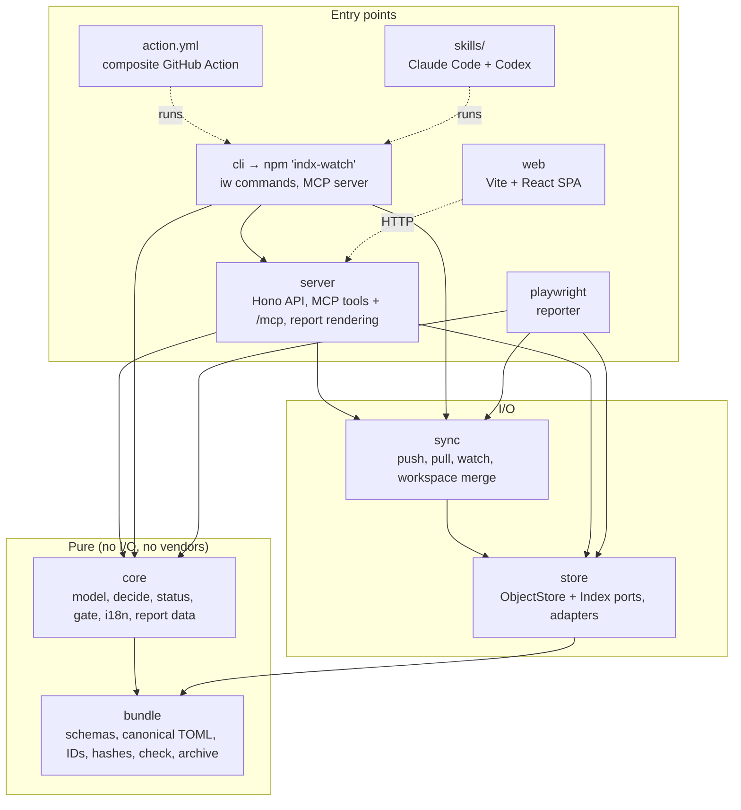
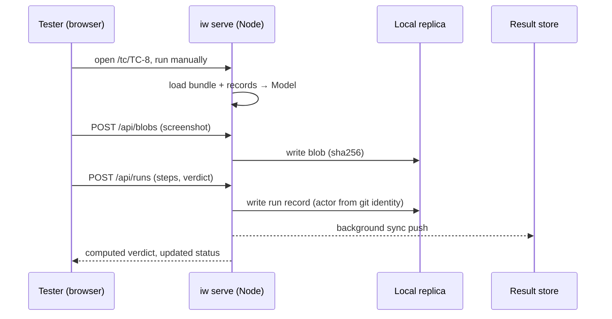

# Architecture

One TypeScript codebase, eight small packages, one published npm package. Pure domain logic in the middle; every vendor behind a port. This page is the home of the component map, ports, data flow, runtime targets, line budget and dependency list. Decisions behind it are in [ADRs](adr/README.md).

## Components

| Package | Path | Responsibility |
|---|---|---|
| `bundle` | `packages/bundle` | Zod schemas for every file and record (→ JSON Schema), canonical TOML parse/format, IDs and keys, content hashes and versions, loading a bundle through a `BundleFs` port, `check`, archive read/write. `src/node/` holds the Node `BundleFs`. |
| `core` | `packages/core` | Builds the in-memory **model** from a bundle and records; `decide`, latest results, AC/UC status, coverage, `evaluateGate`, plan item status, staleness, flakiness (flake rate), impact analysis, `localize`, report data. Pure. |
| `store` | `packages/store` | Ports `ObjectStore`, `Index`, `IdentityProvider`, `ContextProvider`, `BrowserProvider`, `LlmClient`; adapters (`fs`, `s3`, `r2`, `http`, `memory`; `memory`, `d1` and `sqlite` (`node:sqlite`) index; `git`, `github`, `cloudflare-access` identity; Playwright and Browser Run browsers; Anthropic); `ResultStore` (record/blob protocol on top of `ObjectStore`); the local replica; `runAgent`, the agent execution loop over `BrowserProvider` and `LlmClient`. |
| `sync` | `packages/sync` | Push/pull algorithm, lookback cursor, watch mode, bundle snapshots (workspace-mode merge: v0.2). |
| `server` | `packages/server` | `createApp(deps)` Hono app: JSON API, `/api/store/*` protocol endpoint, `/mcp` (Streamable HTTP MCP), report rendering (md/html), static SPA. `tools.ts` holds the one MCP tool set that `iw mcp` also serves. `node.ts` and `worker.ts` entry points. |
| `web` | `packages/web` | SPA: readiness dashboard, spec tree, test case, manual runner, run viewer + review, fixtures, report preview. Builds to static files embedded in the npm package. |
| `cli` | `packages/cli` | `iw` commands ([cli.md](spec/cli.md)), JSON envelopes, MCP server (`iw mcp`), `iw deploy` (wrangler wrapper). Published as `indx-watch` with everything bundled. |
| `playwright` | `packages/playwright` | Reporter ([integrations.md](spec/integrations.md#playwright-reporter)); exported as `indx-watch/playwright`. |

Outside `packages/`: [`action.yml`](../action.yml) (composite action), [`skills/`](../skills) (agent skills), [`schemas/`](../schemas) (generated), [`examples/shop`](../examples/shop) (the one sample), [`.indx-watch/`](../.indx-watch) (this repo's own QA).

## Ports and adapters
Interfaces live in [`packages/store/src/ports.ts`](../packages/store/src/ports.ts) (the reference; the table abridges it). Only adapter folders may import vendor SDKs. Biome `noRestrictedImports` enforces this for `core` and `bundle` (no `node:fs`, `aws4fetch` or `hono` outside `bundle/src/node/`); in the other packages review enforces it. `iw login` runs `cloudflared` from `packages/cli/src/commands/` as the one exception.

| Port | Methods (abridged) | Adapters in v0.1 |
|---|---|---|
| `ObjectStore` | `get(key)`, `head(key)`, `put(key, body, { ifNoneMatch })`, `list({ prefix, startAfter, limit })`, `delete(key)` (tests only) | `fs`, `s3` (aws4fetch: S3, R2, MinIO, GCS), `r2` (binding), `http` (hosted server), `memory` |
| `Index` | `ingest(records, logKey?)` (applies the [merge rule](spec/sync.md#merge-rules) for two bodies with one ID), `setDefinitions(snapshot)`, `records(filter)`, `definitions()`, `meta` get/set, `reset()` | `memory`, `sqlite` (`node:sqlite`, Node), `d1` (Workers) — `sqlite` and `d1` share one plain SQL schema and the same guarded writes |
| `BundleFs` | `read`, `write`, `list`, `remove`, `stat` | Node fs, in-memory (tests, Workers snapshot), tar snapshot |
| `IdentityProvider` | `current(request?) → Actor` | process (`env` → `github` → `git`), `cloudflare-access`, trusted header |
| `ContextProvider` | `build()`, `ci()` | `git`, `github` |
| `BrowserProvider` | `open(baseUrl) → session`: `observe()` (URL, title, accessibility tree with refs, screenshot), `act(action)`, `close()` | `playwright` (local Chromium) and `browser-run` (Cloudflare Browser Run over CDP), both Node (`@indx-watch/store/node`), Playwright imported at run time ([agents.md](spec/agents.md#agent-execution-mode-v02)); fake |
| `LlmClient` | `judge(rubric, observation) → { verdict, confidence, reason }`; optional `next(step, observation, history) → action` (agent mode) | `anthropic` (Node, `@indx-watch/store/llm`; gateway via `ANTHROPIC_BASE_URL`); fake |

`ResultStore` (in `store`) implements the [sync protocol](spec/sync.md) once on top of any `ObjectStore`.

## Core model

`buildModel(bundle, records)` returns a `Model` with resolved references; the types are in [`packages/core/src/types.ts`](../packages/core/src/types.ts). Everything the CLI, server, reporter, MCP server and reports show is a function of `Model` and a `Scope`. There is no second implementation of any rule.

## HTTP API
The server's routes, request and response types are defined in [`packages/server/src/contract.ts`](../packages/server/src/contract.ts) (`ROUTES` and the exported interfaces). The web UI and the `http` store adapter use only these. `/api/store/*` exposes the [store protocol](spec/sync.md#store-layout) so a hosted server can act as a result store for `iw sync`. `/mcp` serves the MCP tools over Streamable HTTP ([agents.md](spec/agents.md#mcp-server)); the tool definitions live in `packages/server/src/tools.ts` so `iw mcp` (in `cli`, which may import `server`) uses the same set, and the CLI passes the output schemas from `json.ts` (`ToolOutputs`) to `createToolServer`, `startNodeServer` and `createWorker`; without them the server has no `/mcp`.

## Data flow

On Cloudflare the same app runs in a Worker: the "local replica" is the R2 bucket itself, the index is D1, and the actor comes from Cloudflare Access.

## Runtime targets

| Target | Command | Store | Index | Identity | Static UI |
|---|---|---|---|---|---|
| Local | `npx indx-watch serve` | local replica (+ any remote via sync) | `node:sqlite` (`cache/index.sqlite`) | git | served by `@hono/node-server` from the package |
| Docker / VM | `iw serve --host 0.0.0.0 --identity-header …` | `s3://` or `file://` | `node:sqlite` (`cache/index.sqlite`) | trusted proxy header (SSO proxy or Cloudflare Access) | same |
| Cloudflare | `iw deploy` | R2 binding | D1 | Cloudflare Access JWT | Workers static assets |

Node ≥ 22.13 is required (Node 20 is end-of-life; see [platform notes](research/platform-notes.md#libraries-and-versions)).

## Line budget
Counted as non-blank, non-comment lines of TypeScript/JavaScript/SQL in `src/` (tests, CSS and JSON excluded) by `scripts/loc.mjs`, checked in CI. Raising a budget needs a note in the PR description. The bundle budget includes about 700 lines of schema declarations. After the v0.1 security and correctness review, per-package budgets were rebalanced (CLI, server, store and reporter up; core, sync and web down) while the total stayed below the original 11,600. v0.2 raised `store` by 80 lines for the Anthropic `LlmClient` adapter (T-202), and `web` (+1,000), `cli` (+250) and `server` (+250) for the web app v2, uploads, `iw push` / `iw clone` / `iw translate` and the declared tester (T-213–T-216). Signed records (T-211) raised `bundle` by 40 (Ed25519 signing and verification over WebCrypto, no new dependency) and `cli` by 30 (`iw keygen`). The review of signed records raised `store` by 60 (guarded D1 ingest, signed bodies win merges), `server` by 70 (deploy-pinned trust root, the hosted catch-up's daily full listing, the log key clock window) and `cli` by 10 (`iw deploy` pins `SIGNING_KEYS`); the total rose by 140. A readability refactor (splitting `check`, `fix`, `createApp`, `startNodeServer` and `syncOnce` into named steps) raised `bundle` by 40 and `server` by 30; the total rose by 70. The `node:sqlite` index (T-210) raised `store` by 55 (a D1-shaped wrapper of `DatabaseSync`, so the D1 index code runs unchanged on Node, plus emptying an index file written with an older schema; no new dependency). Importing Playwright Test Agents plans (T-212) raised `cli` by 110 (the Markdown plan parser and `iw import playwright-plan`). Flaky tests (T-303) raised `web` by 30 (the Flaky quarantine view on Tests) and `server` by 5 (the flake rate in the spec tree); the total rose by 35. GitLab CI, CircleCI and Buildkite context (T-208) raised `store` by 35 (the provider variable table, job retries and the checkout commit fallback) and `bundle` by 5 (the new `via` values); the total rose by 40. Impact analysis (T-304) raised `core` by 40 (`impactedTestCases()` and a small glob matcher, no new dependency) and `cli` by 45 (`iw impact` and its JSON shape); the total rose by 85. Reading `iw serve` records through the `node:sqlite` index (T-217) raised `store` by 70 (listing the replica with file times, ingesting only new files, rebuilding after a rewrite or removal, and replacing an index file that is not a SQLite database) and `server` by 10 (opening the index, with a fallback to reading the replica); the total rose by 80. The Streamable HTTP MCP endpoint (T-205) moved the MCP tool set and the `list` / `show` data from `cli` to `server` (`cli` down 180) and added `/mcp` with server-side tool handlers (`server` up 380, plus 5 where it meets the node:sqlite option from T-217); the total rose by 205. Log compaction snapshots (T-206) raised `sync` by 70 (`compactLog()`, full listings that start from the newest log snapshot, merging the records of a log object concurrently per ID), `store` by 45 (writing and validating log snapshots, and creating each replica folder once instead of on every write), `cli` by 30 (`iw compact` and its JSON shape) and `bundle` by 5 (the `LogSnapshot` schema); the total rose by 150. The agent execution mode (T-201) raised `store` by 230 (the `runAgent` loop, the Playwright and Browser Run `BrowserProvider` adapters, `LlmClient.next` in the Anthropic adapter and its fake) and `cli` by 90 (`iw run`: placeholders, ports, the run record with evidence per step); the total rose by 320.

| Package | Budget |
|---|---|
| bundle | 2,090 |
| core | 1,040 |
| store | 1,875 |
| sync | 520 |
| server | 2,110 |
| web | 3,850 |
| cli (incl. MCP, deploy) | 2,585 |
| playwright | 450 |
| **Total** | **14,520** |
## Dependencies
Runtime dependencies of the published package. Each needs a reason; adding one needs a line here.

| Dependency | Why |
|---|---|
| `zod` | One schema source for validation, TypeScript types and JSON Schema |
| `smol-toml` | Small, spec-compliant TOML parser (we serialize ourselves, [ADR 0004](adr/0004-canonical-toml.md)) |
| `ulid` | ULIDs (monotonic factory) on Node and Workers |
| `hono`, `@hono/node-server` | One HTTP app for Node and Workers |
| `jose` | Verify Cloudflare Access JWTs |
| `aws4fetch` | SigV4 signing over `fetch`: S3/R2/MinIO on Node and Workers without the AWS SDK |
| `@modelcontextprotocol/server` | Official MCP server (SDK v2, runtime-neutral; stdio for `iw mcp`, `createMcpHandler` for `/mcp` on Node and Workers) |
| `citty` | Tiny CLI argument parsing with subcommands |
| `modern-tar` | Deterministic tar read/write (long paths, no dependencies, Workers-compatible) for archives and bundle snapshots |
| `@anthropic-ai/sdk` | Official Claude API client for the `LlmClient` adapter (`iw judge`); loaded only when a judge runs |

Build-time only: TypeScript, tsup (esbuild), Vite, React, Biome, Vitest, Playwright (peer of the reporter, optional; `iw run` imports the project's copy at run time and the package stays without it).

## Acceptance criteria

- [x] `scripts/loc.mjs` reports every package within budget (CI).
- [x] Biome fails if `packages/core` or `packages/bundle` (outside `src/node/`) imports `node:fs`, `aws4fetch` or `hono` (`pnpm check:pure`, CI).
- [x] The packed `indx-watch` tarball contains the CLI, the reporter entry, the web build and `schemas/`, and, installed into an empty project (`npm install --save-dev ./indx-watch-*.tgz`), the README quickstart runs with `npx indx-watch` (CI).
- [x] The Worker bundle builds with `wrangler deploy --dry-run` from the same `createApp`, using the config `iw deploy` generates (`pnpm check:worker`, CI).
