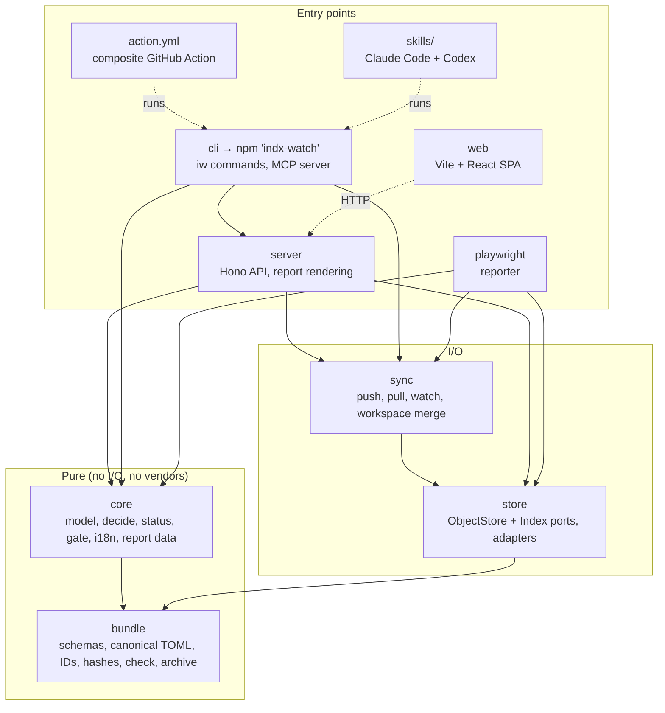
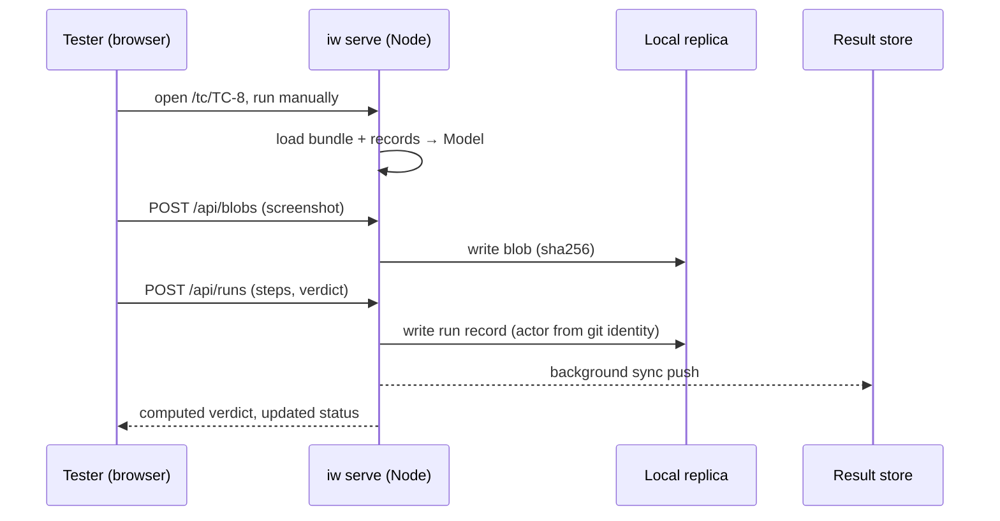

# Architecture

One TypeScript codebase, eight small packages, one published npm package. Pure domain logic in the middle; every vendor behind a port. This page is the home of the component map, ports, data flow, runtime targets, line budget and dependency list. Decisions behind it are in [ADRs](adr/README.md).

## Components



| Package | Path | Responsibility |
|---|---|---|
| `bundle` | `packages/bundle` | Zod schemas for every file and record (→ JSON Schema), canonical TOML parse/format, IDs and keys, content hashes and versions, loading a bundle through a `BundleFs` port, `check`, archive read/write. `src/node/` holds the Node `BundleFs`. |
| `core` | `packages/core` | Builds the in-memory **model** from a bundle and records; `decide`, latest results, AC/UC status, coverage, `evaluateGate`, plan item status, staleness, flakiness, `localize`, report data. Pure. |
| `store` | `packages/store` | Ports `ObjectStore`, `Index`, `IdentityProvider`, `ContextProvider`, `BrowserProvider`, `LlmClient`; adapters (`fs`, `s3`, `r2`, `http`, `memory`; `sqlite`, `d1`, `memory` index; `git`, `github`, `cloudflare-access` identity); `ResultStore` (record/blob protocol on top of `ObjectStore`); the local replica. |
| `sync` | `packages/sync` | Push/pull algorithm, lookback cursor, watch mode, bundle snapshots, workspace-mode file merge. |
| `server` | `packages/server` | `createApp(deps)` Hono app: JSON API, `/api/store/*` protocol endpoint, report rendering (md/html), static SPA. `node.ts` and `worker.ts` entry points. |
| `web` | `packages/web` | SPA: readiness dashboard, spec tree, test case, manual runner, run viewer + review, fixtures, report preview. Builds to static files embedded in the npm package. |
| `cli` | `packages/cli` | `iw` commands ([cli.md](spec/cli.md)), JSON envelopes, MCP server (`iw mcp`), `iw deploy` (wrangler wrapper). Published as `indx-watch` with everything bundled. |
| `playwright` | `packages/playwright` | Reporter ([integrations.md](spec/integrations.md#playwright-reporter)); exported as `indx-watch/playwright`. |

Outside `packages/`: [`action.yml`](../action.yml) (composite action), [`skills/`](../skills) (agent skills), [`schemas/`](../schemas) (generated), [`examples/shop`](../examples/shop) (the one sample), [`.indx-watch/`](../.indx-watch) (this repo's own QA).

## Ports and adapters {#ports-and-adapters}

Interfaces live in `packages/store/src/ports.ts`. Only adapter folders may import vendor SDKs (enforced by Biome `noRestrictedImports`).

| Port | Methods (abridged) | Adapters in v0.1 |
|---|---|---|
| `ObjectStore` | `get(key)`, `head(key)`, `put(key, body, { ifNoneMatch })`, `list({ prefix, startAfter, limit })`, `delete(key)` (tests only) | `fs`, `s3` (aws4fetch: S3, R2, MinIO, GCS), `r2` (binding), `http` (hosted server), `memory` |
| `Index` | `ingest(records)`, `setDefinitions(snapshot)`, `records(filter)`, `definitions()`, `meta` get/set, `reset()` | `memory`, `sqlite` (`node:sqlite` via Drizzle), `d1` (Drizzle) |
| `BundleFs` | `read`, `write`, `list`, `remove`, `stat` | Node fs, in-memory (tests, Workers snapshot), tar snapshot |
| `IdentityProvider` | `current(request?) → Actor` | `env`, `git`, `github`, `cloudflare-access` |
| `ContextProvider` | `build()`, `ci()` | `git`, `github` |
| `BrowserProvider` | `open`, `act`, `observe`, `close` | interface + fake (v0.2: Playwright, Cloudflare Browser Run) |
| `LlmClient` | `judge(rubric, observation) → { verdict, confidence, reason }`, `complete` | interface + fake (v0.2: Anthropic, optional gateway) |

`ResultStore` (in `store`) implements the [sync protocol](spec/sync.md) once on top of any `ObjectStore`.

## Core model {#core-model}

`buildModel(bundle, records)` returns plain objects with resolved references:

```ts
interface Model {
  project: Project;
  features: FeatureNode[];          // → useCases → criteria (with covering testCases)
  testCases: Map<string, TestCaseNode>;   // by ID; includes version, priority, fixture refs
  fixtures: Map<string, FixtureNode>;     // includes version, files
  runs: Map<string, RunView>;             // records + later judgements; verdict + deciding rule
  waivers: WaiverRecord[];
  deployments: DeploymentRecord[];
  keys: KeyIndex;                          // key ↔ ID lookups
}
```

Everything the CLI, server, reporter, MCP server and reports show is a function of `Model` and a `Scope`. There is no second implementation of any rule.

## Data flow



On Cloudflare the same app runs in a Worker: the "local replica" is the R2 bucket itself, the index is D1, and the actor comes from Cloudflare Access.

## Runtime targets

| Target | Command | Store | Index | Identity | Static UI |
|---|---|---|---|---|---|
| Local | `npx indx-watch serve` | local replica (+ any remote via sync) | memory or `node:sqlite` | git | served by `@hono/node-server` from the package |
| Docker / VM | `node …/iw serve --host 0.0.0.0` | `s3://` or `file://` | `node:sqlite` file | env, or Cloudflare Access in front | same |
| Cloudflare | `iw deploy` | R2 binding | D1 | Cloudflare Access JWT | Workers static assets |

Node ≥ 20.19 is supported; Node 22+ is recommended (built-in `node:sqlite`, `zstd`).

## Line budget {#line-budget}

Counted as non-blank, non-comment lines of `src/` (tests excluded) by `scripts/loc.mjs`, checked in CI. Raising a budget needs a note in the PR description.

| Package | Budget |
|---|---|
| bundle | 1,800 |
| core | 1,200 |
| store | 1,200 |
| sync | 600 |
| server | 1,200 |
| web | 3,000 |
| cli (incl. MCP, deploy) | 2,000 |
| playwright | 400 |
| **Total** | **11,400** |

## Dependencies {#dependencies}

Runtime dependencies of the published package. Each needs a reason; adding one needs a line here.

| Dependency | Why |
|---|---|
| `zod` | One schema source for validation, TypeScript types and JSON Schema |
| `smol-toml` | Small, spec-compliant TOML parser (we serialize ourselves, [ADR 0004](adr/0004-canonical-toml.md)) |
| `ulidx` | ULIDs that work on Node and Workers |
| `hono`, `@hono/node-server` | One HTTP app for Node and Workers |
| `jose` | Verify Cloudflare Access JWTs |
| `aws4fetch` | SigV4 signing over `fetch`: S3/R2/MinIO on Node and Workers without the AWS SDK |
| `drizzle-orm` | One SQLite schema for `node:sqlite` and D1 |
| `@modelcontextprotocol/server` | Official MCP server (SDK v2, runtime-neutral; stdio for `iw mcp`) |
| `citty` | Tiny CLI argument parsing with subcommands |
| `nanotar` | Tar read/write for archives and bundle snapshots |

Build-time only: TypeScript, tsup (esbuild), Vite, React, Biome, Vitest, Playwright (peer of the reporter, optional).

## Acceptance criteria

- [ ] `scripts/loc.mjs` reports every package within budget (CI).
- [ ] Biome fails if `packages/core` or `packages/bundle` (outside `src/node/`) imports `node:fs`, `aws4fetch` or `hono`.
- [ ] The packed `indx-watch` tarball contains the CLI, the reporter entry, the web build and `schemas/`, and `npx ./indx-watch-*.tgz --help` works in an empty directory.
- [ ] The Worker bundle builds with `wrangler deploy --dry-run` from the same `createApp`.
