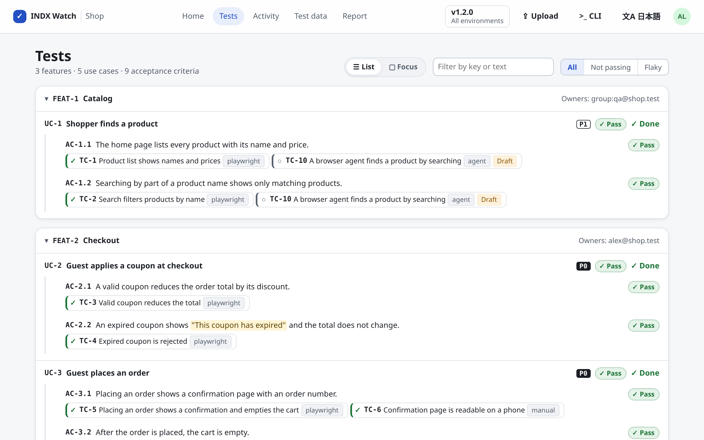
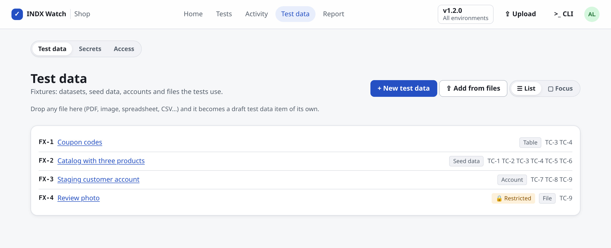
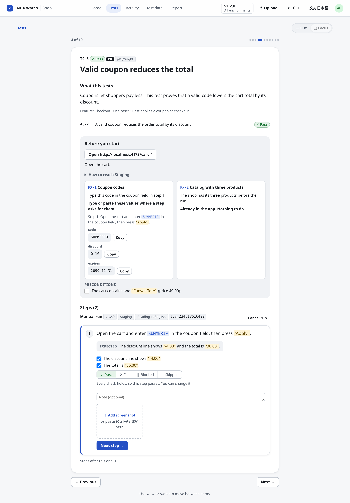
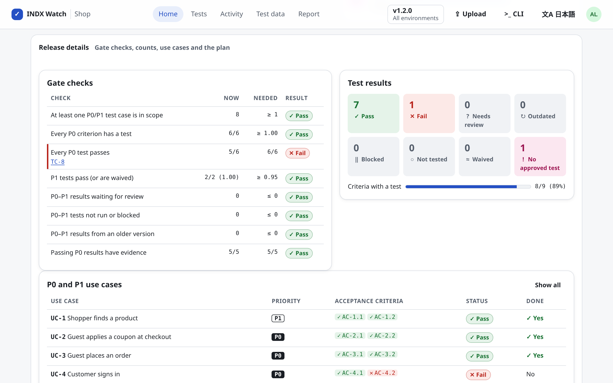
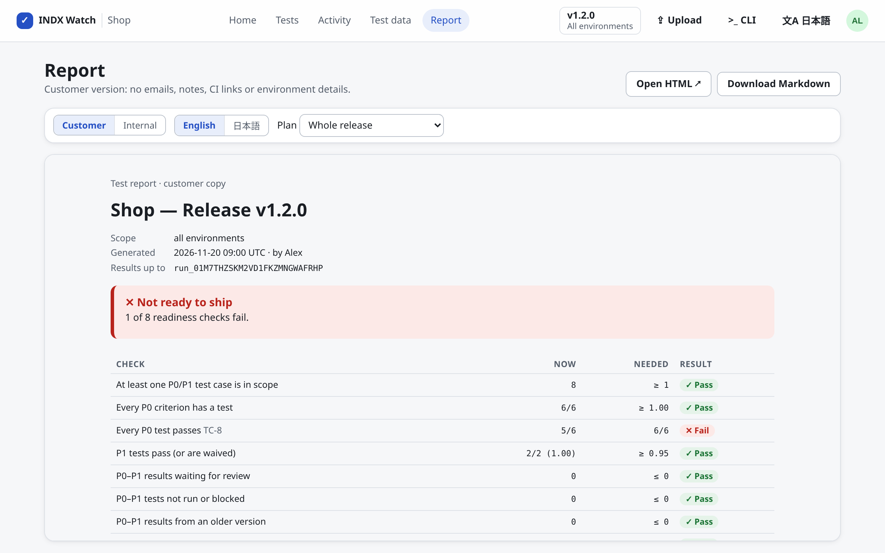

# From zero to "can we ship?"

This guide walks through INDX Watch in the order a team meets it, from an empty repository to a release decision. Each step says who does it, what they say or run, what they see, what a person approves, and where the details live. All examples use the sample shop in [`examples/shop`](https://github.com/INDXDev/indx-watch/tree/main/examples/shop): features Catalog, Checkout and Account, release `v1.2.0`, and testers Alex (owns Checkout) and Sam.

You do not have to do every step. A small team can stop after step 5 and ask "can we ship?" with results on one laptop; steps 8 and 9 add CI and sharing when more people join.

## Roles at a glance

| Role | Typical steps | Never does |
|---|---|---|
| **Developer** | 1 install, 2 set up, 3 design, 5b Playwright, 6 triage, 8 CI | — |
| **QA / tester** | 3 design, 4 test data, 5a manual runs, 6 triage, 7 review | — |
| **PM / approver (lead)** | 7 approve drafts, review runs, waive; 10 decide and share the report | — |
| **Coding agent** (Claude Code, Codex) | Reads, proposes, writes **drafts**, runs tests, records runs, explains failures, writes reports | Approves, reviews, waives or ships ([rules](../spec/agents.md#rules-for-ai-written-content)) |

The same person can hold several roles. The only hard line is between people and agents: whatever counts towards readiness passes through a person.

## 0. Key terms

| Term | Meaning | Shop example |
|---|---|---|
| **Use case** (`UC-n`) | Who wants to achieve what; carries the priority (P0–P3) | UC-2 "Guest applies a coupon at checkout" (P0) |
| **Acceptance criterion** (`AC-n.m`) | One observable yes/no statement about a use case | AC-2.2 "An expired coupon shows "This coupon has expired" and the total does not change." |
| **Test case** (`TC-n`) | Steps that check one or more criteria; `manual`, `playwright`, `agent` or `hybrid` | TC-4 "Expired coupon is rejected" (Playwright) |
| **Fixture / test data** (`FX-n`) | Data a test needs: rows, a seed, a file or an account (secrets only as references) | FX-1 coupon codes, FX-3 staging customer account |
| **Run** | One recorded execution with a verdict, who ran it, the commit, environment and evidence | Sam's failed run of TC-8 |
| **Computed done** | A use case is done when every ready criterion is covered by ready test cases whose latest result on this release passes | UC-4 is not done: TC-8 fails |
| **Release gate** | The checks a release must pass, computed from the results | "Not ready to ship: 1 of 8 checks fail" |
| **Draft / approval** | New items start as `draft`; AI-written ones carry `origin = "ai"`. Drafts do not count until a person approves them | TC-9 is an AI draft |

Full definitions: [concepts](../spec/concepts.md).

## 1. Install once

**Who:** one developer, once per repository. **Needs:** Node 22.13+, a git repository with your app, Claude Code or Codex.

```bash
npx indx-watch init
```

This writes the `.indx-watch/` bundle with placeholders, the skills for Claude Code (`.claude/skills/`) and Codex (`.agents/skills/`), the `indx-watch` MCP server (`.mcp.json`, `.codex/config.toml`) and a block in `AGENTS.md`. Commit it so everyone who clones gets the same setup.

**Approves:** each person approves the project MCP server once in their agent; a repository cannot approve its own servers. Details: [quickstart → install once](./quickstart.md#1-install-once).

## 2. Set up the project: `/iw-setup`

**Who:** a developer or lead. **Says:** "Set up testing for this repo." (Codex: `$iw-setup`.)

The agent reads `package.json`, the Playwright config, tests, CI and git history, then asks one question at a time with a recommended answer: project key (`SHOP`), environment (`staging` at http://localhost:4173), features (Catalog, Checkout, Account), owners per feature, the release (`v1.2.0`), and whether to add the Playwright reporter and a CI workflow. It replaces the placeholders and lists the changed files.

**Approves:** a person reviews the diff, commits it, and runs the one approval line the agent gives, for example `iw approve FEAT-1 && iw approve FEAT-2 && iw approve FEAT-3 && iw approve staging && iw approve v1.2.0`. Details: [testing with agents → set up](./testing-with-agents.md#set-up-the-project-iw-setup).

## 3. Design tests: `/iw-design`

**Who:** a tester, developer or product owner. **Says:** "What should we test in checkout?"

The agent reads the feature's use cases and test cases, the app's source and existing tests, and proposes what is missing in plain words before writing anything: "**An unknown coupon is refused** (P0): entering a code that does not exist shows "This coupon is not valid" and the total stays 40.00." Only the proposals you accept become draft criteria and test cases, each with a purpose, a start page and yes/no checks per step.

**You see** the result in the web app's Tests tree (`npx indx-watch serve --open`), feature by feature, with each criterion's test cases and their status:



**Approves:** a person reads each draft like a pull request and runs `iw approve AC-2.3 && iw approve TC-11`. How a good test case reads: [writing test cases](./writing-test-cases.md).

## 4. Prepare test data: `/iw-data` or the Test data screen

**Who:** whoever knows the coupon codes, accounts and files. **Says:** "The review photo tests need data."

The agent finds what each test case needs and says what the tester does with it ("for TC-9, sign in with the FX-3 account and upload the photo from FX-4"). Missing data becomes a draft fixture after you agree. Passwords stay references such as `env:SHOP_CUSTOMER_PASSWORD`; you set the variable yourself.

People who prefer the browser use **Test data** in the web app: create a table, a seed, an account or a file, or drop any file to make it a draft fixture.



**Approves:** a person approves new fixtures (`iw approve FX-5`) and sets any secret. Details: [fixtures](./fixtures.md).

## 5. Run tests

Three ways produce results. They all land in the same place and count the same way.

### 5a. Manual runs

**Who:** a tester. **Says:** "Test my features" or "Walk me through TC-3", or opens the test case in the web app.

In the web app every test case is one page: *What this tests*, *Before you start* (an Open link, test data cards with what to do with each), *Steps* with their checks, and *Result*. **Run manually** turns the steps into a runner in place; ticking every check suggests pass, and a failed step asks for a note and a screenshot.



With `/iw-test`, the agent explains the test in three lines (what it checks, where to start, what to look for), then asks each check as a yes/no question and records your answers.

**Approves:** a run the agent guided is `needs_review` until you, who did the steps, confirm it in the run viewer or with the one `iw review` line the agent gives. Runs you record yourself in the web app need no extra review.

### 5b. Playwright

**Who:** a developer. **Runs:** `npx playwright test` with the reporter in `playwright.config.ts`:

```ts
reporter: [['list'], ['indx-watch/playwright', { environment: 'staging' }]],
```

Tag each test with the test case it implements: `test('valid coupon reduces the total', { tag: ['@TC-3'] }, …)`. Each result becomes a run with the commit, the fixture versions and screenshots.

> **Set `mode = "playwright"` on the test case.** A test case without `[[judges]]` uses its mode's default judge: `human` for `manual`, `assert` for `playwright`. A passing Playwright run of a test case that still says `mode = "manual"` has no human judgement, so it lands as `needs_review`, not `pass` ([decision policy](../spec/concepts.md#decision-policy)).

Details: [Playwright](./playwright.md).

### 5c. Agent runs

**Who:** a coding agent, asked by anyone. **Says:** "Run the checkout tests." `/iw-test` runs the Playwright tests of the test cases you named and reports each in one line. For test cases with `mode = "agent"`, `iw run TC-10` lets Claude follow the plain-language steps in a browser and record a note and a screenshot per step ([cli → iw run](../spec/cli.md#iw-run-tc-ref)).

**Approves:** agent verdicts below the confidence threshold, and any agent pass of a test case that declares a `human` judge, wait in `needs_review` for a person.

## 6. Triage failures: `/iw-triage`

**Who:** the developer or tester who must decide what a red result means. **Says:** "Why did TC-8 fail?"

The agent reads the run (Sam's manual run, step 1 failed: "The message did not appear; the page reloaded silently."), compares it with the test case and the app code, and answers with a class and a confidence: product bug, test problem, or environment/data problem. It proposes a fix or an issue text and suggests a re-run when evidence is missing.

On Home, the failure is in **Your queue** with a **See failure** button that opens the run viewer.

**Approves:** filing the issue (only on your yes), any change to a test. Details: [testing with agents → fix failures](./testing-with-agents.md#fix-failures-iw-triage).

## 7. Review, approve and waive (people only)

**Who:** a lead or approver. These are the three human decisions; agents get exit code 2 if they try.

| Decision | When | How |
|---|---|---|
| **Approve** a draft | An AI or a person wrote a draft that should count | `iw approve TC-11` |
| **Review** a run | A run is `needs_review` | Activity → **Review** in the web app, or `iw review <run> --verdict pass --reason "…"` |
| **Waive** a failure | A known P1–P3 failure may ship | `iw waive TC-n --release v1.2.0 --reason "…"`; P0 failures cannot be waived |

Details: [cli → approve](../spec/cli.md#iw-approve-ref), [review](../spec/cli.md#iw-review-run-ref), [waive](../spec/cli.md#iw-waive-tc-ref).

## 8. CI: the GitHub Action

**Who:** a developer, once. `/iw-setup` can add the workflow for you.

Run Playwright with the reporter, then the action:

```yaml
- uses: INDXDev/indx-watch@v0
  if: ${{ !cancelled() }}
  with:
    release: v1.2.0
    summary: true
    gate: true
```

It syncs results, writes the readiness report into the job summary, and with `gate: true` fails the job when the gate fails. The gate also fails while any definition file does not load (the `valid_definitions` check of the [readiness gate](../spec/concepts.md#readiness-gate)), so a broken TOML file in a pull request cannot pass unnoticed. `comment: true` and `check: true` add one PR comment and a check run, including the test cases a pull request touches. Details: [GitHub Actions](./github-actions.md). `npx indx-watch init --github` writes the workflow, a deploy workflow for your own Cloudflare account and the issue templates; the whole path is in [Self-host on Cloudflare from GitHub](./self-host-cloudflare-from-github.md).

## 9. Share results with the team

Definitions travel through git. Results travel separately, so they never bloat the repository. Pick one:

| Option | Good for | Guide |
|---|---|---|
| A shared folder or an S3-compatible bucket (S3, R2, MinIO, GCS) in `[store]` | Teams with git; `iw sync` and `iw serve` exchange runs within seconds | [S3 sync](./s3-sync.md) |
| A hosted app on Cloudflare (`iw deploy`) behind Cloudflare Access | Testers and customers who only use a browser; roles and customer UAT | [Cloudflare](./self-host-cloudflare.md) |
| A Node server or Docker container behind your SSO proxy | Teams with their own infrastructure | [Node or Docker](./self-host-node.md) |

Without a store, results stay on the machine that recorded them, and CI keeps them as a workflow artifact.

## 10. Decide and share the report: `/iw-status`

**Who:** the lead who decides. **Says:** "Can we ship 1.2.0?"

> **Agent:** **Not yet.** 7 of 8 test cases pass. TC-8 "Wrong password is rejected" (Account, P0) failed on a manual run by Sam, and P0 failures can't be waived. By feature: Catalog 2/2 · Checkout 4/4 · Account 1/2. Next to act: Sam.

Home shows the same answer, computed from the same function:


**Release details** at the bottom of Home lists each gate check with its current value and threshold:



For stakeholders, "write the release report" (or `iw report --format html --out report.html`) writes one self-contained HTML file. The web app's **Report** screen previews the customer and internal versions in English or Japanese:



**Approves:** shipping. A person changes the release's `state` (`planning`, `testing`, `ready`, `released`) in `releases/v1.2.0.toml`; the agent never does. Report contents: [reports](../spec/reports.md); gate thresholds: [readiness gate](../spec/concepts.md#readiness-gate).

## Next

- [Using the web app](./web-app.md): every screen in one page
- [Testing with Claude Code or Codex](./testing-with-agents.md): each job skill in detail
- [Writing good test cases](./writing-test-cases.md)
