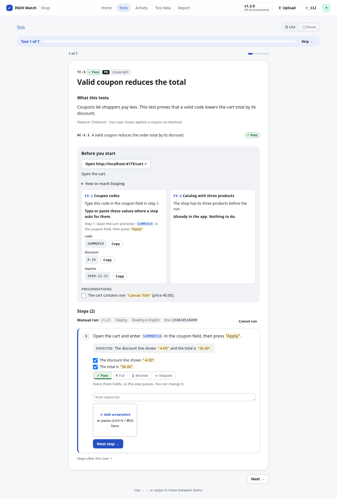

# Quickstart

Install once, then ask your agent. One command sets up your repository for Claude Code and Codex; after that you set up, design, prepare data, test and check readiness by talking to the agent in plain English or Japanese. You never need to learn the CLI. You need Node 22.13 or later, a git repository with your app, and Claude Code or Codex.

> The job skills (`/iw-setup` … `/iw-status`) are in the next `indx-watch` release ([changelog](../../CHANGELOG.md)). Until it is on npm, [build the CLI from source](../../CONTRIBUTING.md#development-setup) or use the [steps without an agent](#without-an-agent).

The examples use the sample shop app in [`examples/shop`](../../examples/shop): a product list, a cart with coupons, orders, sign-in and review photos, with Playwright tests. [Testing with Claude Code or Codex](testing-with-agents.md) describes every job in detail.

## 1. Install once

In your app's repository:

```bash
npx indx-watch init
```

| It writes | For |
|---|---|
| `.indx-watch/` with a project, an environment `local`, a release `v0.1.0` and a feature "General" (placeholders that `/iw-setup` replaces) | Your test cases, criteria and test data, as plain TOML files |
| `.claude/skills/iw-*/` and `.mcp.json` (the `indx-watch` MCP server) | Claude Code: the skills appear as `/iw-setup`, `/iw-test`, … |
| `.agents/skills/iw-*/` (with `agents/openai.yaml`) and `.codex/config.toml` | Codex: the same skills appear as `$iw-setup`, `$iw-test`, … |
| A marked block in `AGENTS.md` (and `@AGENTS.md` in an existing `CLAUDE.md`) | Both: tells the agent which skill to use for which job |

Commit these files so everyone who clones the repository gets the same setup. After upgrading `indx-watch`, run `npx indx-watch skills install`; it updates only what it wrote. Details: [install](../spec/agents.md#install).

Just looking? `npx indx-watch init demo --example` creates a folder `demo` with the full shop bundle and its sample results.

## 2. Open your agent

| | Claude Code | Codex |
|---|---|---|
| Start | `claude` in the repository | `codex` in the repository |
| Call a skill | Type `/iw-setup` (or `/` to see them all); arguments follow, as in `/iw-test TC-3` | Type `$iw-setup`, or pick it from `/skills` |
| Plain words | "Set up testing for this repo" picks `iw-setup` by itself | The same |
| First time only | Approve the `indx-watch` MCP server when Claude Code asks | Trust the project, so Codex loads `.codex/config.toml` |

Each person approves the MCP server once; a repository cannot approve its own servers ([platform notes](../research/platform-notes.md#claude-code)). The skills also work without the MCP server, through the agent's shell.

## 3. Set up: `/iw-setup`

> **You:** Set up testing for this repo.

The agent reads your `package.json`, Playwright config, tests, CI and git history and says what it found in three lines. Then it asks one question at a time, each with a recommended answer: the project key (`SHOP`), the languages (English with Japanese translations), the test environment (`staging` at http://localhost:4173, the URL Playwright uses), the features (Catalog, Checkout, Account), the release (`v1.2.0`), an owner per feature, and whether to add the Playwright reporter and a CI workflow. Answer "yes", give another answer, or say "you decide" / 「おまかせ」.

It replaces the placeholders, writes the environment, release and features as AI drafts, checks the bundle and lists the changed files. **You approve:** review the diff, commit it, and run the one approval line it gives you. An agent cannot approve its own drafts.

## 4. Design tests: `/iw-design`

> **You:** What should we test in checkout?

The agent reads the feature's use cases and test cases, the app's source and the existing tests. It proposes what is missing in plain words, without writing anything yet: "**An unknown coupon is refused** (P0): entering a code that does not exist shows "This coupon is not valid" and the total stays 40.00." You say which proposals to keep. Only those become draft criteria and test cases, with a purpose, a start page and yes/no checks per step ([writing test cases](writing-test-cases.md#guidance-purpose-start-checks-and-test-data)).

**You approve:** the drafts. They do not count towards readiness until a person approves them.

## 5. Prepare test data: `/iw-data`

> **You:** The review photo tests need data.

The agent finds the data each test case needs and says what the tester does with it: for TC-9, sign in with the FX-3 account and upload the photo from FX-4. For missing data it proposes a fixture ("a small text file FX-5, to test that a wrong file is refused") and writes it as a draft after you agree. Passwords and tokens stay references such as `env:SHOP_CUSTOMER_PASSWORD`; the agent asks you to set the variable. More: [fixtures](fixtures.md).

## 6. Test: `/iw-test`

> **You:** Test my features.
>
> **You:** Walk me through TC-3.

"My features" are the features you own. For Alex, who owns Checkout, that is TC-3–TC-6: the agent runs the Playwright tests of TC-3, TC-4 and TC-5 and reports each in one line. For a manual test case such as TC-6, or when you ask to be walked through one, it first explains the test in three lines:

> **What it checks:** coupons let shoppers pay less; a valid code lowers the cart total by its discount (AC-2.1).
> **Where to start:** open http://localhost:4173/cart with one "Canvas Tote" (40.00) in the cart; use the coupon code SUMMER10 from FX-1.
> **What to look for:** after "Apply", the discount line shows "-4.00" and the total "36.00"; after "Place order", an order number.

Then it goes one step at a time, asks each check as a yes/no question ("Is the total 36.00?"), asks for a screenshot where the step wants one, and records the run with your answers. **You approve:** a run the agent guided stays `needs_review` until you confirm it in the web app's run viewer, or with the one review line the agent gives you.

In the web app the same test case is one page: what it tests, where to start with an Open link, the test data with what to do with each item, then the steps with their checks. "Run manually" turns the steps into the runner in place.



## 7. Know where you are: `/iw-status`

> **You:** Can we ship 1.2.0?
>
> **Agent:** **Not yet.** 7 of 8 test cases pass. TC-8 "Wrong password is rejected" (Account, P0) failed on a manual run by Sam, and P0 failures can't be waived. By feature: Catalog 2/2 · Checkout 4/4 · Account 1/2. Next to act: Sam.

Ask "what's left for me?" for only your features, and "write the release report" for a single HTML file to share. When something failed, ask "why did TC-8 fail?" (`/iw-triage`). Shipping is your decision: the agent never changes a release's state.

## Without an agent

Everything the skills do runs on the `iw` CLI, which you can use directly. `iw` and `npx indx-watch` are the same ([cli.md](../spec/cli.md)); install the package globally (`npm install --global indx-watch`) for the short name.

<details>
<summary>The same flow with commands</summary>

```bash
npx indx-watch init demo --no-agents && cd demo   # bundle only, no agent files
iw new uc --title "Guest applies a coupon at checkout" \
  --ac "A valid coupon reduces the order total by its discount." --ready
iw new tc --uc UC-1 --title "Valid coupon reduces the total" \
  --step "Open the cart, enter SUMMER10 in the coupon field and press \"Apply\" => The total shows \"36.00\"" --ready
iw check                                           # schemas, references, keys, secret scan
git init && git add .indx-watch && git commit -m "Add INDX Watch bundle"
iw serve --open                                    # dashboard and manual runner on http://127.0.0.1:4321
iw record TC-1 --verdict pass --step 1=pass        # or record a result from the terminal
iw status                                          # coverage, status, readiness gate
iw report --format html --out report.html          # one self-contained file to share
```

- `iw new` writes plain TOML files you can open and edit; their `#:schema` line gives editors completion. Without `--ready`, items start as `draft` and do not count until someone runs `iw approve`.
- `iw serve` keeps running; use a second terminal. Open TC-1 and press "Run manually". A run records your git identity, the commit, the release and the environment. Results stay out of git (`runs/` is ignored) and travel through a [result store](s3-sync.md).
- Every command takes `--json` for scripts ([envelopes](../spec/cli.md#json-envelope)). How status and the gate are computed: [concepts](../spec/concepts.md#computed-done). Report formats: [reports](../spec/reports.md).

</details>

## Next

- [Testing with Claude Code or Codex](testing-with-agents.md): every job, what you say and what you approve
- [Writing good test cases](writing-test-cases.md) and [fixtures](fixtures.md)
- Link automated tests: [Playwright](playwright.md), then [GitHub Actions](github-actions.md)
- Share results with your team: [S3 sync](s3-sync.md)
