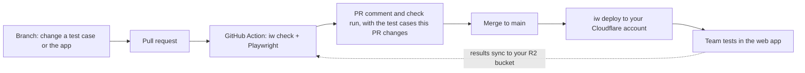

# Self-host on Cloudflare from GitHub

Your test cases live in your git repository. Your team's INDX Watch app runs on **your own Cloudflare account**, on the free tier to start with. GitHub does the routine work: every pull request is checked, tested and commented on, and every merge updates the app. There is no INDX Watch cloud in between.

This guide is one path from an empty repository to the first deployed Worker and the first pull request comment. It uses the repository workflow files that `iw init --github` writes. The deeper references are [Self-host on Cloudflare](./self-host-cloudflare.md) (every deploy detail), [GitHub Actions](./github-actions.md) (every Action input) and [the CLI reference](../spec/cli.md#iw-init-dir).



What you get at the end:

| Where | What happens |
|---|---|
| Your repository | Test cases, criteria and test data as TOML in `.indx-watch/`, reviewed in pull requests like code |
| Pull requests | One comment that says whether the release gate passes, which test cases the PR added, changed or removed, and which ones to run |
| Your Cloudflare account | The web app on a Worker, results in R2, the index in D1, sign-in through Cloudflare Access |
| Your team | Testers open the app, run manual tests and record results; leads see readiness |

## What you need

- A GitHub repository with your app, and optionally Playwright tests.
- A Cloudflare account. The Workers, R2 and D1 free plans cover a small team ([limits](../research/platform-notes.md#limits)). Cloudflare Access sits in Zero Trust, which has its own free plan; check the current user limit on Cloudflare's pricing page before inviting a large team.
- Node 22.13 or later on the machine where you run the first commands.

## 1. Set up the repository

```bash
npx indx-watch init --github
```

This creates `.indx-watch/` (or leaves an existing one alone) and writes, only when missing:

- `.github/workflows/indx-watch.yml`: on every pull request and push to `main` it runs `iw check`, your Playwright tests with the INDX Watch reporter, and then the INDX Watch action, which writes the **PR comment** and a **check run**.
- `.github/workflows/indx-watch-deploy.yml`: on a push to `main` that changes `.indx-watch/` or your dependencies, it runs `iw deploy`.
- The GitHub issue templates, when they ship with your version.

Running it again changes nothing that exists, so you can edit the workflows freely. It ends with the names of the two repository secrets you add in step 3. Then ask your agent "Set up testing for this repo" (`/iw-setup`) to fill in the features, release and owners, review the drafts, and commit the files on a branch.

## 2. Open the first pull request

Push the branch and open a pull request. The check workflow runs and, within a minute or two, the action posts one comment on the pull request and keeps it up to date on every push:

- **The gate line**: passed or failed, with the pass, fail and untested counts and a link to the job.
- **Test cases changed in this PR**: the use cases, criteria and test cases the PR added, changed (steps, covered criteria, data) or removed. Short by design: at most 20 lines.
- **Suggested test cases**: the test cases whose automation files, definition or test data the PR touches.
- The release report.

Make the **INDX Watch** check required in branch protection if you want an unready release to block merging. Pull requests from forks get a read-only token, so they only get the job summary.

## 3. Deploy to your Cloudflare account

Do this once, by hand, so you can see each step.

1. Add `[hosting]` to `.indx-watch/project.toml` ([the keys](./self-host-cloudflare.md#configure-hosting)): a Worker `name` and your Zero Trust `access_team`.
2. Create a Cloudflare API token from the **Edit Cloudflare Workers** template, plus D1 Edit and Workers R2 Storage Edit.
3. Run the first deploy from your laptop and finish the Access application with the printed steps:

   ```bash
   export CLOUDFLARE_API_TOKEN=…        # from step 2
   export CLOUDFLARE_ACCOUNT_ID=…       # dashboard → Workers & Pages
   npx indx-watch deploy --dry-run      # read the plan
   npx indx-watch deploy
   ```

   Copy the Access application's Audience tag into `[hosting].access_aud`, commit, and deploy again ([Put Cloudflare Access in front](./self-host-cloudflare.md#3-put-cloudflare-access-in-front)).
4. Add the repository secrets the deploy workflow reads (**Settings → Secrets and variables → Actions**, or `gh secret set`): `CLOUDFLARE_API_TOKEN` and `CLOUDFLARE_ACCOUNT_ID`. Never put them in a file.

From now on, merging a pull request that changes `.indx-watch/` redeploys the app. Run **Actions → indx-watch-deploy → Run workflow** to deploy by hand.

## 4. Let results flow

The app and CI share one store, the R2 bucket. Point `project.toml` at the Worker's URL (the [hosted server](./self-host-cloudflare.md#4-sync-against-the-hosted-server)) and give the check workflow an Access service token, so CI results show up in the app:

```toml
[store]
url = "https://shop-watch.example.workers.dev"
```

Add `CF_ACCESS_CLIENT_ID` and `CF_ACCESS_CLIENT_SECRET` as repository secrets and pass them as `env:` to the Playwright and action steps, as in [CI: service tokens](./self-host-cloudflare.md#ci-service-tokens). Without a store the action still comments and gates from the results of that job, and uploads them as a workflow artifact.

## 5. The team tests in the app

Testers open the Worker's URL, sign in through Cloudflare Access, and use [the web app](./web-app.md): their assigned test cases, step-by-step manual runs, evidence, and the readiness gate. Their results land in your bucket; the next pull request's comment and the report include them.

## Why this shape

- **Git is the source of truth.** A change to a test case is a diff with an author, a review and a history. The PR comment makes that diff readable for people who do not read TOML.
- **Your account, your data.** The app is a Worker in your Cloudflare account, results are in your bucket. `iw export --full` writes everything out whenever you want to leave.
- **Small and replaceable.** Everything the workflows do is a `npx indx-watch` command you can run on your laptop.

## Troubleshooting

| Symptom | Fix |
|---|---|
| No comment on the PR | The workflow needs `pull-requests: write`; forks get none. See the job log for the warning |
| "Test cases changed" section missing | The `version` input of the action is older than 0.5, or the base commit could not be fetched; see the job log |
| Deploy job says "nothing to deploy" | `project.toml` has no `[hosting]` table |
| Worker answers 403 for everybody | `[hosting].access_aud` is still empty: finish step 3 |
