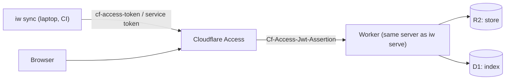

# Self-host on Cloudflare

`iw deploy` puts the same server and web UI that `iw serve` runs locally on Cloudflare Workers. Results go to an R2 bucket (the store), the query index lives in D1, and Cloudflare Access decides who gets in. Your team then syncs with `iw sync` against the Worker's URL and opens the UI in a browser. The command reference is [cli.md](../spec/cli.md#iw-deploy); the security model is [security.md](../spec/security.md#hosted-app).



## Prerequisites

- A Cloudflare account. The Free plan works for a small team; Workers Paid is recommended because the Free CPU limit per request is tight for large bundles ([limits](../research/platform-notes.md#limits)).
- A Cloudflare Zero Trust organization. Its **team name** is the `<team>` in `<team>.cloudflareaccess.com` (shown under Zero Trust → Settings).
- Node ≥ 22.13 and the `indx-watch` package (`npx indx-watch …` works).
- `wrangler` 4. `iw deploy` uses `wrangler` from your `PATH`, or runs `npx --yes wrangler@4` when it is missing. Log in once with `npx wrangler login`, or set `CLOUDFLARE_API_TOKEN` and `CLOUDFLARE_ACCOUNT_ID` (start from the "Edit Cloudflare Workers" token template and add D1 Edit and Workers R2 Storage Edit).
- `cloudflared` on the machines of people who use the CLI against the hosted server ([Cloudflare docs](https://developers.cloudflare.com/cloudflare-one/tutorials/cli/)).

## Configure `[hosting]`

Add a `[hosting]` table to `.indx-watch/project.toml` (from [`examples/shop`](../../examples/shop/.indx-watch/project.toml)):

```toml
[hosting]
provider = "cloudflare"
name = "shop-watch"        # Worker name → https://shop-watch.<your-subdomain>.workers.dev
r2_bucket = "shop-watch"   # default: name
d1_database = "shop-watch" # default: name
access_team = "example"    # your Zero Trust team name
# access_aud = "…"         # filled in after the Access application exists (step 3 below)
```

| Key                        | Required               |                                                                                                 |
| -------------------------- | ---------------------- | ----------------------------------------------------------------------------------------------- |
| `provider`                 | yes                    | Only `cloudflare` in v0.1                                                                       |
| `name`                     | yes                    | Worker name: lowercase letters, digits and `-`. `--name` overrides it.                          |
| `r2_bucket`, `d1_database` | no                     | Default to `name`. Existing resources with these names are reused.                              |
| `access_team`              | yes, unless `--public` | Team name of your Zero Trust organization                                                       |
| `access_aud`               | after the first deploy | The Access application's Audience (AUD) tag. Until it is set, the Worker rejects every request. |

Nothing in `[hosting]` is secret. Never put API tokens in `project.toml`.

## 1. Preview the plan

```console
$ npx indx-watch deploy --dry-run
Cloudflare Access is not finished: [hosting].access_aud is empty, so the Worker rejects every request until you set it.
  1. Cloudflare dashboard → Zero Trust → Access → Applications → Add an application → Self-hosted.
  …
Dry run: nothing was changed. Commands:
  wrangler r2 bucket create shop-watch
  wrangler d1 create shop-watch
  wrangler deploy --config /work/shop/.indx-watch/cache/deploy/wrangler.jsonc
```

`--dry-run` only reads: it runs `wrangler whoami`, `wrangler d1 list --json`, `wrangler r2 bucket info <bucket> --json` and `wrangler deployments list --name <worker> --json`, then prints the resources and the exact commands a real deploy would run. Resources that already exist are not created again, so the list gets shorter on later deploys. With `--json` the plan is printed as `{ "resources": [...], "commands": [...], "url": null }`.

It also writes the generated Wrangler configuration to `.indx-watch/cache/deploy/wrangler.jsonc` (`cache/` is git-ignored), so you can read exactly what will be deployed:

| Setting               | Value                                                                                                                                             |
| --------------------- | ------------------------------------------------------------------------------------------------------------------------------------------------- |
| `main`                | The Worker bundle shipped in the `indx-watch` package                                                                                             |
| `assets`              | The web UI build, binding `ASSETS`, `not_found_handling: "single-page-application"`, `run_worker_first: ["/api/*", "/healthz", "/mcp", "/mcp/*"]` |
| `r2_buckets`          | Binding `STORE` → `r2_bucket`                                                                                                                     |
| `d1_databases`        | Binding `DB` → `d1_database` (with its ID)                                                                                                        |
| `vars`                | `ACCESS_TEAM`, `ACCESS_AUD` (and `PUBLIC = "true"` only with `--public`)                                                                          |
| `triggers.crons`      | `["* * * * *"]`: once a minute the Worker picks up new store objects into its index                                                               |
| `compatibility_flags` | `["nodejs_compat"]`                                                                                                                               |

Do not edit the file: it is rewritten on every deploy. Change `[hosting]` instead.

## 2. Deploy

```console
$ npx indx-watch deploy
```

The command creates the missing R2 bucket and D1 database, fills the database ID into the configuration, runs `wrangler deploy` and prints the URL (`https://shop-watch.<your-subdomain>.workers.dev`). Running it again is safe: it only deploys a new version.

If `wrangler` is not logged in, `iw deploy` stops before changing anything with exit code 4 (`EXTERNAL_TOOL`). Without `access_team` it refuses with exit code 3, unless you pass `--public`. Do not use `--public` for anything but a throwaway demo with sample data: anyone with the URL can read and write.

## 3. Put Cloudflare Access in front

INDX Watch has no login of its own. The Worker checks the `Cf-Access-Jwt-Assertion` header that Cloudflare Access adds, against your team's keys and the application's AUD tag.

1. Cloudflare dashboard → **Zero Trust → Access → Applications → Add an application → Self-hosted**.
2. **Application domain**: `shop-watch.<your-subdomain>.workers.dev`, or the custom domain you attached to the Worker. (Alternative: **Workers & Pages → shop-watch → Settings → Domains & Routes**, enable Cloudflare Access for `workers.dev`; it shows the AUD tag in a dialog.)
3. Add policies (next section).
4. Open the application's **Overview / Additional settings** and copy the **Application Audience (AUD) Tag**.
5. Put it in `project.toml` and deploy again:

   ```toml
   [hosting]
   access_aud = "<the AUD tag from step 4>"
   ```

   ```console
   $ npx indx-watch deploy
   Cloudflare Access: team example.cloudflareaccess.com, audience set. Requests without a valid Access token get 401.
   ```

The Worker lets only `/healthz` through without a valid token. Access itself still covers `/healthz`; to monitor it from outside, add a separate Access application for that path with a Bypass policy.

### Policies

| Who                     | Login method (Zero Trust → Settings → Authentication) | Policy                                                                                                          |
| ----------------------- | ----------------------------------------------------- | --------------------------------------------------------------------------------------------------------------- |
| Your team               | **Google Workspace** (or any OIDC/SAML IdP)           | Allow → _Emails ending in_ `@your-company.com`, or a Google Workspace group                                     |
| Invited customers (UAT) | **One-time PIN** (code sent by email)                 | A second Allow policy → _Emails_ listing each customer address. Turn on one-time PIN for this application only. |
| CI and scripts          | **Service token**                                     | Service Auth → the token (see below)                                                                            |

Keep the session duration short for customers (for example 24 hours). Removing an address from the policy revokes access at the next login.

### CI: service tokens

1. **Zero Trust → Access → Service credentials → Service Tokens → Create**. Copy the Client ID and Client Secret (the secret is shown once).
2. Add a policy with the action **Service Auth** that includes this token.
3. Store both values as CI secrets and expose them as `CF_ACCESS_CLIENT_ID` and `CF_ACCESS_CLIENT_SECRET`. `iw sync` and the Playwright reporter send them as `CF-Access-Client-Id` / `CF-Access-Client-Secret`.

Records written with a service token carry the CI identity of the job (see [security.md](../spec/security.md#identity)), not the token.

## 4. Sync against the hosted server

Point the store at the Worker so everyone shares results through it:

```toml
[store]
url = "https://shop-watch.example.workers.dev"
```

On a laptop, log in once per Access session; INDX Watch stores no token itself:

```console
$ npx indx-watch login https://shop-watch.example.workers.dev   # runs: cloudflared access login <url>
$ npx indx-watch sync
```

`iw sync` gets a token with `cloudflared access token -app=<url>` and sends it as `cf-access-token`. You can also pass a token in `IW_ACCESS_TOKEN`. The protocol is the same as for any other store ([sync.md](../spec/sync.md#store-http-endpoints)).

The bundle (definitions) still travels through git. CI on the default branch runs `iw sync --snapshot` (the [GitHub Action](../spec/integrations.md) does this) so the hosted UI shows the current test cases.

## Costs and limits

The free tiers of Workers, R2 and D1 cover a small team. Watch the Workers CPU limit per request, the request body limit (keep large evidence such as videos small) and the D1 database size limit. The current numbers, with dates and sources, are in [platform notes](../research/platform-notes.md#limits) ([D1](../research/platform-notes.md#d1), [R2](../research/platform-notes.md#r2)); check them before relying on them.

## Upgrade

Update the package and run `npx indx-watch@latest deploy`. The store layout is versioned and never rewritten, and the D1 index is derived from the store, so upgrades need no migration step in v0.1.

## Teardown

Export first if you want to keep the results (`iw sync` to another store, or `iw export --full`). Empty the R2 bucket (dashboard → R2 → the bucket, or an expiring lifecycle rule), then:

```console
$ npx wrangler delete --name shop-watch
$ npx wrangler d1 delete shop-watch
$ npx wrangler r2 bucket delete shop-watch   # the bucket must be empty
```

Finally delete the Access application and any service tokens in Zero Trust.

## Troubleshooting

| Symptom                                                 | Fix                                                                                                     |
| ------------------------------------------------------- | ------------------------------------------------------------------------------------------------------- |
| `wrangler is not logged in` (exit 4)                    | `npx wrangler login`, or set `CLOUDFLARE_API_TOKEN` and `CLOUDFLARE_ACCOUNT_ID`                         |
| `refusing to deploy without Cloudflare Access` (exit 3) | Set `[hosting].access_team`                                                                             |
| Every request returns 401                               | `access_aud` is missing or wrong, or the Access application does not cover the Worker's domain          |
| `iw sync` gets 401/403                                  | Run `iw login <url>` again (session expired), or check the CI service token and its Service Auth policy |
| `missing build output`                                  | You are running from a source checkout without `pnpm build`; use the published package or build first   |
