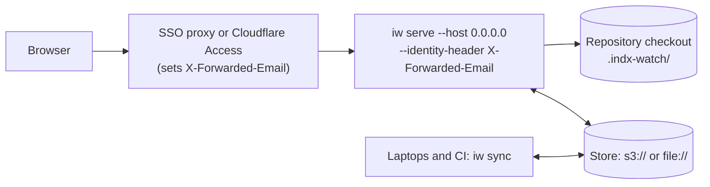

# Self-host on Node or Docker

Any machine with Node ≥ 22.13 can host a shared INDX Watch: it runs the same server and web UI as `iw serve` on your laptop. There is no published container image: to use Docker, clone this repository and build the image from its [`Dockerfile`](https://github.com/INDXDev/indx-watch/blob/main/Dockerfile) ([below](#run-with-docker)); without Docker, `npx indx-watch` is all you need. Results live in a store that everyone syncs with (an S3-compatible bucket or a shared folder), and a proxy in front of the server decides who gets in. For a fully managed setup, see [Self-host on Cloudflare](./self-host-cloudflare.md). The runtime targets are compared in [architecture.md](../architecture.md#runtime-targets).



## What you need

- A checkout of the repository that contains `.indx-watch/` (the server reads definitions from it; keep it current with `git pull`, for example from a cron job or a deploy hook).
- A store that the team and CI also use, configured in `project.toml` ([sync.md](../spec/sync.md)):

  ```toml
  [store]
  url = "s3://shop-qa/results"
  region = "auto"
  endpoint = "https://<account-id>.r2.cloudflarestorage.com"   # omit for AWS S3
  ```

  Credentials come from the environment (`AWS_ACCESS_KEY_ID`, `AWS_SECRET_ACCESS_KEY`, or `AWS_PROFILE`), never from the file. Give the server a read-write key scoped to this bucket.

- A reverse proxy that authenticates users, unless the server is only for you.

## Run on a VM

```console
$ cd /srv/shop                    # the repository checkout
$ npx indx-watch serve --host 0.0.0.0 --port 4321 --identity-header X-Forwarded-Email
```

With `[store]` set, the server syncs in the background, so runs recorded by CI and by teammates appear within seconds, and runs recorded in the UI reach the store.

### Identity and the proxy

INDX Watch has no login of its own ([security.md](../spec/security.md#shared-servers)):

- Bound to a non-loopback address, the server **rejects writes** (recording a run, reviewing, uploading evidence) unless `--identity-header <name>` is set. Reads are allowed. A warning is printed.
- With `--identity-header`, the server attributes each write to the email in that header. Only set it when a proxy in front **always** sets the header and strips any value sent by the client, and when the server port is not reachable except through the proxy (bind to a private interface or use a firewall).

Proxies that work:

| Proxy                                                                                                                                                  | Header                               |
| ------------------------------------------------------------------------------------------------------------------------------------------------------ | ------------------------------------ |
| [oauth2-proxy](https://oauth2-proxy.github.io/oauth2-proxy/) with Google Workspace or any OIDC provider (`--set-xauthrequest` / `--pass-user-headers`) | `X-Forwarded-Email`                  |
| Cloudflare Tunnel (`cloudflared tunnel`) + a Cloudflare Access application                                                                             | `Cf-Access-Authenticated-User-Email` |
| Your company's SSO gateway                                                                                                                             | whatever header it documents         |

A Caddy front for oauth2-proxy (listening on `127.0.0.1:4180` with `--set-xauthrequest`):

```caddyfile
qa.example.com {
  request_header -X-Forwarded-Email
  handle /oauth2/* {
    reverse_proxy 127.0.0.1:4180
  }
  handle {
    forward_auth 127.0.0.1:4180 {
      uri /oauth2/auth
      copy_headers X-Auth-Request-Email>X-Forwarded-Email
      @denied status 401
      handle_response @denied {
        redir * /oauth2/sign_in?rd={scheme}://{host}{uri}
      }
    }
    reverse_proxy 127.0.0.1:4321
  }
}
```

Run `iw serve` with `--host 127.0.0.1` in this setup: only the proxy on the same host can reach it.

## Run with Docker

Clone the repository first (`git clone https://github.com/INDXDev/indx-watch && cd indx-watch`); the image is built locally, not pulled from a registry. The repository ships a [`Dockerfile`](https://github.com/INDXDev/indx-watch/blob/main/Dockerfile) based on `node:22-slim`. It installs `indx-watch` from npm, or from a tarball you packed yourself, runs as the `node` user, and starts `iw serve --host 0.0.0.0` in `/project`.

```console
$ docker build -t indx-watch .                                   # latest release from npm
$ docker build -t indx-watch --build-arg IW_VERSION=0.1.4 .      # a specific version
$ (cd packages/cli && npm pack --pack-destination ../..) && docker build -t indx-watch .   # this checkout
```

Mount the repository checkout at `/project` and pass store credentials as environment variables:

```console
$ docker run -d --name shop-qa -p 127.0.0.1:4321:4321 \
    -v /srv/shop:/project \
    -e AWS_ACCESS_KEY_ID -e AWS_SECRET_ACCESS_KEY \
    indx-watch serve --host 0.0.0.0 --identity-header X-Forwarded-Email
```

- The arguments after the image name replace the default command (`serve --host 0.0.0.0`); any `iw` command works, for example `docker run --rm -v "$PWD:/project" indx-watch check`.
- The container writes the local replica to `.indx-watch/runs/` and caches to `.indx-watch/cache/` in the mounted folder. If the files are not owned by uid 1000, add `--user "$(id -u):$(id -g)"`.
- Publish the port on `127.0.0.1` and let the proxy on the host reach it, as above.
- `git` is installed in the image so commits and identities are detected from the checkout.

## Without a bucket: a shared folder

For a small team on one network, a `file://` store on a shared drive works the same way (`url = "file:///mnt/qa-store"`), with the drive's permissions as access control. Mount it into the container with a second `-v`.

## Upgrade and backup

- Upgrade: `npx indx-watch@latest serve …`, or rebuild the image. The store format is versioned and never rewritten.
- Backup: the bundle is in git; the results are in the store. Back up the bucket (object versioning or replication), or run `iw export --full` on a schedule.
