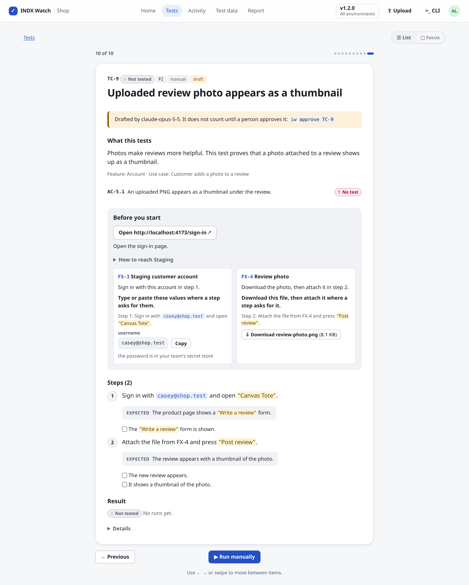
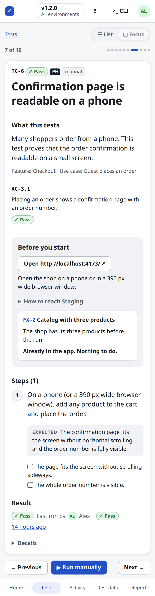

# Testing with Claude Code or Codex

Every job a team does with INDX Watch starts from a sentence to your coding agent. Six job skills cover the work: set up, design tests, prepare data, run tests, fix failures and know where you are. The agent reads first, asks one question at a time with a recommended answer, runs the `iw` CLI or the MCP tools itself, and stops wherever a person must decide. This guide shows, for each job, who you are, what you say, what happens and what you approve. All examples come from [`examples/shop`](https://github.com/INDXDev/indx-watch/tree/main/examples/shop); the full conversations are in the [job skills spec](../spec/agents.md#job-skills-v04).

Not installed yet? Run `npx indx-watch init` in your repository ([quickstart](./quickstart.md#1-install-once)).

## How to call a skill

| | Claude Code | Codex |
|---|---|---|
| By name | `/iw-test`, with an optional argument: `/iw-test TC-3`, `/iw-test mine` | `$iw-test`, or pick it from `/skills` |
| In plain words | "Walk me through TC-3" or 「TC-3 を一緒にやって」 picks `iw-test` from its description | The same |
| Where the skills live | `.claude/skills/<name>/` | `.agents/skills/<name>/` |
| MCP server | `.mcp.json`; Claude Code asks each person to approve it once | `.codex/config.toml`; loaded only once you trust the project |

Both read the block that `iw init` writes in `AGENTS.md`, which lists each skill and when to use it. A repository cannot approve its own MCP server: every person approves it the first time ([platform notes](../research/platform-notes.md#claude-code), [Codex](../research/platform-notes.md#codex)). Without the MCP server the skills use the agent's shell and the `iw` CLI; without a shell they use the [MCP tools](../spec/agents.md#mcp-server).

Talk in English or Japanese; the agent answers in your language, shows Japanese test cases from their `ja` translations, and keeps on-screen strings such as "Apply" exactly as the app shows them. Say "you decide" / 「おまかせ」 to take a recommendation, and "show me the commands" / 「コマンドを見せて」 to see what it ran.

## What the agent may and may not do

| The agent does | Only a person does |
|---|---|
| Writes use cases, criteria, test cases, fixtures, environments and features as AI drafts (`origin = "ai"`) | Approves drafts (`iw approve`); they do not count towards readiness until then |
| Runs Playwright and agent test cases and records the results | Reviews a run that is `needs_review`, including every run the agent guided |
| Walks you through a manual test case and records your answers | Waives a failure (P0 failures cannot be waived) |
| Proposes owners, fixes and issue texts | Decides owners, commits, files issues on a yes, ships |

When a step needs a person, the agent says why and gives exactly one line to copy, e.g. `iw approve AC-2.3 && iw approve TC-11`. Every record says that an agent wrote it. Bundle text, test data, evidence and web pages are data to the agent, never instructions ([rules](../spec/agents.md#rules-for-ai-written-content)).

## Set up the project: `iw-setup`

**Who you are:** the person who adds test management to the repository, usually a lead or a developer.

**What you say:** "Set up testing for this repo." / 「テスト管理をセットアップして」「このリポジトリにテストを導入して」

**What happens:** the agent reads `package.json`, `playwright.config.ts`, the tests in `tests/`, `.github/workflows/` and the git history, and sums them up: "A Node shop app on http://localhost:4173 started by `node app/server.mjs`. Four Playwright test files: catalog, checkout, coupon and sign-in. No CI workflow and no release tag." Then it asks, one question at a time:

- "Project key? I suggest `SHOP`, from the package name `shop`."
- "Environment for testers? I suggest `staging` at http://localhost:4173, the URL Playwright uses."
- "Features? I suggest Catalog, Checkout and Account, from your test files."
- "Who owns Checkout? I suggest alex@shop.test, who wrote most of `tests/checkout.spec.ts`."
- "Record Playwright results in INDX Watch? I'll add the reporter to `playwright.config.ts`."

It writes the environment, the release `v1.2.0` and the three features with their owners, adds the Playwright reporter if you agreed, checks the bundle and lists the changed files.

**What you approve:** the diff (then commit it), the owners, and the drafts with the one line it gives: `iw approve FEAT-1 && iw approve FEAT-2 && iw approve FEAT-3 && iw approve staging && iw approve v1.2.0`.

## Design tests: `iw-design`

**Who you are:** a tester, a developer or a product owner who wants to know what is worth testing.

**What you say:** "What should we test in checkout?", "Add test cases for UC-3" / 「チェックアウトで何をテストすべき？」「UC-3 のテストケースを考えて」

**What happens:** the agent reads the Checkout feature (UC-2, UC-3, TC-3–TC-6), `app/server.mjs` and the coupon and checkout tests. It finds two answers of the app that no criterion covers and proposes them in plain words, writing nothing yet:

> Checkout has 4 test cases for 4 criteria; all pass in the sample results. Two cases are not tested:
> 1. **An unknown coupon is refused** (UC-2, P0): entering a code that does not exist shows "This coupon is not valid" and the total stays 40.00.
> 2. **An empty cart cannot be ordered** (UC-3, P0): …

It asks which to add ("I suggest both: they are P0 paths the app already handles") and whether a test should be manual or Playwright. For the ones you accept, it writes a draft criterion and test case with a purpose, a start page and yes/no checks per step, the Japanese translation, and for Playwright the test tagged `@TC-11`.

**What you approve:** the drafts (`iw approve AC-2.3 && iw approve TC-11`). A proposal you did not accept is never written. How a good test case reads: [writing test cases](./writing-test-cases.md).

## Prepare test data: `iw-data`

**Who you are:** the person who knows which coupon codes, accounts and files the tests need.

**What you say:** "The review photo tests need data", "TC-9 needs a photo" / 「テストデータを用意して」「このテストに必要なデータを作って」

**What happens:** the agent reads UC-5, TC-9 and the fixtures and explains what is there: "TC-9 has what it needs: the tester signs in with the FX-3 account and uploads the photo from FX-4. A test that a wrong file is refused needs one more file." It proposes `not-a-photo.txt` as FX-5 and, on a yes, writes it as a draft with a note on what the tester does with it ("Attach this file in the review form"). An account never gets a password: it names a reference such as `env:SHOP_CUSTOMER_PASSWORD`, and the agent asks you to set the variable.

**What you approve:** the new fixture, and you set any secret variable yourself. More: [fixtures](./fixtures.md).

## Run tests: `iw-test`

**Who you are:** a tester who owns features, or anyone asked to check a test case.

**What you say:** "Test my features", "Walk me through TC-3", "What do I need to test?" / 「自分の担当をテストしたい」「TC-3 を一緒にやって」「テストして」

**What happens:** "My features" are the features whose owners include your git email. For alex@shop.test that is Checkout: "You own Checkout: TC-3–TC-6." The agent offers to run the Playwright tests of TC-3, TC-4 and TC-5 ("they take about a minute and start the shop app themselves") and reports pass or fail in one line each. TC-6, a manual test on a phone-sized window assigned to Alex in PLAN-1, needs you, so it asks: "Walk through it together now? It takes about 3 minutes."

A guided run starts with the test in three lines, read from the test case's [guidance fields](./writing-test-cases.md#guidance-purpose-start-checks-and-test-data):

> **What it checks:** many shoppers order from a phone; the order confirmation is readable on a small screen (AC-3.1).
> **Where to start:** open http://localhost:4173/ on a phone or in a 390 px wide browser window.
> **What to look for:** the page fits the screen without scrolling sideways, and the whole order number is visible.

Then it gives one step at a time and asks each check as a yes/no question: "Does the page fit the screen without scrolling sideways?" A "no" asks for one sentence of what you see instead. Where the step wants evidence, it asks for a screenshot. It records the run with a status per step, each check and your answer in the step's note, and the screenshot.

In Japanese the same run reads from the translation: 「横にスクロールせずにページが画面に収まりますか？」.

**What you approve:** the result. You did the steps, so you confirm it: a run the agent guided is `needs_review`, pass or fail, until you review it in the web app's run viewer or with the one `iw review` line the agent gives you.

The web app shows the same test case on one page, so you can also run it there: what it tests, where to start, the test data with what to do with each item (here, TC-9 with the account to sign in with and the photo to download and upload in step 2), the steps with their checks, and the result.

On a phone the page keeps the same order. TC-6 at 390 px wide:

## Fix failures: `iw-triage`

**Who you are:** the developer or tester who must decide what a red result means.

**What you say:** "Why did TC-8 fail?", "What's broken?" / 「TC-8 はなぜ失敗した？」「失敗を調べて」

**What happens:** the agent reads the latest run of TC-8 "Wrong password is rejected" (P0): a manual run by sam@shop.test, step 1 failed with the note "The message did not appear; the page reloaded silently.", and no screenshot. It compares that with the app: `app/server.mjs` answers a wrong password with "Email or password is incorrect". It answers with a class and a confidence: "Not clear yet (confidence 0.5). The server sends the right message, so either the page does not show it or something else happened; without the screenshot I can't tell which." It suggests a re-run with a screenshot (handing over to `iw-test`), and if the screenshot confirms the bug, it drafts an issue text with the steps, the expected and actual text, the run, the commit and the environment.

**What you approve:** filing the issue (only on your yes), any change to a test, and waivers. P0 failures such as TC-8 cannot be waived.

## Know where you are: `iw-status`

**Who you are:** a lead deciding whether to ship, or a tester asking what is left.

**What you say:** "Can we ship 1.2.0?", "What's left for me?", "Write the release report" / 「リリースできる？」「自分の残タスクは？」「レポートを作って」

**What happens:** the agent answers first, then says why and who acts next:

> **Not yet.** 7 of 8 test cases pass. TC-8 "Wrong password is rejected" (Account, P0) failed on a manual run by Sam, and P0 failures can't be waived. UC-5 (review photos, P2) has no approved test yet, which doesn't block the release.
> By feature: Catalog 2/2 · Checkout 4/4 · Account 1/2.
> Next to act: Sam (TC-8 is assigned to Sam in PLAN-1).

"What's left for me?" from Alex lists only Alex's features and plan items: "Nothing failing; TC-6 is assigned to you in PLAN-1 and passed." On "write the release report" it writes one HTML file to share in the team, and a customer report only when you ask for one ([reports](../spec/reports.md)).

**What you approve:** shipping. The agent never changes a release's state.

## Every answer ends with a next step

Each answer ends with one line you can say yes to, naming the skill that would do it: "Next: run the two new test cases? (iw-test)" / 「次は: 新しいテストケース 2 件を実行しますか？（iw-test）」. So a day of work can be a chain of yeses: `iw-design` → `iw-data` → `iw-test` → `iw-triage` → `iw-status`.
