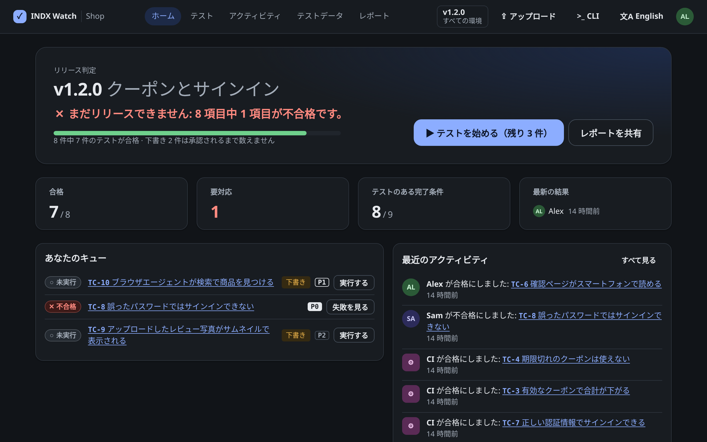
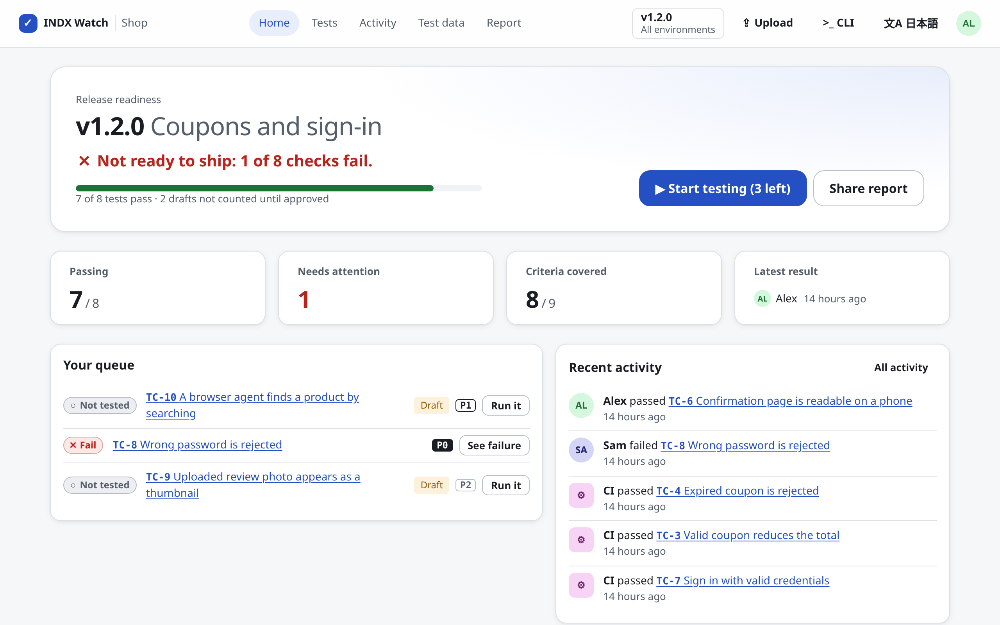
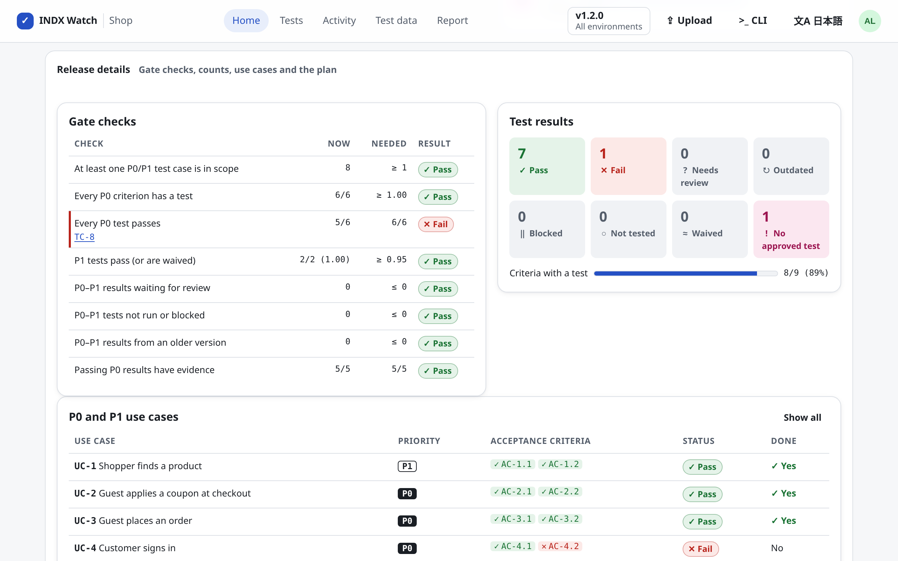
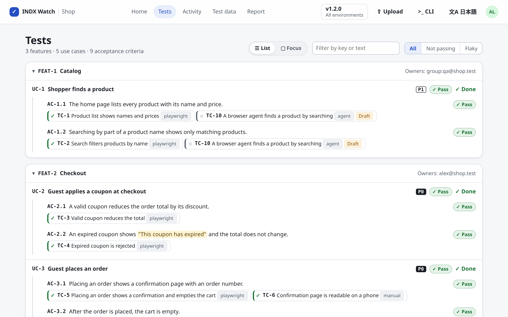
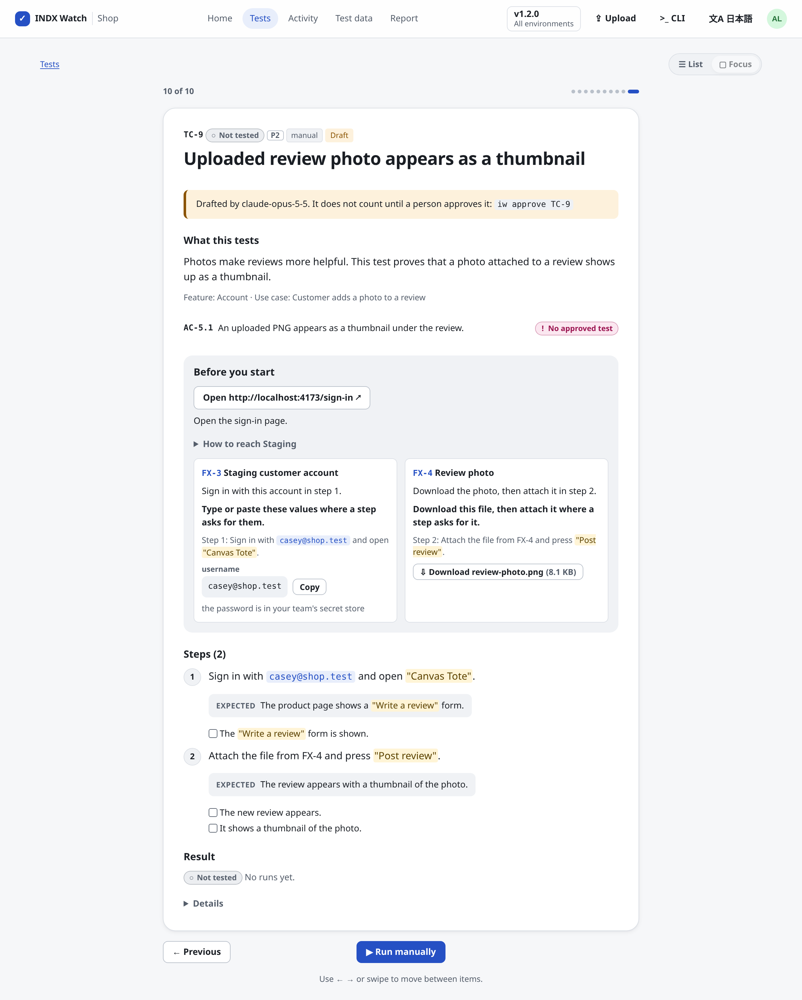
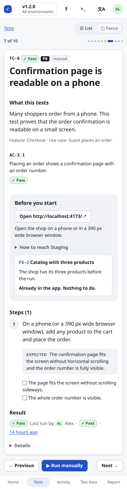
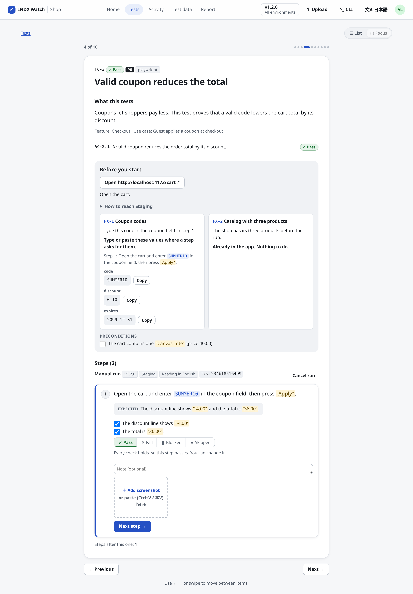
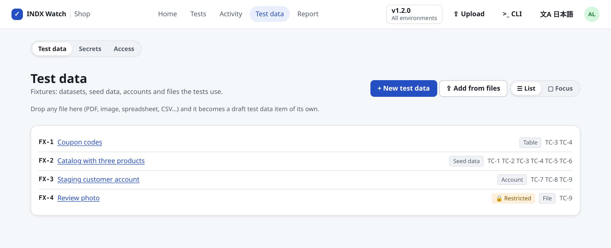
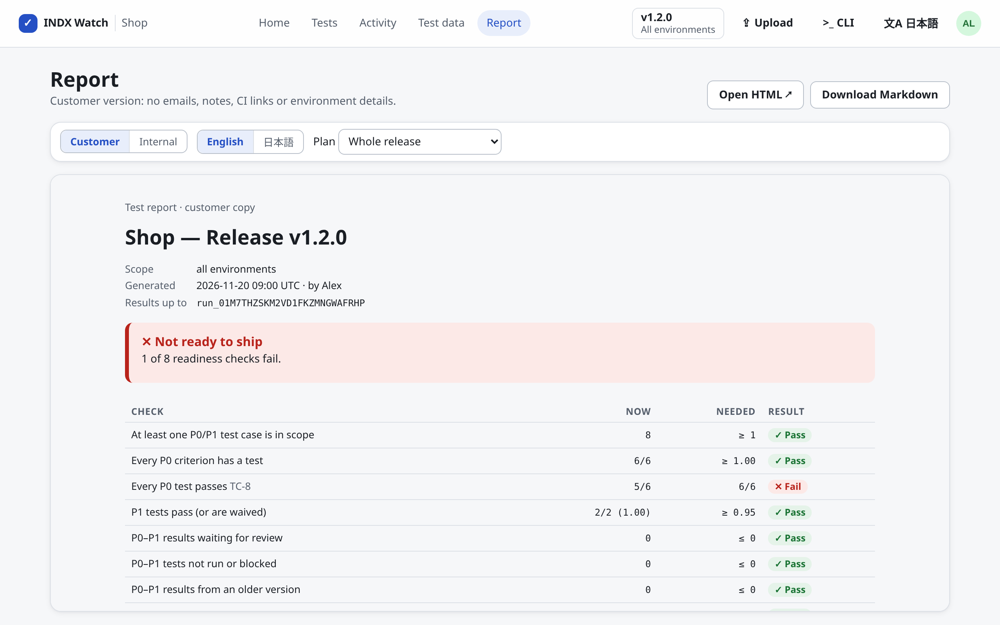
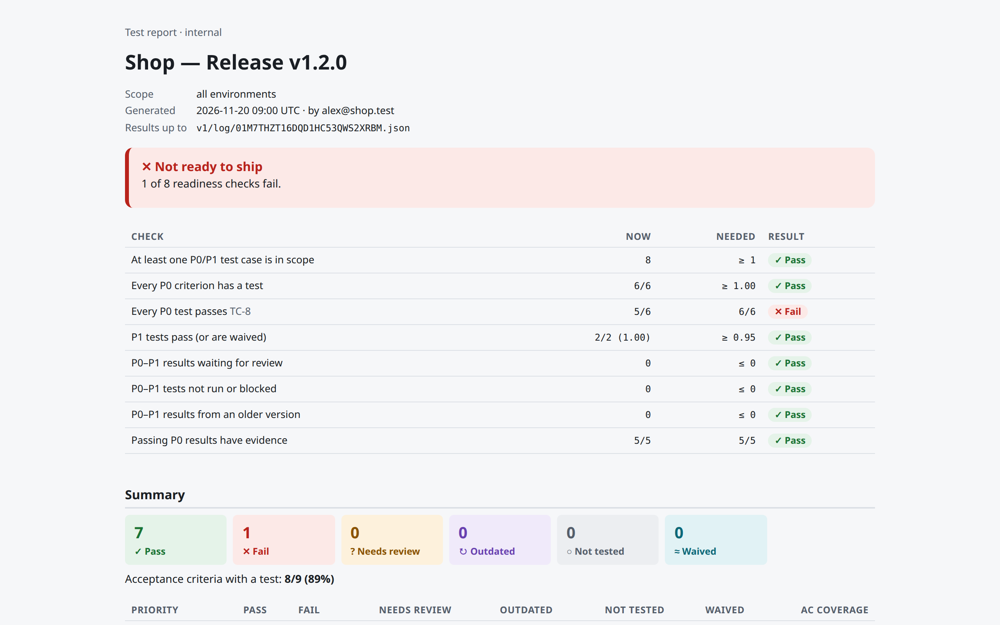

# Using the web app

The web app is for the people who test, review and decide, without a terminal or a coding agent. It reads the same files and results as the CLI and the skills, so every screen shows the same numbers. Start it locally with:

```bash
npx indx-watch serve --open        # http://127.0.0.1:4321
```

or open your team's hosted app ([Cloudflare](./self-host-cloudflare.md), [Node or Docker](./self-host-node.md)). The [live demo](https://indx-watch-demo.i-248.workers.dev) shows `examples/shop` read-only. Screens, routes and behaviour are specified in [web](../spec/web.md); this page is the tour.

The top bar has the five screens (Home, Tests, Activity, Test data, Report), the release and environment picker, **Upload** and the **CLI** panel, which shows the command for what you are looking at. The app speaks English and Japanese and follows the system's light or dark theme.



## Home

One answer first: is the release ready? The hero shows the release, a sentence such as "Not ready to ship: 1 of 8 checks fail", and a progress bar. **Start testing (n left)** opens a runner over the open items, yours first. **Share report** opens the Report screen.



Below are four cards (passing, needs attention, criteria covered, last upload), **Your queue** (your plan items first, each with Run, Review or See failure), and **Recent activity**. **Release details** at the bottom holds the gate checks, counts by status and the use case table:



If you own features, Home, Tests and the runner start in **My features**; switch to **All features** in the scope menu.

## Tests

The tree goes feature → use case → acceptance criterion → test case, each with its status, priority, mode and owners. Filter by key or text, or show only **Not passing** or **Flaky** test cases. **List** shows the tree; **Focus** shows one test case per screen, with ← / → or a swipe to move.



## The test case page

Every test case is one page, written for someone who has never seen the app:

1. **What this tests**: the purpose, the feature and the criteria it covers.
2. **Before you start**: an Open link to the start page on the selected environment, a card per test data item that says what to do with it (type it, download it, upload it in step N, or nothing because it is seeded) with a Copy or Download button, and preconditions as a checklist.
3. **Steps**: each instruction with its expected result and yes/no checks.
4. **Result**: the latest verdict and runs.

An AI draft says so at the top, with the command a person runs to approve it.



On a phone the page keeps the same order:



## Running a test manually

**Run manually** turns the Steps block into the runner without leaving the page. One step at a time: tick each check you see, attach a screenshot where the step asks for one, then **Next step**. Ticking every check suggests pass; a failed step with an unticked check asks for a note. The run records who you are, the commit, the release, the environment and your ticks.



Where the server has no verified identity (for example `iw serve` on a shared machine without a proxy), the app asks "Who's testing?" once and records the name you give as browser-declared.

## Activity and reviewing runs

**Activity** lists runs, reviews and uploads, newest first. Open a run to see its steps, ticked checks, notes and screenshots, who ran it and how that identity was established. **Review** opens a queue of `needs_review` runs: read the evidence and record pass, fail, blocked or skipped with a reason. Agents cannot review; every run an agent guided waits here for the person who did the steps.

## Test data

**Test data** lists the fixtures with their kind and the test cases that use them. **New test data** creates a table, seed data, an account (a username and a secret reference, never a password) or a file; **Add from files**, or dropping any file on the screen, turns each file into a draft fixture. The **Secrets** tab keeps passwords and API keys encrypted by the server, and leads also get an **Access** tab that shows what one person can open and why ([fixtures → sharing](./fixtures.md#sharing)).



## Report

**Report** previews the release report as customers or your team will see it: **Customer** (no emails, notes, CI links or environment details) or **Internal**, English or 日本語, the whole release or one plan. **Open HTML** gives a single self-contained file; **Download Markdown** gives the same content as text. On a hosted app behind Cloudflare Access you can also create an expiring share link ([reports](../spec/reports.md#share-links)).



The HTML file opens offline, without the app:



## Upload

**Upload** takes a changed `.indx-watch` folder or single files, previews every file as added, changed or unchanged with the result of `iw check`, and writes nothing until you confirm. Locally it writes the files for you to commit; on a hosted app it publishes a snapshot ([web → upload](../spec/web.md#upload)).
