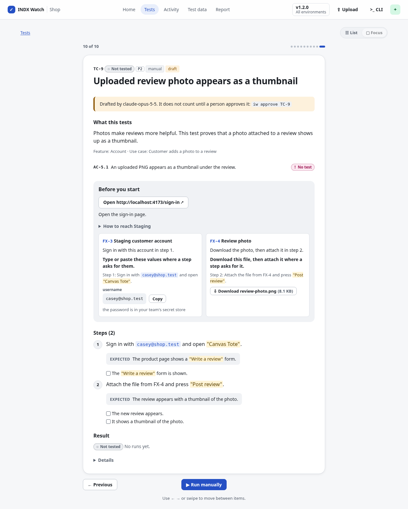

# Writing good test cases

INDX Watch can only tell you a release is done if the definitions say clearly what "done" means. This guide shows how to write use cases, acceptance criteria and test cases that anyone — a new tester, a customer, Playwright or an agent — can execute the same way. Field-level rules live in the [bundle format](../spec/bundle-format.md); the meaning of each entity in [concepts](../spec/concepts.md). All examples are from [`examples/shop`](../../examples/shop/.indx-watch). With Claude Code or Codex, `/iw-design` writes test cases that follow this guide and explains each one before it writes it ([testing with agents](testing-with-agents.md#design-tests-iw-design)).

## Start from the use case

A use case names **who** wants to achieve **what**, and why it matters (its priority):

```toml
key = "UC-2"
title = "Guest applies a coupon at checkout"
actor = "Guest shopper"
goal = "Pay a discounted price for the items in the cart."
priority = "P0"
```

Keep use cases at the level of a user goal, not a screen or a button. "Guest places an order" is a use case; "Cart page" is not.

## Acceptance criteria: observable and binary

An acceptance criterion (AC) is one statement that is either true or false when you look at the app. A use case is done when every ready AC is covered by ready test cases whose latest result passes.

| Good                                                                               | Why                                                |
| ---------------------------------------------------------------------------------- | -------------------------------------------------- |
| `A valid coupon reduces the order total by its discount.`                          | One outcome, checkable on the screen               |
| `An expired coupon shows "This coupon has expired" and the total does not change.` | Names the exact message and what must _not_ happen |
| `After the order is placed, the cart is empty.`                                    | Clear before/after                                 |

| Avoid                                                       | Problem                                        |
| ----------------------------------------------------------- | ---------------------------------------------- |
| `Coupons work correctly.`                                   | Not binary: nobody can say when it is false    |
| `The coupon API returns 200 and updates state.`             | Describes implementation, not what a user sees |
| `Valid and expired coupons are handled and the UI is fast.` | Three criteria in one; split them              |

Write the negative paths too (expired, wrong password, empty cart, no permission): `UC-4` has `AC-4.1` for valid credentials and `AC-4.2` for a wrong password.

Add a criterion with `iw new ac --uc UC-2 --text "…"`. Criteria are never deleted: set `status = "retired"` so the key stays reserved. Rewording a criterion makes earlier results of the test cases that cover it [stale](../spec/concepts.md#versions-and-staleness), so reword only when the meaning changes.

## Steps: one action, one observable result

```toml
[[steps]]
instruction = "Open the cart and enter {{FX-1.code}} in the coupon field, then press \"Apply\"."
expected = "The discount line shows \"-4.00\" and the total is \"36.00\"."
checks = ["The discount line shows \"-4.00\".", "The total is \"36.00\"."]
evidence = ["screenshot"]
```

- **`instruction`** is what to do, in plain language. No CSS selectors, no code, no "verify that…".
- **`expected`** is what must be visible afterwards. If a tester cannot decide pass or fail by looking, rewrite it.
- **`checks`** split `expected` into yes/no observations, one per thing to look at ([guidance](#guidance-purpose-start-checks-and-test-data)).
- **`evidence`** asks for proof at that step: `screenshot`, `video`, `trace`, `log` or `file`. Ask for a screenshot on every step that proves an AC.
- **`preconditions`** describe the starting state once ("The cart contains one \"Canvas Tote\" (price 40.00)."), so steps do not repeat it.
- Keep a test case short (2–6 steps) and focused on the ACs it lists in `covers`. Write another test case rather than a long one.

## Guidance: purpose, start, checks and test data

A person who has never seen the app should be able to run a test case from its page alone, without asking what it is for, where to begin or what to do with a file. Four optional fields give them that. They do not change the test case version, so adding them later keeps existing results current, and `iw check` warns (`missing-guidance`) when a `ready` manual or hybrid test case has no `purpose` or no start ([field rules](../spec/bundle-format.md#specsfeatuctc-n-slugtoml)).

```toml
key = "TC-3"
title = "Valid coupon reduces the total"
purpose = "Coupons let shoppers pay less. This test proves that a valid code lowers the cart total by its discount."
start = "/cart"
start_note = "Open the cart."
preconditions = "The cart contains one \"Canvas Tote\" (price 40.00)."

[[fixtures]]
ref = "FX-1"
rows = ["SUMMER10"]
use = "enter"
note = "Type this code in the coupon field in step 1."
```

| Field | Write | Shop example |
|---|---|---|
| `purpose` | Two sentences for a newcomer: why the feature matters, then what this test proves. No jargon, no step details. | TC-6: "Many shoppers order from a phone. This test proves that the order confirmation is readable on a small screen." |
| `start` | The path where the tester begins, appended to the environment's `base_url`; the page shows it as an Open link. | `"/cart"` → http://localhost:4173/cart on `staging` |
| `start_note` | One sentence about the starting point, especially when a path is not enough. | TC-6: "Open the shop on a phone or in a 390 px wide browser window." |
| step `checks` | Yes/no observations that together make up `expected`, one per thing to look at; quote on-screen text exactly. The runner shows them as checkboxes, and an agent asks them as questions. | TC-6: "The page fits the screen without scrolling sideways.", "The whole order number is visible." |
| fixture `use` | What the tester does with the data: `enter` (type or paste it), `download` (save the file), `upload` (save it, then attach it in a step) or `seeded` (already in the app; nothing to do). | TC-3: FX-1 `enter`, FX-2 `seeded`; TC-9: FX-3 `enter`, FX-4 `upload` |
| fixture `note` | One sentence naming the step that uses it. | TC-9: "Download the photo, then attach it in step 2." |

Translate them like the other fields (`purpose`, `start_note` in `[i18n.ja]`, `checks` in `[steps.i18n.ja]`, `note` in `[fixtures.i18n.ja]`); a translated `checks` list keeps one item per source check.

The web app turns these fields into the one-page test case: *What this tests* (purpose, feature, covered criteria), *Before you start* (the Open link, a card per fixture with what to do and a download button for files, preconditions as a checklist), *Steps* with their checks, and *Result*:



## Literal strings

Text in double quotes — `"Apply"`, `"This coupon has expired"` — is the **exact on-screen text** of the app. Copy it from the app or its code, keep capitalization and punctuation, and never paraphrase it. Translations keep literals untouched, and `iw check` warns when a translation drops one ([i18n](../spec/i18n.md#literal-strings)). This is what lets a Japanese-speaking tester read `TC-4` in Japanese and still look for 「This coupon has expired」:

```toml
[steps.i18n.ja]
instruction = "カートを開き、クーポン欄に {{FX-1.code}} を入力して「Apply」を押す。"
expected = "「This coupon has expired」と表示され、合計は「40.00」のまま。"
```

## Data comes from fixtures

Do not hard-code test data or credentials in steps. Reference a [fixture](fixtures.md) and use placeholders:

- `{{FX-1.code}}` — column `code` of the selected row of dataset `FX-1` (rows are chosen with `rows = ["SUMMER10"]`)
- `{{FX-3.username}}` — a field of account `FX-3`; the password is never written, steps say "the account password"
- `{{env.base_url}}` — a field of the environment the run uses

Say on each fixture reference what the tester does with it (`use`, `note`; see [guidance](#guidance-purpose-start-checks-and-test-data)).

## Modes and judges

| Mode         | When                                                                                                                      | Default judge    |
| ------------ | ------------------------------------------------------------------------------------------------------------------------- | ---------------- |
| `manual`     | A person follows the steps in the browser runner (or records with `iw record`)                                            | `human`          |
| `playwright` | A Playwright test tagged `@TC-n` implements it; list the file in `[automation] files` ([Playwright guide](playwright.md)) | `assert`         |
| `agent`      | An LLM browser agent follows the plain-language steps (`iw run`)                                                          | `assert` + `llm` |
| `hybrid`     | An agent or script executes, a person confirms; always ends in `needs_review` until a human judges                        | any + `human`    |

Write the steps of a `playwright` test case as carefully as a manual one: they are the specification the test implements, and step results map by number when the test uses `test.step('1. …')`.

## Priorities

| Priority    | Use for                                         | Gate                                               |
| ----------- | ----------------------------------------------- | -------------------------------------------------- |
| `P0`        | Release blockers: money, sign-in, personal data | Every P0 test case must pass; P0 ACs fully covered |
| `P1`        | Main paths                                      | ≥ 95% pass; failures need a waiver                 |
| `P2` / `P3` | Normal features / cosmetic                      | Reported, not gated                                |

Set the priority on the use case. A test case inherits the highest priority of the use cases it covers and may not set a lower one, so a P0 criterion can never be "passed" by a P3 test case. Thresholds: [readiness gate](../spec/concepts.md#readiness-gate).

## Drafts, AI and approval

Every new item starts as `draft` unless a human creates it with `--ready`. Drafts can be run and planned, but they do not count towards coverage or readiness.

Coding agents with the [shipped skills](../../skills/README.md) (`/iw-design` in Claude Code, `$iw-design` in Codex) write drafts with `origin = "ai"` and an `[ai]` table naming the model — `TC-9` in the shop is one:

```toml
key = "TC-9"
title = "Uploaded review photo appears as a thumbnail"
status = "draft"
origin = "ai"
# …
[ai]
model = "claude-opus-5-5"
skill = "write-test-cases"
created_at = 2026-11-19T03:00:00Z
```

Review a draft like a pull request: are the ACs right, are the literal strings exact, would a new tester know what to do? Then approve it:

```bash
iw approve TC-9
```

This sets `status = "ready"`, `approved_by` (your identity) and `approved_version`. If anyone later edits an approved AI-written test case, `iw check` fails until a human approves it again. Agents cannot approve, review or waive.

## Keys, files and tags

- `iw new` assigns the next free key (`TC-11`) and a machine ID. Never renumber or reuse keys by hand; deprecate items instead of deleting them (`status = "deprecated"`).
- File names are `{KEY}-{slug}`; the slug is cosmetic and `iw fmt` regenerates it from the title. Moving a file never changes its identity.
- Two branches can create the same key. `iw check` reports it and `iw check --fix` renumbers the newer item, including the `@TC-n` tags in its `[automation] files`.
- `tags` (`["coupon", "smoke"]`) are lowercase labels for filtering (`iw list tcs --tag smoke`). They are separate from Playwright tags such as `@TC-3`.
- Repeated boilerplate goes into a template: `iw new tc --uc UC-2 --title "…" --template web` merges `templates/test-case.web.toml`.

## Before you commit

```bash
iw fmt     # canonical formatting
iw check   # schemas, references, keys, priorities, secret scan
```

Then open a pull request. Test cases are reviewed next to the code they test.
