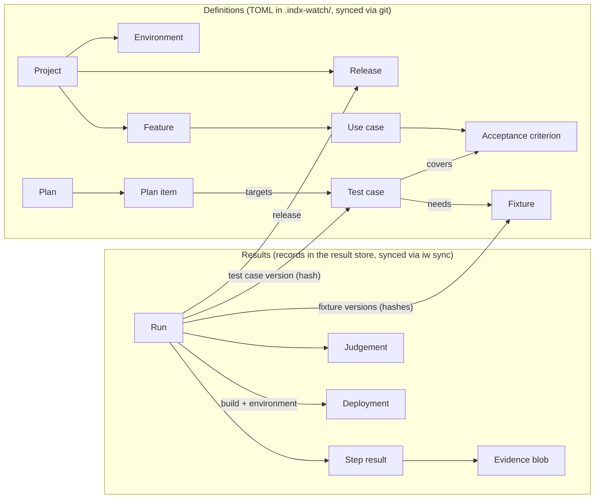
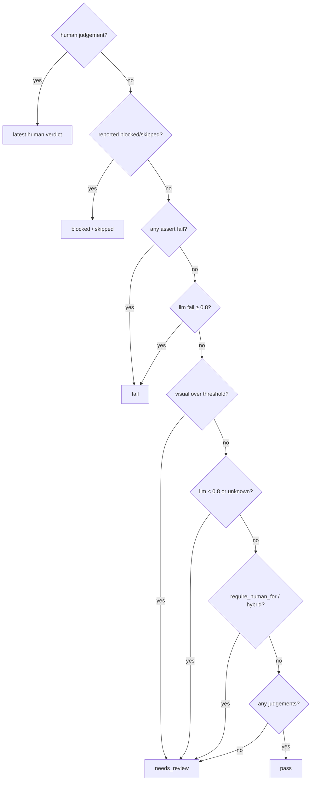
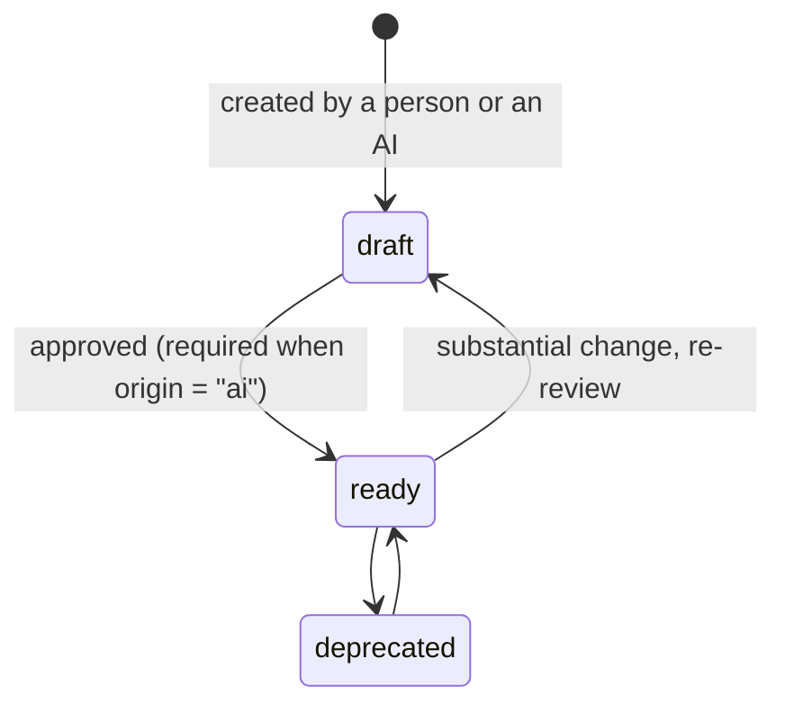

# Concepts

This page defines the domain model: every entity, ID, state, and the rules that compute "done" and release readiness. The file layout lives in [bundle-format.md](bundle-format.md); result records live in [sync.md](sync.md). All examples use the canonical sample project [`examples/shop`](../../examples/shop).

## Overview

Definitions say **what done means**. Results say **what actually happened**, with evidence. Core logic joins them to compute coverage, status and readiness.

## Glossary

| Term | File / record | Human key | Definition |
|---|---|---|---|
| Project | `project.toml` | `SHOP` | One product, usually one repository. Holds the readiness gate, defaults and store/hosting config. Key: 2–10 uppercase letters/digits. |
| Environment | `environments/<name>.toml` | `staging` | Where tests run: base URL, how to get in (secret *references* only), reset/seed hooks, a human entry guide. |
| Release | `releases/<version>.toml` | `v1.2.0` | A version under test. Runs are attributed to a release. |
| Build | (in run records) | `a1b2c3d` | A commit SHA, plus optional ref and CI build URL. |
| Deployment | `deployment` record | `staging@a1b2c3d` | A build on an environment at a time. Posted by CI or the GitHub Action. |
| Feature | `specs/<FEAT>/feature.toml` | `FEAT-1` | A group of use cases (e.g. "Cart & checkout"). |
| Use case | `specs/<FEAT>/<UC>/use-case.toml` | `UC-12` | Who wants to achieve what. Has an actor, a goal, a priority. |
| Acceptance criterion (AC) | inside the use case file | `AC-12.2` | An observable, binary statement that must hold for the use case to be done. Numbered within its use case. |
| Test case (TC) | `specs/<FEAT>/<UC>/TC-<n>-<slug>.toml` | `TC-128` | Steps with expected results that verify one or more ACs. Has a mode, fixtures, judges and a decision policy. |
| Test case version | computed | `tcv:3f9a1c2b7e10` | Content hash of the parts of a test case that change what is tested. |
| Fixture | `fixtures/<FX>/fixture.toml` + data | `FX-3` | Test data. Kinds: `dataset`, `seed`, `file`, `account`. |
| Fixture version | computed | `fxv:91be03d2a4c8` | Content hash of the fixture definition plus its data. |
| Plan | `plans/<PLAN>.toml` | `PLAN-2` | Which test cases, on which environment, by whom, by when — usually for one release. |
| Plan item | inside the plan file | — | One assignment: test case × environment × assignee × due date. |
| Run | `run` record | `RUN-01JF…` | One execution of one test case version against one build and environment. |
| Step result | inside the run | — | Result, note and evidence for one step. |
| Evidence | blob | `sha256:…` | Screenshot, trace, video, log or file. Stored content-addressed. |
| Judgement | inside the run, or a `judgement` record | — | One judge's conclusion: `assert`, `visual`, `llm` or `human`, with reason and confidence. |
| Verdict | computed | `pass` | The final result of a run, computed by the decision policy from its judgements. |
| Waiver | `waiver` record | — | A human decision to accept a known failure of a P1–P3 test case for a release, with a reason. |
| Report | rendered file | — | A snapshot for a release or plan: readiness, coverage, failures, evidence. See [reports.md](reports.md). |

## IDs

Every entity has two identifiers.

| | Machine ID | Human key |
|---|---|---|
| Form | `{prefix}_{ULID}`, e.g. `tc_01JF3Q8M5X2V7K9D4R6T1W0Y3Z` | `TC-128`, `AC-12.2`, `FX-3` |
| Purpose | Identity. Never changes. References in result records use it. | Conversation, file names, Playwright tags, reports. |
| Created | Offline, by whoever creates the file. ULIDs do not collide. | By `iw new`: next free number in the bundle. |

Prefixes: `prj env rel fea uc ac tc fx pln run jdg dep wvr rec`.

**Key rules**

- Keys are unique per kind within a project and never reused, even after deprecation.
- `AC-{uc}.{n}` is numbered within its use case.
- Two branches can create the same key (`TC-129`) concurrently. `iw check` reports the duplicate; `iw check --fix` renumbers the file whose ID sorts later (the newer one) and rewrites references inside the bundle. Results are unaffected because they reference machine IDs. See [ADR 0005](../adr/0005-ids-and-keys.md).
- Cross-project references use `SHOP:TC-128`.

## Priorities

| Priority | Meaning | Default gate treatment |
|---|---|---|
| `P0` | Release blocker: money, login, personal data | 100% AC coverage; every P0 test case passes |
| `P1` | Main paths | Pass rate ≥ 95%; failures need a waiver |
| `P2` | Normal features with workarounds | Reported, not gated |
| `P3` | Cosmetic | Reported, not gated |

A test case inherits the highest priority of the use cases it covers unless it sets its own.

## Modes, judges and verdicts

**Mode** (per test case) — how it is executed:

| Mode | Who executes | Typical judges |
|---|---|---|
| `manual` | A person follows the steps in the browser runner or CLI | `human` |
| `playwright` | A Playwright test tagged `@TC-128` | `assert` (+ `visual`) |
| `agent` | An LLM browser agent follows the plain-language steps (v0.2) | `assert` + `llm` |
| `hybrid` | An agent or script executes, a person confirms | any + `human` |

**Judges** — who or what decides:

| Judge | Output |
|---|---|
| `assert` | Deterministic check (Playwright assertion, URL, text, HTTP). `pass`/`fail`. |
| `visual` | Pixel diff against an approved baseline. `pass` or `diff` with a ratio. |
| `llm` | Rubric-based model judgement with `confidence` 0–1 and a reason. |
| `human` | A person's verdict with a mandatory reason. |

**Verdicts**: `pass`, `fail`, `blocked` (could not execute: environment down, missing data, an earlier bug), `skipped` (out of scope this time; reason required), `needs_review` (a human must decide).

### Decision policy {#decision-policy}

One pure function, `decide(judgements, policy, priority)` in `packages/core`, turns judgements into a verdict. Rules are evaluated top to bottom; the first match wins.

| # | Condition | Verdict |
|---|---|---|
| 1 | A `human` judgement exists | the latest human judgement |
| 2 | The run reported `blocked` or `skipped` (setup failure, missing precondition) | that verdict |
| 3 | Any `assert` judgement is `fail` | `fail` |
| 4 | Any `llm` judgement is `fail` with confidence ≥ `policy.llm_fail_confidence` (default 0.8) | `fail` |
| 5 | Any `visual` judgement exceeds `policy.visual_threshold` | `needs_review` |
| 6 | Any `llm` judgement has confidence < `policy.llm_pass_confidence` (default 0.8) or is `unknown` | `needs_review` |
| 7 | The test case priority is in `policy.require_human_for`, or mode is `hybrid` | `needs_review` |
| 8 | At least one judgement and all are `pass` | `pass` |
| 9 | No judgements | `needs_review` |

A human review never edits a run. It appends a `judgement` record; the verdict is recomputed. History stays as a list of judgements.

## States

### Test case and use case

- `draft` test cases can be run and planned but **do not count** towards coverage or readiness.
- A file with `origin = "ai"` can only become `ready` if it records `approved_by` (a human identity). `iw check` enforces this.

### Run

A run record is written once, when execution ends. Live progress (a manual run in the browser, a Playwright test in flight) is client state, not a record. A run's verdict can still change later through appended judgements.

### Plan item (computed)

| Status | Rule |
|---|---|
| `todo` | No relevant run yet |
| `done` | Latest relevant run has verdict `pass`, `fail` or `skipped` |
| `blocked` | Latest relevant run is `blocked` |
| `review` | Latest relevant run is `needs_review` |

### Release

`planning` → `testing` → `ready` → `released`, set in `releases/<version>.toml` by a person. The **gate** (below) tells them whether `ready` is justified; it never sets the state itself.

## Versions and staleness

- **Test case version** = `tcv:` + the first 12 hex chars of SHA-256 over the canonical TOML of these fields: `covers`, `preconditions`, `steps`, `fixtures`, `judges`, `decision_policy`, `mode`. Title, tags, priority, status, translations and owner changes do **not** create a new version.
- **Fixture version** = `fxv:` + 12 hex of SHA-256 over the canonical fixture definition (excluding title and translations) and the SHA-256 of each data file or pointer.
- A run records the test case version and the version of every fixture it used.
- A result is **stale** when its test case version differs from the current one, or any fixture version it used differs from the current version of that fixture.
- Git history is the version history of definitions. `iw show TC-128 --versions` lists versions by walking `git log` of the file.

## Computed done {#computed-done}

"Done" is evaluated for a **scope** = (release, environment?). If no environment is given, runs from any environment count.

1. **Relevant runs** for a test case: runs with `release` = the scope's release (and `environment` if set).
2. **Latest relevant result**: the relevant run with the latest `ended_at`; its verdict is computed by the decision policy including later judgements. If it is stale, the result is `stale`.
3. **Waivers**: a `fail` with a valid waiver for this release counts as `waived`.

**Acceptance criterion status** — the worst of the statuses of its `ready` test cases, in this order:

`uncovered` (no `ready` test case covers it) > `fail` > `needs_review` > `stale` > `untested` (no run, or `blocked`) > `waived` > `pass`

`skipped` results are ignored; if all are skipped, the AC is `untested`.

**Use case status** = the worst AC status. A use case is **done** when every AC is `pass` or `waived` and every passing result has at least one evidence item or an `assert` judgement.

**Coverage** = ACs with ≥ 1 `ready` test case ÷ all ACs of `ready` use cases.

## Readiness gate {#readiness-gate}

`evaluateGate(model, scope, gate)` in `packages/core` is the one pure function that answers "can we ship?". It returns every check with its actual value and whether it passed. Thresholds live in `project.toml` `[gate]`:

| Key | Default | Check |
|---|---|---|
| `p0_coverage` | `1.0` | Coverage of ACs of P0 use cases |
| `p0_all_pass` | `true` | Every `ready` P0 test case's latest result is `pass` |
| `p1_pass_rate` | `0.95` | `pass + waived` ÷ all `ready` P1 test cases |
| `max_needs_review` | `0` | Latest results in `needs_review` (P0–P1) |
| `max_untested` | `0` | `ready` P0–P1 test cases without a relevant run |
| `allow_stale` | `false` | Whether stale latest results count as their verdict |
| `require_evidence` | `true` | Passing P0 results must carry evidence or an `assert` judgement |

The gate passes only when every check passes. `iw status --release v1.2.0 --gate` exits non-zero when it does not, so CI can block a release.

## Fixture kinds

| Kind | Content | Used for | Example in `examples/shop` |
|---|---|---|---|
| `dataset` | CSV or JSON rows | Values in steps (`{{FX-1.code}}`); data-driven runs, one per row | `FX-1` coupon codes |
| `seed` | JSON payload | Sent to an environment's seed hook to reset state before a run | `FX-2` catalog seed |
| `file` | Any file (image, PDF) | Upload steps | `FX-3` product photo |
| `account` | Public fields + secret references | Logging in | `FX-4` staging customer |

Small data files live in git next to `fixture.toml`. Files over `fixtures.inline_max_bytes` (default 1 MiB) become `*.blob.toml` pointers to the result store's blob area. See [bundle-format.md](bundle-format.md#fixtures).

## Invariants

These are enforced by `iw check` and unit tests:

1. A run references exactly one test case ID, one test case version and one build.
2. A `human` judgement has a non-empty reason.
3. A definition with `origin = "ai"` is never `ready` without `approved_by`.
4. Keys are unique per kind and never reused (`iw check` compares against the result store's known keys when available).
5. No secret values appear in the bundle.
6. Every `covers` entry resolves to an existing AC; every fixture reference resolves to an existing fixture.

## Acceptance criteria

- [ ] `decide()` has a unit test per decision-policy row, including rule order conflicts (human beats assert fail; assert fail beats llm pass).
- [ ] `evaluateGate()` on `examples/shop` with its sample results returns the documented values in [reports.md](reports.md#example).
- [ ] Changing only the title of a test case keeps its version hash; changing a step changes it and makes earlier results `stale`.
- [ ] `iw check` fails on an `origin = "ai"` test case marked `ready` without `approved_by`.
- [ ] `iw check --fix` resolves a duplicate `TC-` key by renumbering the newer file and updating references.
