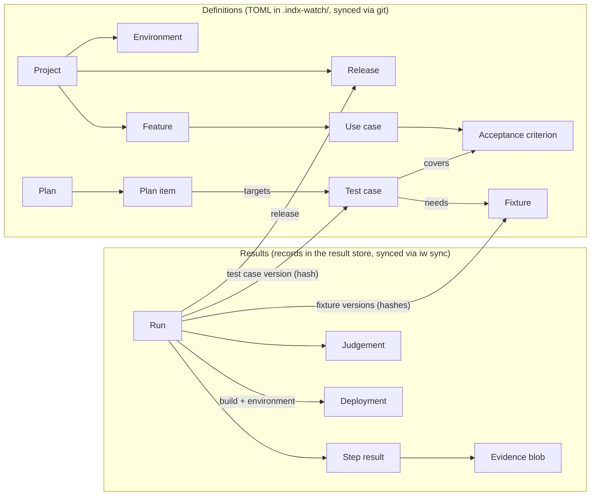
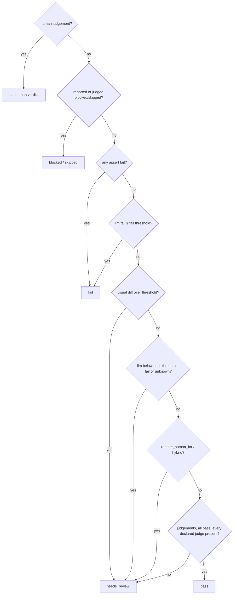

# Concepts

This page defines the domain model: every entity, ID, state, and the rules that compute "done" and release readiness. The file layout lives in [bundle-format.md](bundle-format.md); result records live in [sync.md](sync.md). All examples use the canonical sample project [`examples/shop`](../../examples/shop).

## Overview



Definitions say **what done means**. Results say **what actually happened**, with evidence. Core logic joins them to compute coverage, status and readiness.

## Glossary

| Term | File / record | Human key | Definition |
|---|---|---|---|
| Project | `project.toml` | `SHOP` | One product, usually one repository. Holds the readiness gate, defaults and store/hosting config. Key: 2–10 uppercase letters/digits. |
| Environment | `environments/<name>.toml` | `staging` | Where tests run: base URL, how to get in (secret *references* only), reset/seed hooks, a human entry guide. |
| Release | `releases/<version>.toml` | `v1.2.0` | A version under test. Runs are attributed to a release. |
| Build | (in run records) | `a1b2c3d` | A commit SHA, plus optional ref and CI build URL. |
| Deployment | `deployment` record | `staging@a1b2c3d` | A build on an environment at a time. Posted by CI or the GitHub Action. |
| Feature | `specs/<FEAT>/feature.toml` | `FEAT-1` | A group of use cases (e.g. "Cart & checkout"). |
| Use case | `specs/<FEAT>/<UC>/use-case.toml` | `UC-12` | Who wants to achieve what. Has an actor, a goal, a priority. |
| Acceptance criterion (AC) | inside the use case file | `AC-12.2` | An observable, binary statement that must hold for the use case to be done. Numbered within its use case. |
| Test case (TC) | `specs/<FEAT>/<UC>/TC-<n>-<slug>.toml` | `TC-128` | Steps with expected results that verify one or more ACs. Has a mode, fixtures, judges and a decision policy. |
| Test case version | computed | `tcv:3f9a1c2b7e10` | Content hash of the parts of a test case that change what is tested. |
| Fixture | `fixtures/<FX>/fixture.toml` + data | `FX-3` | Test data. Kinds: `dataset`, `seed`, `file`, `account`. |
| Fixture version | computed | `fxv:91be03d2a4c8` | Content hash of the fixture definition plus its data. |
| Plan | `plans/<PLAN>.toml` | `PLAN-2` | Which test cases, on which environment, by whom, by when — usually for one release. |
| Plan item | inside the plan file | — | One assignment: test case × environment × assignee × due date. |
| Run | `run` record | `run_01JF…` | One execution of one test case version against one build and environment. |
| Step result | inside the run | — | Result, note and evidence for one step. |
| Evidence | blob | `sha256:…` | Screenshot, trace, video, log or file. Stored content-addressed. |
| Judgement | inside the run, or a `judgement` record | — | One judge's conclusion: `assert`, `visual`, `llm` or `human`, with reason and confidence. |
| Verdict | computed | `pass` | The final result of a run, computed by the decision policy from its judgements. |
| Waiver | `waiver` record | — | A human decision to accept a known failure of a P1–P3 test case for a release, with a reason. |
| Report | rendered file | — | A snapshot for a release or plan: readiness, coverage, failures, evidence. See [reports.md](reports.md). |

## IDs

Every entity has two identifiers.

| | Machine ID | Human key |
|---|---|---|
| Form | `{prefix}_{ULID}`, e.g. `tc_01JF3Q8M5X2V7K9D4R6T1W0Y3Z` | `TC-128`, `AC-12.2`, `FX-3` |
| Purpose | Identity. Never changes. References in result records use it. | Conversation, file names, Playwright tags, reports. |
| Created | Offline, by whoever creates the file. ULIDs do not collide. | By `iw new`: next free number in the bundle. |

Prefixes: `prj env rel fea uc ac tc fx pln run jdg dep wvr rec`. Runs have no human key; commands accept a run ID or any unique prefix of at least 8 characters after `run_`.

**Key rules**

- Keys are unique per kind within a project. Items are deprecated rather than deleted, so their keys stay reserved; `iw new` also skips keys that appear in results.
- `AC-{uc}.{n}` is numbered within its use case.
- Two branches can create the same key (`TC-10`) concurrently. `iw check` reports the duplicate; `iw check --fix` renumbers the item that is not on the default branch (by git; otherwise the one whose ID sorts later), rewrites references inside the bundle and the `@TC-n` tags in that test case's `[automation].files`. Results are unaffected because they reference machine IDs. See [ADR 0005](../adr/0005-ids-and-keys.md).
- Cross-project references use `SHOP:TC-128`.

## Priorities

| Priority | Meaning | Default gate treatment |
|---|---|---|
| `P0` | Release blocker: money, login, personal data | 100% AC coverage; every P0 test case passes |
| `P1` | Main paths | Pass rate ≥ 95%; failures need a waiver |
| `P2` | Normal features with workarounds | Reported, not gated |
| `P3` | Cosmetic | Reported, not gated |

A test case inherits the highest priority of the use cases it covers unless it sets its own.

## Modes, judges and verdicts

**Mode** (per test case) — how it is executed:

| Mode | Who executes | Typical judges |
|---|---|---|
| `manual` | A person follows the steps in the browser runner or CLI | `human` |
| `playwright` | A Playwright test tagged `@TC-128` | `assert` (+ `visual`) |
| `agent` | An LLM browser agent follows the plain-language steps (v0.2) | `assert` + `llm` |
| `hybrid` | An agent or script executes, a person confirms | any + `human` |

**Judges** — who or what decides:

| Judge | Output |
|---|---|
| `assert` | Deterministic check (Playwright assertion, URL, text, HTTP). `pass`/`fail`. |
| `visual` | Pixel diff against an approved baseline. `pass` or `diff` with a ratio. |
| `llm` | Rubric-based model judgement with `confidence` 0–1 and a reason. |
| `human` | A person's verdict with a mandatory reason. |

**Verdicts**: `pass`, `fail`, `blocked` (could not execute: environment down, missing data, an earlier bug), `skipped` (out of scope this time; reason required), `needs_review` (a human must decide).

### Decision policy

One pure function, `decide(judgements, policy, { priority, mode, reported, judges })` in `packages/core`, turns a run's judgements into a verdict ([ADR 0013](../adr/0013-decision-policy.md)). `policy` is the test case's `[decision_policy]` merged over the project's, merged over the defaults. Rules are evaluated top to bottom; the first match wins.

| # | Condition | Verdict |
|---|---|---|
| 1 | A `human` judgement exists | the verdict of the last human judgement (in judgement order, below) |
| 2 | The run's `reported` is `blocked` or `skipped`, or any non-human judgement has verdict `blocked`/`skipped` | `blocked` (or `skipped` if nothing says `blocked`) |
| 3 | Any `assert` judgement is `fail` | `fail` |
| 4 | Any `llm` judgement is `fail` with confidence ≥ `llm_fail_confidence` (default 0.8) | `fail` |
| 5 | Any `visual` judgement has verdict `diff` or `fail` and (`diff_ratio` missing or `diff_ratio` > `visual_threshold`) | `needs_review` |
| 6 | Any `llm` judgement has confidence < `llm_pass_confidence` (default 0.8), or verdict `fail` or `unknown` | `needs_review` |
| 7 | The test case priority is in `require_human_for`, or the mode is `hybrid` | `needs_review` |
| 8 | At least one judgement, every judgement is `pass` (a `visual` `diff` within the threshold counts as `pass`), and every judge kind the test case declares in `judges` has at least one judgement | `pass` |
| 9 | No judgements | `needs_review` |
| 10 | Anything else (e.g. an `assert` with verdict `unknown`, or a declared judge kind with no judgement yet) | `needs_review` |

- A missing `llm` confidence counts as 0.
- Declared judges matter: an agent's confident `llm` pass on a test case whose `judges` is `[{ kind = "human" }]` is `needs_review` (rule 10) until a person reviews it, whatever the priority. `judges` is the test case's own list; `decide` gets its kinds as `judges`.
- **Judgement order**: by `at` as an instant (so `…:00Z` and `…:00.100Z` compare correctly), then `id`. `buildModel` fills a judgement's `at`/`by` from its enclosing record when absent (a run's inline judgements get `ended_at` and the run's actor).
- A `human` judgement's verdict is one of `pass`, `fail`, `blocked`, `skipped`. A reason is required for `fail`, `blocked` and `skipped`, and for every `judgement` record (a review).
- `decide` returns the verdict, the rule number and a reason; `iw show <run> --json` prints them.



A human review never edits a run. It appends a `judgement` record; the verdict is recomputed. History stays as a list of judgements.

## States

### Test case, use case, fixture

```mermaid
stateDiagram-v2
  [*] --> draft: created (iw new; AI-written items always start here)
  draft --> ready: iw approve (or iw new --ready, humans only)
  ready --> draft: substantial change, re-review
  ready --> deprecated
  deprecated --> ready
```

- `draft` items can be run and planned but **do not count** towards coverage or readiness.
- `iw approve <ref>` sets `status = "ready"`, `approved_by` (from the [identity](security.md#identity) of whoever runs it — never a flag) and `approved_version` (the current version hash). Agents cannot approve.
- An `origin = "ai"` item is only valid as `ready` while `approved_version` equals its current version. Editing an approved AI-written test case therefore fails `iw check` until a human approves it again.
- Items are **deprecated, not deleted**, so their keys stay reserved. Acceptance criteria have their own `status`: `draft`, `ready` (default) or `retired`.
- An `origin = "ai"` acceptance criterion counts as `ready` only with `approved_by`; `iw approve AC-n.m` writes it (criteria have no version of their own: rewording one changes the versions of the test cases that cover it).

### Run

A run record is written once, when execution ends. Live progress (a manual run in the browser, a Playwright test in flight) is client state, not a record. A run's verdict can still change later through appended judgements. A `retraction` record hides a run that was recorded by mistake (wrong release or test case); nothing is deleted.

### Plan item (computed)

A plan item's scope is (`plan.release`, `item.environment` ?? `plan.environment`). Its status comes from the test case's [result](#computed-done) in that scope:

| Status | Rule |
|---|---|
| `todo` | No result yet |
| `done` | Result is `pass`, `fail`, `waived` or `skipped` |
| `blocked` | Result is `blocked` |
| `review` | Result is `needs_review` or `stale` |

A test case may appear in a plan more than once only with different environments (`iw check`).

### Release

`planning` → `testing` → `ready` → `released`, set in `releases/<version>.toml` by a person. The [gate](#readiness-gate) tells them whether `ready` is justified; it never sets the state itself.

## Versions and staleness

- **Test case version** = `tcv:` + the first 12 hex characters of SHA-256 over the canonical TOML body (no header) of a table with, in this order: `covers`, `criteria` (the text of each covered criterion, in `covers` order), `mode`, `preconditions`, `fixtures`, `steps` (without their `i18n` tables), `judges`, `decision_policy`. Absent fields are omitted. Rewording a covered acceptance criterion therefore makes earlier results stale; title, tags, priority, status, notes and translations do not.
- **Fixture version** = `fxv:` + 12 hex of SHA-256 over: the canonical TOML body of the fixture without `title`, `status`, `origin`, `approved_by`, `approved_version`, `tags`, `notes`, `ai`, `x`, `i18n`; a newline; then one line per data file, sorted by name: `<name> <sha256 of the content>` (for a pointer, its `sha256`). Text data files (`.csv`, `.json`, `.txt`, `.md`, `.toml`, `.yaml`, …) are hashed with CRLF read as LF, so a Windows checkout gives the same version.
- A run records the test case version and the version of every fixture it used.
- A result is **stale** when its test case version differs from the current one, or any fixture version it used differs from the current version of that fixture.
- Git history is the version history of definitions. `iw show TC-3 --versions` lists versions by walking `git log` of the file.

## Computed done

"Done" is evaluated for a **scope** = (release, environment?). If no environment is given, runs from any environment count. If the release names a `plan`, only test cases in that plan count towards the gate.

1. **Relevant runs** of a test case: runs with `release` = the scope's release (and `environment`, if set) that are not retracted.
2. **Variants.** A test case can legitimately produce several runs per execution: one per Playwright project (chromium, webkit) and one per dataset row. A run's variant = `automation.project` + its sorted fixture `rows`. Runs with the same `automation.group` and variant form one **execution** (e.g. shards); its verdict is the worst of its runs.
3. **Latest result per variant**: the execution with the latest `ended_at`, compared as instants (ties: greatest run ID). Its verdict comes from the decision policy, including later judgements. If any of its runs is stale, the result is `stale`.
4. **Test case result** = the worst latest result over all variants seen in scope.
5. **Waivers**: a `fail` result is `waived` if the latest non-revoked waiver for (release, test case ID) has a `version` equal to the result's test case version. Waivers are rejected for test cases whose effective priority is P0. A waiver for another version is not applied, and reports list only applied waivers.

**Statuses, from worst to best:**

`uncovered` > `fail` > `needs_review` > `stale` > `blocked` > `untested` > `waived` > `pass`

`untested` means no relevant run. `skipped` results are ignored for ACs; if every result is skipped, the AC is `untested`.

**Acceptance criterion status** = the worst status of its `ready` test cases; `uncovered` if it has none. Draft and retired ACs are ignored.

**Use case status** = the worst AC status. A use case is **done** when every AC is `pass` or `waived` and, if the gate's `require_evidence` is on, every passing result has at least one evidence item or an `assert` judgement.

**Coverage** = ready ACs with ≥ 1 `ready` test case ÷ ready ACs of `ready` use cases.

**Counts** (`iw status` `counts`, the report's counts by priority) count `ready` test cases only, like the gate. Draft test cases are still listed with their result.

**Effective priority** of a test case = its own `priority`, or the highest priority of the use cases it covers. A test case may not set a priority lower than that (`iw check` error), so a P0 use case can never be passed through a P3 test case.

## Readiness gate

`evaluateGate(model, scope)` in `packages/core` is the one pure function that answers "can we ship?". Thresholds come from `project.toml` `[gate]` merged over these defaults:

| Key | Default | Check | `actual` / `expected` format |
|---|---|---|---|
| `has_gated_tests` | always on | The scope has at least one `ready` P0 or P1 test case (in the release's plan, when it names one) | `"8"` / `"≥ 1"` |
| `p0_coverage` | `1.0` | Coverage of ACs of P0 use cases | `"9/9"` / `"≥ 1.00"` |
| `p0_all_pass` | `true` | Every in-scope `ready` P0 test case's result is `pass` | `"3/4"` / `"4/4"` |
| `p1_pass_rate` | `0.95` | (`pass` + `waived`) ÷ in-scope `ready` P1 test cases | `"19/20 (0.95)"` / `"≥ 0.95"` |
| `max_needs_review` | `0` | P0–P1 results in `needs_review` | `"1"` / `"≤ 0"` |
| `max_untested` | `0` | In-scope `ready` P0–P1 test cases that are `untested` or `blocked` | `"2"` / `"≤ 0"` |
| `allow_stale` | `false` | Whether a stale result counts as its underlying verdict; when `false`, stale P0–P1 results fail this check | `"0"` / `"≤ 0"` |
| `require_evidence` | `true` | Passing P0 results carry evidence or an `assert` judgement | `"4/4"` / `"4/4"` |

- `ignore_unverified` (default `false`, *v0.2*) is not a check: when `true`, every check is computed as if records that claim a verified `via` without a valid signature, and the judgements in them, did not exist ([signed records](security.md#signed-records)). Status, the UI and reports still show those records, marked unverified.
- A check with an empty denominator passes with `actual = "n/a"`. `has_gated_tests` comes first and fails when nothing is gated, so an empty project, or one with only P2–P3 or draft test cases, is never "ready to ship".
- Each failing check lists the offending keys in `items`.
- The gate passes only when every check passes. `iw status --release v1.2.0 --gate` exits 1 when it does not, so CI can block a release.

## Fixture kinds

| Kind | Content | Used for | Example in `examples/shop` |
|---|---|---|---|
| `dataset` | CSV or JSON rows | Values in steps (`{{FX-1.code}}`); data-driven runs, one per row | `FX-1` coupon codes |
| `seed` | JSON payload | Sent to an environment's seed hook to reset state before a run | `FX-2` catalog seed |
| `account` | Public fields + secret references | Logging in | `FX-3` staging customer |
| `file` | Any file (image, PDF) | Upload steps | `FX-4` review photo (stored as a blob pointer) |

Small data files live in git next to `fixture.toml`. Files over `fixtures.inline_max_bytes` (default 1 MiB) become `*.blob.toml` pointers to the result store's blob area. See [bundle-format.md](bundle-format.md#fixtures).

## Invariants

These are enforced by `iw check` and unit tests:

1. A run references exactly one test case ID, one test case version and one build.
2. Human judgements follow the reason rule above.
3. An `origin = "ai"` item is `ready` only with `approved_by` and an `approved_version` equal to its current version (an acceptance criterion: only with `approved_by`).
4. Keys are unique per kind; deprecated items and retired ACs keep their keys; `iw new` also avoids keys seen in results.
5. No secret values appear in the bundle.
6. Every reference resolves: `covers` → ready or draft ACs; fixture refs → fixtures; plan items → test cases; `project.default_environment`, `plan.environment`, item environments → environments; `project.current_release`, `plan.release` → releases; `release.plan` → a plan; `environment.accounts` → `account` fixtures; a `seed` fixture used with `apply = "before_run"` → an environment hook of that name.
7. A test case's own priority is not lower than its effective priority.
8. Within a plan, (test case, environment) is unique.

## Acceptance criteria

- [x] `decide()` has a unit test per decision-policy row (1–10), including rule-order conflicts (human beats assert fail; assert fail beats llm pass), missing llm confidence, and a visual diff within the threshold.
- [x] A TC with a failing webkit run and a later passing chromium run in the same scope has status `fail`.
- [x] Rewording a covered AC makes earlier results of its test cases `stale`; editing a translation does not.
- [ ] `evaluateGate()` on `examples/shop` with its sample results returns the documented values in [reports.md](reports.md#example).
- [ ] Changing only the title of a test case keeps its version hash; changing a step changes it and makes earlier results `stale`.
- [x] `iw check` fails on an `origin = "ai"` test case marked `ready` without `approved_by`, or whose `approved_version` differs from its current version.
- [x] `iw check --fix` resolves a duplicate `TC-` key by renumbering the newer file and updating references.
- [x] A gate check with an empty denominator passes with `actual = "n/a"`; a scope with no `ready` P0–P1 test case fails `has_gated_tests`.
- [x] A confident agent pass on a test case that declares a `human` judge is `needs_review`.
