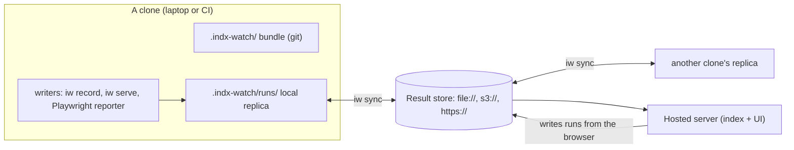
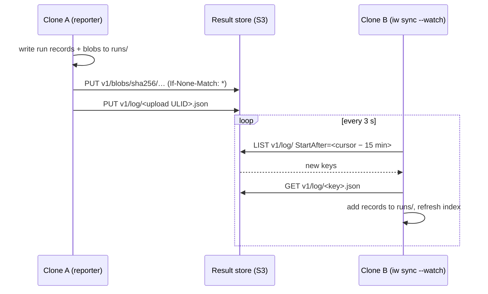

# Sync and the result store

Definitions sync through git (or, in [workspace mode](#workspace-mode-v02), also through the store). Results — runs, judgements, waivers, deployments, bundle snapshots and their blobs — sync through a **result store**: a folder or any S3-compatible bucket, optionally fronted by a hosted INDX Watch server. This page specifies the store layout, the record format, the merge rules and `iw sync`. Why it is split this way: [ADR 0002](../adr/0002-two-sync-channels.md), [ADR 0003](../adr/0003-storage-only-store-protocol.md). Prior art and S3 facts: [platform notes](../research/platform-notes.md#s3-and-conditional-writes).

## Pieces



- Every writer appends records to the **local replica** first (`.indx-watch/runs/`). Writing never needs the network.
- `iw sync` pushes local records and blobs the store does not have, and pulls records the replica does not have.
- The hosted server is a client like any other; its UI writes go straight to its store.

## Local replica layout

```text
.indx-watch/runs/
├── records/2026-11/run_01JF7Z3K0W8N2Q4R6S8T0V2X4Y.json   # one file per record, by record ID, grouped by the month of the ID's ULID time
└── blobs/sha256/87/8760bc67a01b22044c4098fddeb3a749cd395c4757fab3740aa626cd0da51e1b
```

Sync bookkeeping lives in `.indx-watch/cache/sync/<store-hash>.json` and `.indx-watch/cache/writer-id`. Deleting `cache/` is always safe.

## Store layout

Any `ObjectStore` (fs, S3, R2 binding, HTTP) exposes the same keys under the store URL's prefix:

```text
<prefix>/
├── indx-watch-store.json               # {"format":"indx-watch-store","version":1,"project":"prj_…"}
├── v1/log/01JF7Z9A2B4C6D8E0F2G4H6J8K.json   # log objects: one per upload, key = upload ULID
├── v1/blobs/sha256/87/8760bc67…1e1b     # content-addressed blobs
└── v1/snapshots/01JF8A1B2C3D4E5F6G7H8J9K0M.json   # log snapshots (compaction): key = upload ULID
```

| Object | Rule |
|---|---|
| `indx-watch-store.json` | Created by the first writer with a conditional create. A store bound to another project ID is refused (exit 4). |
| Log object | Key = a ULID generated **at upload time**. Body = `{"v":1,"writer":"<writer-id>","records":[…]}`, at most 1,000 records or 5 MB. Never overwritten. |
| Blob | Key = SHA-256 of the content. Written only if absent. Verified on read. |
| Log snapshot | *(v0.2)* Key = a ULID generated at upload time. A copy of log objects for fresh clones ([log snapshots](#log-snapshots-v02)). Never overwritten; trusted like the log, and `iw sync --full` reads the log itself. |

Writes use `If-None-Match: *` (on GCS: `x-goog-if-generation-match: 0`), so nothing is ever overwritten; ULID keys and content hashes make collisions practically impossible anyway. Store URLs:

| URL | Adapter | Credentials |
|---|---|---|
| `file:///abs/path` or `file://../rel` (relative to the bundle) | `fs` | file system permissions |
| `s3://bucket/prefix` + `[store].endpoint`/`region` | `s3` (S3, R2, MinIO, GCS interop) | `AWS_ACCESS_KEY_ID` / `AWS_SECRET_ACCESS_KEY` / `AWS_SESSION_TOKEN`; with `AWS_PROFILE` (incl. SSO), credentials come from `aws configure export-credentials --format process` |
| `https://watch.example.com` | `http` → the hosted server's [store endpoints](#store-http-endpoints) | `IW_ACCESS_TOKEN`, or `cloudflared access token -app=<url>`, sent as `cf-access-token`; in CI an Access service token (`CF_ACCESS_CLIENT_ID` / `CF_ACCESS_CLIENT_SECRET`) |
| (Workers only) | `r2` binding | Worker binding |

### Store HTTP endpoints

A hosted server exposes the same layout over HTTP (behind Cloudflare Access): `GET`/`HEAD /api/store/objects/<key>` (404 when absent), `PUT /api/store/objects/<key>` (201; always create-only: 412 when the key exists, with or without `If-None-Match`; 400 for keys outside the layout, invalid manifests or log objects, records of another project, and blobs whose content does not match their key), `GET /api/store/list?prefix=&startAfter=&limit=` → `{ "keys": [{ "key", "size", "etag"? }], "truncated" }`. *(v0.2)* `POST /api/sign` (a GitHub OIDC token instead of Access) signs records for a CI job without a key and returns them; it writes nothing to the store ([GitHub OIDC](./security.md#github-oidc)). Types: [`packages/server/src/contract.ts`](https://github.com/INDXDev/indx-watch/blob/main/packages/server/src/contract.ts).

## Records

Every record is a JSON object that starts with `kind` and `id`, followed by the envelope. The Zod schemas in [`packages/bundle/src/schema/records.ts`](https://github.com/INDXDev/indx-watch/blob/main/packages/bundle/src/schema/records.ts) are the field-level reference and are published as `schemas/v1/record.json`.

| Field | |
|---|---|
| `kind` | `run`, `judgement`, `waiver`, `deployment`, `bundle`, `retraction`, `baseline` (*v0.2*), `share` (*v0.2*), `file` (*v0.2*, [workspace mode](#workspace-mode-v02)), `secret` (*v0.5*) |
| `id` | `{prefix}_{ULID}`, generated at creation (offline) |
| `v` | `1` |
| `project` | project machine ID |
| `at` | creation time (RFC 3339) |
| `actor`, `source` | [security.md](./security.md#identity) |
| `client` | optional, *v0.5*: `{ "version", "patches" }` of a [patched server](./security.md#patched-servers) that wrote the record; absent from records of unpatched builds |
| `sig` | optional, *v0.2*: the writer's signature ([signed records](#signed-records)) |

**Canonical record JSON.** Writers validate a record with its strict schema and store `JSON.stringify` of the parsed result (keys in schema order, defaults materialized, no whitespace). Those exact bytes go into the replica, log objects and archives. Readers accept unknown extra fields (from newer tools) and keep the bytes they received; two records with the same ID are compared by these bytes.

### Signed records

*(v0.2)* A writer with `IW_SIGNING_KEY` adds `sig = { "alg": "Ed25519", "kid", "value" }` to every record it writes: an Ed25519 signature (base64url) over `indx-watch/record/v1\n` + the canonical record JSON without `sig`. Readers recompute those bytes from the record they decoded, so a reader whose schema lacks a field a newer writer signed sees the record as unverified until it is upgraded. Signing never changes merge rules: a signed and an unsigned body with the same ID are two different bodies. A GitHub Actions job without a key gets the same signature from the hosted server by exchanging its OIDC token (`POST /api/sign`, [GitHub OIDC](./security.md#github-oidc)); the token never goes into the record. Which keys are trusted, and what "unverified" means for the UI, reports and the gate: [security.md](./security.md#signed-records).

### Run record

```json
{
  "v": 1, "kind": "run", "id": "run_01JF7Z3K0W8N2Q4R6S8T0V2X4Y", "project": "prj_01JF3Q8M5X2V7K9D4R6T1W0Y00",
  "at": "2026-11-19T04:13:40Z",
  "actor": { "kind": "ci", "id": "github:octocat", "name": "octocat", "via": "github" },
  "source": "playwright",
  "test_case": { "id": "tc_01JF3Q8M5X2V7K9D4R6T1W0Y33", "key": "TC-3", "version": "tcv:3f9a1c2b7e10" },
  "fixtures": [ { "id": "fx_01JF3Q8M5X2V7K9D4R6T1W0Y41", "key": "FX-1", "version": "fxv:91be03d2a4c8", "rows": ["SUMMER10"] } ],
  "release": "v1.2.0", "environment": "staging",
  "build": { "commit": "a1b2c3d4e5f60718293a4b5c6d7e8f9012345678", "ref": "refs/heads/main", "dirty": false },
  "ci": { "provider": "github", "url": "https://github.com/INDXDev/indx-watch/actions/runs/1/attempts/1", "run_id": "1", "run_attempt": 1, "job": "e2e", "pr": 12 },
  "started_at": "2026-11-19T04:13:31Z", "ended_at": "2026-11-19T04:13:40Z",
  "reported": null,
  "locale": "en",
  "steps": [ { "index": 1, "status": "pass", "note": "", "evidence": ["8760bc67…"] } ],
  "evidence": [ { "sha256": "8760bc67…", "name": "step-1.png", "media_type": "image/png", "size": 8295, "kind": "screenshot", "step": 1 } ],
  "judgements": [ { "id": "jdg_01JF7Z…", "kind": "assert", "verdict": "pass", "confidence": 1, "reason": "", "test": "coupon.spec.ts › valid coupon reduces the total" } ],
  "automation": { "framework": "playwright", "project": "chromium", "group": "github:1:1" }
}
```

- `reported`: what the executor reported for the whole run (`blocked`, `skipped`, or `null`). Only used by decision-policy rule 2.
- `steps[].checks` *(v0.4)*: for a step whose test case step has [`checks`](./bundle-format.md#specsfeatuctc-n-slugtoml), which of them the tester ticked, as booleans in the order of the source `checks` (`[true, false]`: the first held, the second did not). The manual runner writes it; other writers leave it out. It never changes the verdict.
- The verdict is **not stored**; it is computed ([concepts](./concepts.md#decision-policy)).

### Other records

| Kind | Fields (besides the envelope) | Meaning |
|---|---|---|
| `judgement` | `run` (run ID), `judgement` (as in the run: `id`, `kind`, `verdict`, `confidence`, `diff_ratio`, `reason`, `test`, `flaky`, `by`, `at`, and from v0.2 `locale` and `baseline` — the SHA-256 of the approved baseline a `visual` judgement compared with) | A later judgement, e.g. a human review. |
| `waiver` | `release`, `test_case` (ID + key), `reason`, `version` (test case version it applies to), `run`, `revokes` (waiver ID) | Accept a known failure of that version; a later waiver with `revokes` cancels one. |
| `deployment` | `environment`, `build`, `release`, `url` | A build was deployed to an environment (`iw deployment add`). |
| `bundle` | `commit`, `commit_time`, `ref`, `sha256` (blob: `.tar` of the definition files), `definitions_hash` (SHA-256 over the sorted lines `<path> <sha256>\n` of every definition file — excluding `cache/`, `runs/` and dot-files — to skip unchanged snapshots), `files` (count), `dirty` and `message` (*v0.2*, [snapshots from people](#snapshots-from-people-v02)) | A snapshot of definitions for hosted viewers in git mode. |
| `retraction` | `target` (record ID), `reason` | Hides a record recorded by mistake; nothing is deleted. |
| `baseline` | *v0.2*: `test_case` (ID + key), `name` (screenshot evidence name), `automation_project` (the run's `automation.project`, if any), `sha256` (blob: the PNG), `run` (run it was taken from) | A person approved this screenshot as the [visual baseline](./concepts.md#visual-baselines) for (test case, name, project). Only `human` actors count; the latest per key wins. Tools older than v0.2 skip it with a warning. |
| `share` | `action` (`create`, `open`, `revoke`); `link` (the `create` record's ID, on `open` and `revoke`); on `create`: `token_sha256`, `expires_at`, `audience`, `locale`, `release`, `environment`, `plan`, `sha256` (blob: the frozen HTML report) | *v0.2*: a [report share link](./reports.md#share-links) was created, opened or revoked. Written only by the hosted server; a retracted `create` record also ends its link. |
| `secret` | `action` (`set`, `delete`, `reveal`), `name`; on `set` and `delete`: optional `title`, `username` (login ID), `notes`, `shared_with`, and `sealed` (base64url of IV and AES-256-GCM ciphertext) | *v0.5*: a [secret kept by INDX Watch](./security.md#secrets) was changed, deleted or viewed. Written only by the server holding `IW_SECRETS_KEY`; a `set` or `delete` counts only if its seal opens, so nobody else can change a secret's value or sharing. Never retracted; the push secret scan skips `sealed` like `sig`. |
| `file` | *v0.2*: `path` (bundle-relative), `entity` (the `id` inside the file, if any), `sha256` (blob: the file's bytes; absent when deleted), `deleted`, `bases` (unused, empty), `parents` (the `file` record IDs this version replaces) | One version of a definition file in [workspace mode](#workspace-mode-v02). |

## Merge rules

| Data | Rule |
|---|---|
| Records | Set union by `id`. Records are immutable. Two different bodies with the same ID: keep the one signed by a pinned key, otherwise the one whose log key sorts first, and report a warning (see below). |
| Verdict changes | Never edit; append a `judgement` record. Verdict = decision policy over all judgements of the run. |
| Waivers | Latest non-revoked waiver per (release, test case) by `at`, ties broken by `id`. |
| Baselines | Latest `baseline` record by a human per (test case, `name`, `automation_project`) by `at`, ties broken by `id`. |
| Bundle snapshots | Latest by `commit_time`, then `at`, per `ref`, so an outdated checkout cannot roll the hosted view back. |
| Workspace files | Version graph per entity by `parents`; several heads merge field by field ([workspace mode](#workspace-mode-v02)). |
| Retractions | A retracted record is ignored by the model; push never uploads a retracted record again. |
| Blobs | Content-addressed; identical by definition. |

**Two bodies with one record ID.** Normal writers never produce this; it means a forged or corrupted upload. So that every replica and index ends with the same body, each one remembers, per record ID, the earliest log key under which it read the body it holds: the sync state (`keys` in `cache/sync/<store>.json`) for a clone, the `record_keys` table for an index. A record written locally and not yet pushed, or held before keys were remembered, has no key and sorts last. When a log object brings another body for a held ID:

- exactly one of the two bodies carries a valid signature by a key pinned in `project.toml` `[[signing_keys]]` (on the hosted app: the keys `iw deploy` pinned, see [signed records](./security.md#signed-records)): that body wins, whatever the log keys, so a forged unsigned body can never replace a signed one;
- otherwise, its key sorts first: the held copy is replaced (`LocalReplica.replaceRecord`, which only sync calls; a guarded `UPDATE` in the D1 index), and the key is remembered;
- otherwise the held copy stays.

Both cases produce the warning `record <id> in <log key> differs from the local copy; replaced the local copy (signed, or its log key sorts first)` (or `…; kept the local copy`; `indexed copy` in an index). Sync returns it in `warnings` and keeps it in the sync state (`conflicts`); `iw check` reports it as a `record-conflict` warning, and the web app shows it in the problems banner (a hosted server keeps it in the index meta `record.conflicts`). Because a full listing reads log objects in key order, a clone that lost `cache/` meets the earliest key first and converges again on the next sync. An index whose rows predate remembered keys converges once it is rebuilt from the store. The D1 index writes each decision as statements guarded by the state it read (the held body and key), so two ingests running at once cannot overwrite each other: a guarded write that changes nothing is decided again. Because the uploader picks the log key, `PUT /api/store/objects/v1/log/…` refuses a key whose time is more than an hour from the server clock; a direct bucket writer can still pick any key, which is why signed bodies win regardless of keys.

Because every operation is a union of immutable items, sync is idempotent, order-independent and safe to interrupt at any point.

## `iw sync` algorithm

**Push**

1. Run the secret scan; refuse if it reports errors.
2. Collect local records not in the pushed set (`cache/sync/<store>.json`). Records that fail the secret scan are held back with a warning (`held` in the result). This step is part of the sync engine, so the background sync of `iw serve` and the Playwright reporter's push hold them back too.
3. Upload every blob they reference that the store does not have (`HEAD`, then conditional `PUT`), plus the blobs of fixture pointer files in the bundle.
4. Upload records in log objects of ≤ 1,000 records, keyed by a fresh ULID, *after* their blobs.
5. Add their IDs to the pushed set.
6. With `--snapshot` (the GitHub Action passes it on the default branch): if the definitions hash differs from the last pushed snapshot and the working tree is clean, upload the bundle tarball and a `bundle` record. Plain local `iw sync` never publishes snapshots.

**Pull**

1. List `v1/log/` with `StartAfter` = the ULID of (cursor time − 15 minutes) — the **lookback window** that absorbs clock skew and slow uploads between writers.
2. Fetch log objects not yet seen (tracked by key for the lookback window), write their records into the local replica if absent (another body for a held ID follows the [merge rules](#merge-rules)), mark them as pushed. Unreadable log objects (corrupt, or from a newer format) are skipped with a warning and remembered as seen; unknown top-level fields are accepted. Records of another project are ignored with a warning.
3. Advance the cursor to min(greatest key seen, ULID of the reader's current time), so one writer with a clock running ahead cannot push every reader's cursor into the future. When no key has been seen, the cursor stays unset.
4. Every 24 hours (or with `--full`, or when `cache/` was deleted), list the whole log once to catch writers whose clocks were wrong by more than the window and to rebuild the pushed set. Unless `--full` was given, this full listing first reads the newest [log snapshot](#log-snapshots-v02), so it only fetches the log objects the snapshot does not hold.
5. Blobs are fetched per `[store].evidence`: `on-demand` (when a page, report or command needs them — read-through from `iw serve`), `all`, or `none`.

**Watch** (`iw sync --watch`): push within ~300 ms of a local write (file watcher on `runs/records/`), poll the store every 3 s (`--interval`). With the `http` adapter, the server can answer list requests by long-polling (v0.2).



### Log snapshots *(v0.2)*

A full listing fetches every log object, so a fresh clone of a store with 100,000 records would make thousands of `GET`s. A **log snapshot** is one object holding a copy of many log objects, so that clone reads one object and then only the log objects written since. (Not to be confused with the bundle snapshots above, which hold definitions.)

```json
{ "v": 1, "format": "indx-watch-log-snapshot", "project": "prj_…", "upto": "v1/log/01JF7Z9A2B4C6D8E0F2G4H6J8K.json",
  "logs": [ { "key": "v1/log/01JF7Z0…json", "records": [ … ] }, … ] }
```

- `logs`: log objects in ascending key order, each with its own key and its records as read (the canonical record JSON, `sig` included). Keeping the log key of every record means a clone applies them exactly as if it had read those log objects in key order, so the [merge rules](#merge-rules) (remembered keys, two bodies with one ID, signed bodies win) converge to the same result. `upto` is the greatest key it holds.
- **Who writes it:** `iw compact` ([cli.md](./cli.md#iw-compact)), run by hand or on a schedule by anyone with direct write access to the store (`file://` or `s3://`). It reads the newest valid snapshot, adds every log object from the log listing that it lacks and whose key is older than the lookback window (now − 15 minutes), and uploads a new snapshot under a fresh ULID with a create-only write. Log objects that cannot be read, or that hold invalid records, are left out, so clones read them from the log and warn as before. When nothing is new it writes nothing. The hosted server's `/api/store` refuses writes under `v1/snapshots/` (as any key outside the layout), so a holder of an Access token alone cannot add one.
- **How a clone uses it:** a full listing ([pull step 4](#iw-sync-algorithm), and every fresh clone) reads the newest snapshot whose key is not in the reader's future, merges its records log object by log object, marks those log keys as read, then lists the whole log and fetches only the keys the snapshot does not hold. The cursor then advances as usual. Every daily full listing merges the snapshot's records again, as it would re-read the log objects they replace, so a replica that lost files is repaired and a newly trusted signing key applies to them too.
- **Safety:** snapshots are additive and immutable; the log is never deleted or rewritten, and removing every snapshot only makes full listings slower. Readers do not compare a snapshot's copies with the log objects they name, so a snapshot is trusted as much as the log: whoever can write to the bucket can write either, and a wrong snapshot (from a buggy or hostile direct writer) can hide the contents of the log objects it names from full listings. `iw sync --full` reads every log object and is the remedy; deleting the bad snapshot fixes it for everyone. A snapshot that is not valid JSON, has another `format`, a newer `v`, another project, keys out of order or above `upto`, or an invalid record is ignored with a warning (`…; reading the whole log instead`), and the clone reads the whole log. `iw sync --full` ignores snapshots and reads every log object. Old snapshots may be deleted by hand or by a bucket lifecycle rule; readers only read the newest.

### Snapshots from people *(v0.2)*

Besides CI (`iw sync --snapshot` on the default branch), a person can publish a snapshot with *(v0.5)* `iw deploy` (merged with the newest snapshot, [data flow](#publishing-definitions-with-iw-deploy)), `iw push` or by uploading files in the hosted web app ([web.md](./web.md#upload)). These `bundle` records carry `dirty: true` when the working tree had uncommitted changes, an optional `message`, and `commit_time` set to the upload time when there is no clean commit, so the newest upload wins under the "by `commit_time`, then `at`" order the hosted server uses. A browser upload (and a Test data edit) has `source = "manual"`; *(v0.5)* when the snapshot it builds on has a `commit`, it keeps that `commit` with `dirty: true` and adds the files it changed or removed to the base's `unsynced`, so `iw deploy` and `iw pull` can merge it. Otherwise it has no `commit`.

## Workspace mode (v0.2)

For teams without git, definitions also sync through the store, Drive-style ([ADR 0002](../adr/0002-two-sync-channels.md), [roadmap T-209](../roadmap.md#v02--agents-and-sharing)). It is switched on with `[store] mode = "workspace"` in `project.toml`; the default `git` mode never writes or reads `file` records.

**File records.** Every published version of a definition file is a `file` record ([records](#other-records)) whose blob is the file's bytes. Files written by INDX Watch (the hosted editor, merges) are canonical TOML from `formatToml()`; files a person saved by hand are published as they are. Which files take part: the [definition files](#other-records) of a bundle snapshot (everything except `cache/`, `runs/` and dot-files) minus conflict files.

- **Entities, not paths.** A version belongs to the entity named by the `id` inside the file (`tc_…`, `uc_…`, `prj_…`), kept in `entity`; files without an `id` (fixture data, READMEs) are tracked by path. Moving or renaming a file is a new version with another `path`.
- **Versions are record IDs.** `parents` lists the `file` record IDs the version was made from: none for a new file, the heads it replaced otherwise. Content hashes are not versions, so a revert to older bytes is a new version, not a cycle. The **heads** of an entity are its versions that no other version names as a parent (retracted records are ignored). `bases` (content hashes) is unused and always empty.
- **Deleting** a file publishes a version with `deleted: true` and no `sha256`.

**Current content.** The current file of an entity is a pure function of its records and blobs (`workspaceFiles()` in `packages/sync`), so every clone and the hosted server compute the same bytes:

1. One head: its content and path.
2. Several heads (concurrent edits): sorted by record ID, folded left to right with a three-way merge of the result so far and the next head, against their nearest common ancestor (the common ancestor with the greatest record ID; none for two roots, which merges against an empty file).
3. **Three-way merge.** Equal sides, or one side equal to the base, take the other side. TOML files are merged field by field: tables recurse, every other value (strings, numbers, arrays such as `steps`) is one field. A field changed on both sides to different values is a **conflict**: the result keeps the earlier head's value. Files that are not TOML (or do not parse) conflict as a whole. An edit wins over a concurrent delete; `path` merges like a field (moved to different paths on both sides is a conflict that keeps the earlier head's path). A merged TOML file is written with `formatToml()`; an unmerged side keeps its exact bytes.
4. **Conflicts** add, next to the file, `<name>.conflict-<sha8>.<ext>` holding the later head's full content (`sha8` = the first 8 hex digits of its `sha256`), e.g. `TC-3-valid-coupon.conflict-1a2b3c4d.toml`. `iw check` fails with `workspace-conflict` while a conflict file exists, and the loader ignores its content.

**`iw sync` in workspace mode** runs the [push and pull](#iw-sync-algorithm) as usual, and between them applies definitions (`applyWorkspace()` in `packages/sync`):

- It remembers, per entity, the heads, path and content hash it last wrote to the working tree (`workspace` in `cache/sync/<store>.json`; deleting it only makes the next sync compare contents).
- A working-tree file equal to the current content is adopted as is. A file changed since the last sync (added, edited, moved or deleted) is published as a new version whose parents are the heads it was based on (none on a first sync, which then merges against an empty file and marks every differing field as a conflict).
- Then the current content is written to the working tree: changed files are rewritten, deleted ones removed, moved ones renamed, conflict files written, and conflict files of earlier merges removed once the entity has one head again.
- **Resolving a conflict:** edit the file and delete the conflict file; the next sync publishes the file with every head as a parent, so the entity has one head again. Deleting the conflict file alone keeps the merged file as the resolution.
- **Agents publish drafts only:** when the actor is an agent ([identity](./security.md#identity)), a changed file is published only if it is TOML with `origin = "ai"` and, if it has a `status`, `status = "draft"`; anything else (also deletions and data files) stays local with a warning, and that entity is not overwritten.
- **Files that do not parse are held:** a TOML file that does not parse (for example while a person is mid-edit and `iw serve` syncs in the background) is neither published nor overwritten, and its entity is not deleted; it is listed as held with a warning until it parses again.
- **Git and the store must not both own definitions.** `iw sync` refuses (exit 1, `CONFLICT`) in workspace mode when files of the bundle are tracked by git, and explains how to choose: switch to `mode = "git"`, or stop tracking `.indx-watch/` (`git rm -r --cached .indx-watch`, keeping `runs/` and `cache/` ignored).
- **Joining:** copy `project.toml` unchanged (same `[store]` URL) into an empty `.indx-watch/` and run `iw sync`; it is adopted, and every other file is written.
- `iw serve` applies definitions on each background sync too, and refuses it the same way (shown as the sync error) while git tracks files of the bundle.

**The hosted server** shows the current content of the `file` records as its definitions whenever the store holds any (otherwise the newest [bundle snapshot](#snapshots-from-people-v02)), including conflict files, so its problems banner shows `workspace-conflict` too. Its editor ([web.md](./web.md#editing-in-workspace-mode)), *(v0.5)* uploads and the [Test data](./web.md#test-data) screen write `file` records (a removed file as a `deleted` version) with the request's verified identity (and the server's signature). `iw serve` in workspace mode writes the same record to its replica and the file to the working tree. Like bundle snapshots, `file` records are trusted as they are: whoever can write to the store can change definitions, so give direct bucket access only to people who may edit; their signatures only change how the editor's identity is shown.

v0.1 tools reject `[store] mode = "workspace"` and skip `file` records.

## Data flow and conflicts

*(v0.5)* This section is the one map of **where each kind of data lives, which command or event moves it, and where two people can collide**. It covers git mode (the default) on a hosted app; [workspace mode](#workspace-mode-v02) replaces the definition parts with `file` records and a field-level merge.

### Where data lives

| Place | What it holds | Source of truth for |
|---|---|---|
| Git repository, `.indx-watch/` | Definitions: project, use cases, criteria, test cases, fixtures, environments, releases, plans, `ui/` | Definitions |
| Working copy, `.indx-watch/runs/` and `cache/` (not in git) | The local replica of records and blobs; sync cursors; the `node:sqlite` index | Nothing: a cache of the store plus records not pushed yet |
| Result store (R2 bucket behind the Worker, or `s3://`, `file://`) | The append-only log of records (runs, reviews, waivers, deployments, `secret` records, `bundle` snapshot records), blobs (evidence, fixture files, snapshot tarballs) | Results, reviews, secrets, and which definitions the app shows |
| D1 (hosted) | The index of the store and the current definitions | Nothing: rebuilt from the store |
| Worker variables (set by `iw deploy`) | `ACCESS_TEAM`, `ACCESS_AUD`, `SIGNING_KEYS`, `OIDC_REPOSITORIES`, `ROLES`, `IW_VERSION`, read from the local `project.toml` at deploy time, never from a snapshot | Who gets in, which keys are trusted, roles |
| Worker secrets (`wrangler secret put`) | `IW_SECRETS_KEY`, `IW_SIGNING_KEY`, `IW_ACCESS_POLICY`, `CLOUDFLARE_API_TOKEN` | Secret keys |

### What moves, when, and how

| Data | From → to | When | Needs |
|---|---|---|---|
| Definitions | working copy → git remote | `git push` | git access |
| Definitions | working copy → store (a `bundle` snapshot) | `iw deploy` (after the Worker deploy, or alone with `--definitions-only` / without a Cloudflare login), merged with the newest snapshot ([below](#publishing-definitions-with-iw-deploy)) | an Access login (`iw login`) or service token |
| Definitions | CI checkout → store | the GitHub Action's `iw sync --snapshot` on the default branch, when the definitions changed and the tree is clean; replaces, no merge | an Access service token or bucket credentials |
| Definitions | working copy → store | `iw push`: replaces, no merge | as above |
| Definitions | browser → store | Upload, Test data edits: a new snapshot built on the open one, with its `commit`, `dirty: true` and `unsynced` | Access login, role `lead` (fixtures: `tester` too) |
| Definitions | store → working copy | `iw pull` (three-way, [below](#bringing-hosted-changes-into-git-with-iw-pull)), or `iw clone` for a new copy | Access login |
| Worker code and variables | working copy → Cloudflare | `iw deploy` with a Cloudflare login (`wrangler login` or `CLOUDFLARE_API_TOKEN`); the `indx-watch-deploy` workflow on a push to the default branch | a Cloudflare API token |
| Results recorded in the app | browser → store | at once (the Worker writes the record) | Access login |
| Results from Playwright, `iw record`, `iw run` | working copy → local replica → store | written locally first; pushed by the reporter at the end of a run, by `iw sync`, or by `iw serve`'s background sync | store credentials or an Access login |
| Records in the store | store → D1 | the Worker's own writes at once; uploads through `/api/store` on receipt; direct bucket writes within 5 s on a read request and once a minute (cron) | — |
| Records in the store | store → working copy | `iw sync` (pull), `iw pull`, `iw deploy` (they pull first) | as above |
| Secrets | browser → store | the Secrets tab writes sealed `secret` records; never to git | `IW_SECRETS_KEY` on the Worker |

Results, reviews and secrets never reach git; definitions reach the app only as snapshots. The Uploads screen shows which snapshot the app is on and which of its files are not in git ([web](./web.md#sync-status)).

### Which definitions the app shows

The Worker shows the newest `bundle` record by `commit_time`, then `at`, then `id`. A snapshot published by `iw deploy` (and by people, `iw push`, the browser) sets `commit_time` to the publish time, so the newest publish wins; a CI snapshot uses its commit's time. `unsynced` lists the files whose content differs from the record's `commit`: changes that are in the app but not in that commit.

### Publishing definitions with `iw deploy`

`iw deploy` publishes the working copy's definitions merged with what the app shows, so two people publishing from different branches, or a publish after an edit in the app, never silently drop the other side:

1. **Checks.** `iw check` must pass. Outside CI, the bundle must be committed (`git status` clean) and `HEAD` must be on a remote branch (pushed), so the next publisher can find the commit; `--force` skips this and the merge. Without a Cloudflare login, the Worker must run at least the version the project pins (`/healthz`, read with the same Access credentials as the store), or definitions it cannot load would replace the working ones.
2. **Pull** the store's records, and take the newest snapshot (*theirs*) and its files.
3. **Base.** The merge base of `HEAD` and theirs' `commit` (fetched first when missing; a shallow checkout is unshallowed). A snapshot without a commit (a browser upload into an app whose snapshot had none, or one made before v0.5), or with a commit git cannot find, has an empty base.
4. **Three-way merge by file** over the definition files (what a snapshot packs) of *mine* (the working tree), *theirs* and *base* (the files at the merge base):
   - mine equals theirs, or theirs equals base → mine;
   - theirs equals a version of that file in `HEAD`'s history → mine. A squash or rebase merge leaves the snapshot's commit off the branch, so its merge base is too old; the file's own history shows that the branch already has theirs and changed it since;
   - mine equals base → theirs (changed only on the hosted side: kept, and listed as `merged`);
   - otherwise → **conflict**: the deploy stops (exit 1, `CONFLICT`) naming the files, and publishes nothing.
5. **Check the merged result.** Two sides can each add a different file with the same key (two new `TC-7`s); the result then fails `iw check` and the deploy stops the same way.
6. **Publish** the merged files as a snapshot with `commit = HEAD`, `commit_time` = now, and `unsynced` = the files that differ from `HEAD` (with `dirty: true` when there are any), then push results.

### Bringing hosted changes into git with `iw pull`

`iw pull` runs steps 2–4 and writes into the working tree instead of publishing: theirs-only changes are written (or removed), and for each conflict your file stays and the hosted version is written beside it as `<name>.conflict-<sha8>.<ext>` (a deletion on the hosted side is only listed). `iw check` fails with `workspace-conflict` while such a file exists, so neither `iw deploy` nor a pull request can go on until someone merges it by hand and deletes it. Then: `iw check --fix` (renumbers a key used twice), commit, `git push`, `iw deploy`. The working tree must be committed first.

### Where conflicts can happen

| Situation | What happens | Resolution |
|---|---|---|
| Two people change the same definition file on different branches | Normal git merge when the branches meet | Resolve in git |
| Two deploys change different files | The second merges the first's changes in; both are kept; `unsynced` lists the first's files until they are in git | Merge the branches in git as usual (or `iw pull`) |
| Two deploys change the same file | The second stops (`CONFLICT`), nothing is published | `git pull` (merge the other branch) or `iw pull`; resolve; deploy |
| An edit in the app and a deploy change the same file | The deploy stops | `iw pull` writes the app's version as a `.conflict` file; merge it; commit, push, deploy |
| Both sides add the same key in different files | The merged result fails `iw check`; the deploy stops | `iw pull`, `iw check --fix`, commit, push, deploy |
| `iw push`, `iw deploy --force`, or CI's `iw sync --snapshot` publishes a newer snapshot | It replaces the definitions without a merge: changes only in the app disappear from it | They stay in older snapshots: download from Uploads, or avoid replacing publishers when people edit in the app |
| Two people record results | No conflict: records are append-only with their own IDs; the same ID with two bodies follows the [merge rules](#merge-rules) | — |
| Two people change a secret | The newest `set` or `delete` that opens wins ([security](./security.md#secrets)) | — |
| `[hosting]` (roles, Access, keys) changes in git | Not applied by a definitions publish: the Worker keeps the variables of its last full deploy | Someone with a Cloudflare login runs `iw deploy`, or merge to the default branch so the deploy workflow runs |

**Known limits.** CI's `iw sync --snapshot` does not merge yet: on a team that also edits in the app, publish from CI with `iw deploy` (the `indx-watch-deploy` workflow does) rather than through the GitHub Action's snapshot. The merge is by whole file, not by field; two edits to different fields of one test case are a conflict.

## The hosted server and the index

The hosted server keeps an index (D1 on Cloudflare) of records and the current definitions; on Node, `iw reindex` builds the same index in `cache/index.sqlite`, and `iw serve` reads the local replica's records through it ([`iw serve`](./cli.md#iw-serve)). The hosted server ingests:

- its own writes, immediately;
- uploads through `/api/store/*`, on receipt;
- writes made directly to the bucket (e.g. CI using S3 credentials), by running the pull algorithm against its own store at most every 5 s on read requests and from a scheduled trigger. Each ingest handles at most 50 log objects, saves its cursor in the index, and holds a lease row so only one runs at a time; a fresh deploy on a large bucket catches up over several invocations. Like a clone, it lists the whole log once a day (step 4), resuming across invocations within the same 50-object budget, so another body under an older key converges in the index as in clones.

Records written by the hosted server itself carry an Access-verified actor and, when the Worker has `IW_SIGNING_KEY`, a signature. Records written directly to the bucket are ingested as written; those claiming a verified `via` without a valid signature by a key the deploy pinned (`SIGNING_KEYS`) are shown as unverified ([signed records](./security.md#signed-records), [threat model](./security.md#threat-model)).

`iw reindex` (or deleting the index) rebuilds it from the store; nothing is lost.

## Acceptance criteria

- [x] Two clones configured with the same `file://` or MinIO store: a run recorded in clone A appears in clone B's `iw status` within 5 s while B runs `iw sync --watch`.
- [x] Sync is idempotent: running `iw sync` twice in a row transfers nothing the second time.
- [x] A record uploaded with a key 10 minutes older than the reader's cursor is still pulled (lookback test with a fake clock).
- [x] Interrupting a push after blobs but before the log object, then re-running, leaves no record without its blobs.
- [x] A store whose `indx-watch-store.json` names another project is refused with exit code 4.
- [x] A reader whose store contains a log key 1 day in the future still pulls records written afterwards by correctly clocked writers.
- [x] `iw sync` without `--snapshot` never writes a `bundle` record.
- [x] Two clones holding a record, after a different body for its ID is uploaded under an earlier log key, both hold that body after their next sync and report a warning; a fresh clone, and the memory and D1 indexes, keep it too.
- [x] A body signed by a pinned key is never replaced by an unsigned body under an earlier key, in clones and indexes; one that arrives later replaces an unsigned body.
- [x] Two concurrent D1 ingests of different bodies for one ID end with the body under the earliest key and a conflict note.
- [x] The hosted catch-up's daily full listing ingests another body written straight to the bucket under a key older than its lookback window.
- [x] `PUT /api/store/objects/v1/log/<key>` refuses a key more than an hour from the server clock.
- [x] A fresh clone pulls 100,000 records from a log snapshot in under 10 s (`pnpm bench:sync`), holds the same records as one that read the whole log, and a corrupt snapshot falls back to the log with a warning.
- [x] Workspace mode: two clones that edit different fields of one test case concurrently both end with both edits after syncing; edits of the same field converge on the same file plus a conflict file in both clones, `iw check` fails until a person resolves it, and passes after the apply otherwise.
- [x] Workspace mode: an agent's change that is not an AI draft is not published, from `iw sync` or the hosted editor.
- [x] The adapter contract test suite passes for `memory`, `fs`, `http`, and `s3` (against MinIO when available, otherwise an S3-compatible fake).
