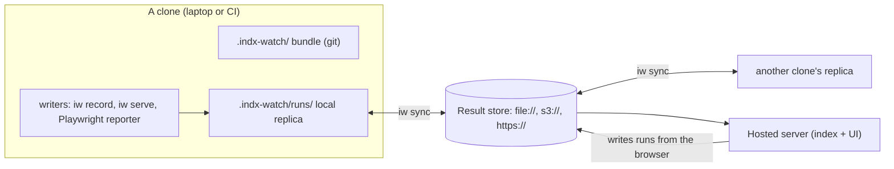
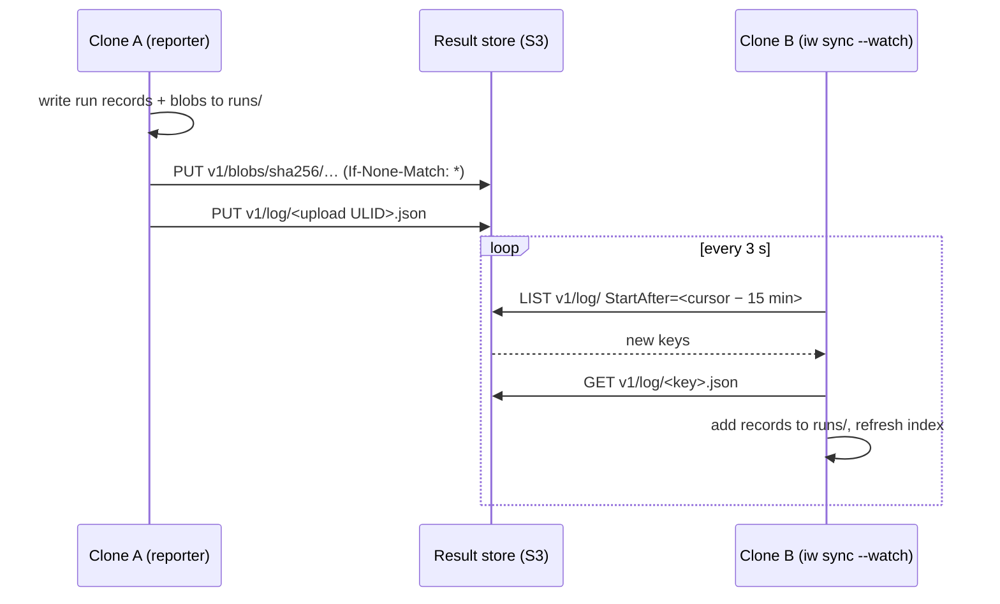

# Sync and the result store

Definitions sync through git. Results — runs, judgements, waivers, deployments, bundle snapshots and their blobs — sync through a **result store**: a folder or any S3-compatible bucket, optionally fronted by a hosted INDX Watch server. This page specifies the store layout, the record format, the merge rules and `iw sync`. Why it is split this way: [ADR 0002](../adr/0002-two-sync-channels.md), [ADR 0003](../adr/0003-storage-only-store-protocol.md). Prior art and S3 facts: [platform notes](../research/platform-notes.md#s3-and-conditional-writes).

## Pieces



- Every writer appends records to the **local replica** first (`.indx-watch/runs/`). Writing never needs the network.
- `iw sync` pushes local records and blobs the store does not have, and pulls records the replica does not have.
- The hosted server is a client like any other; its UI writes go straight to its store.

## Local replica layout

```text
.indx-watch/runs/
├── records/2026-11/run_01JF7Z3K0W8N2Q4R6S8T0V2X4Y.json   # one file per record, by record ID, grouped by month
└── blobs/sha256/87/8760bc67a01b22044c4098fddeb3a749cd395c4757fab3740aa626cd0da51e1b
```

Sync bookkeeping lives in `.indx-watch/cache/sync/<store-hash>.json` and `.indx-watch/cache/writer-id`. Deleting `cache/` is always safe.

## Store layout

Any `ObjectStore` (fs, S3, R2 binding, HTTP) exposes the same keys under the store URL's prefix:

```text
<prefix>/
├── indx-watch-store.json               # {"format":"indx-watch-store","version":1,"project":"prj_…"}
├── v1/log/01JF7Z9A2B4C6D8E0F2G4H6J8K.json   # log objects: one per upload, key = upload ULID
├── v1/blobs/sha256/87/8760bc67…1e1b     # content-addressed blobs
└── v1/snapshots/…                        # (v0.2) compacted log snapshots
```

| Object | Rule |
|---|---|
| `indx-watch-store.json` | Created by the first writer with a conditional create. A store bound to another project ID is refused (exit 4). |
| Log object | Key = a ULID generated **at upload time**. Body = `{"v":1,"writer":"<writer-id>","records":[…]}`, at most 1,000 records or 5 MB. Never overwritten. |
| Blob | Key = SHA-256 of the content. Written only if absent. Verified on read. |

Writes use `If-None-Match: *` where the backend supports it, so nothing is ever overwritten; ULID keys and content hashes make collisions practically impossible anyway. Store URLs:

| URL | Adapter | Credentials |
|---|---|---|
| `file:///abs/path` or `file://../rel` (relative to the bundle) | `fs` | file system permissions |
| `s3://bucket/prefix` + `[store].endpoint`/`region` | `s3` (S3, R2, MinIO, GCS interop) | AWS SDK credential chain (`AWS_ACCESS_KEY_ID`, profiles, …) |
| `https://watch.example.com` | `http` → the hosted server's `/api/store/*` | `cloudflared access token` or `IW_ACCESS_TOKEN` (`cf-access-token` header), or Access service token headers |
| (Workers only) | `r2` binding | Worker binding |

## Records {#records}

Every record is a JSON object with this envelope; the Zod schemas live in `packages/bundle/src/schema/records.ts` and are published as `schemas/v1/record.json`.

| Field | |
|---|---|
| `v` | `1` |
| `kind` | `run`, `judgement`, `waiver`, `deployment`, `bundle`, `file` |
| `id` | `{prefix}_{ULID}`, generated at creation (offline) |
| `project` | project machine ID |
| `at` | creation time (RFC 3339) |
| `actor`, `source` | [security.md](security.md#identity) |

### Run record {#run-record}

```json
{
  "v": 1, "kind": "run", "id": "run_01JF7Z3K0W8N2Q4R6S8T0V2X4Y", "project": "prj_01JF3Q8M5X2V7K9D4R6T1W0Y00",
  "at": "2026-11-19T04:13:40Z",
  "actor": { "kind": "ci", "id": "github:octocat", "name": "octocat", "via": "github" },
  "source": "playwright",
  "test_case": { "id": "tc_01JF3Q8M5X2V7K9D4R6T1W0Y33", "key": "TC-3", "version": "tcv:3f9a1c2b7e10" },
  "fixtures": [ { "id": "fx_01JF3Q8M5X2V7K9D4R6T1W0Y41", "key": "FX-1", "version": "fxv:91be03d2a4c8", "rows": ["SUMMER10"] } ],
  "release": "v1.2.0", "environment": "staging",
  "build": { "commit": "a1b2c3d4e5f60718293a4b5c6d7e8f9012345678", "ref": "refs/heads/main", "dirty": false },
  "ci": { "provider": "github", "url": "https://github.com/INDXDev/indx-watch/actions/runs/1/attempts/1", "run_id": "1", "run_attempt": 1, "job": "e2e", "pr": 12 },
  "started_at": "2026-11-19T04:13:31Z", "ended_at": "2026-11-19T04:13:40Z",
  "reported": null,
  "locale": "en",
  "steps": [ { "index": 1, "status": "pass", "note": "", "evidence": ["8760bc67…"] } ],
  "evidence": [ { "sha256": "8760bc67…", "name": "step-1.png", "media_type": "image/png", "size": 8295, "kind": "screenshot", "step": 1 } ],
  "judgements": [ { "id": "jdg_01JF7Z…", "kind": "assert", "verdict": "pass", "confidence": 1, "reason": "", "test": "coupon.spec.ts › valid coupon reduces the total" } ],
  "automation": { "framework": "playwright", "project": "chromium", "group": "github:1:1" }
}
```

- `reported`: what the executor reported for the whole run (`blocked`, `skipped`, or `null`). Only used by decision-policy rule 2.
- The verdict is **not stored**; it is computed ([concepts](concepts.md#decision-policy)).

### Other records

| Kind | Fields (besides the envelope) | Meaning |
|---|---|---|
| `judgement` | `run` (run ID), `judgement` (as in the run) | A later judgement, e.g. a human review. |
| `waiver` | `release`, `test_case` (ID + key), `reason`, `revokes` (optional waiver ID) | Accept a known failure; a later waiver with `revokes` cancels one. |
| `deployment` | `environment`, `build`, `release`, `url` | A build was deployed to an environment. |
| `bundle` | `commit`, `ref`, `sha256` (blob of a `.tar` of the bundle's definition files), `files` | A snapshot of definitions for hosted viewers in git mode. |
| `file` | `path` (inside the bundle), `sha256` or `deleted: true`, `bases` (parent version hashes) | Workspace mode: one version of one definition file. |

## Merge rules

| Data | Rule |
|---|---|
| Records | Set union by `id`. Records are immutable. Two different bodies with the same ID: keep the one whose log key sorts first and report a warning. |
| Verdict changes | Never edit; append a `judgement` record. Verdict = decision policy over all judgements of the run. |
| Waivers | Latest non-revoked waiver per (release, test case) by `at`, ties broken by `id`. |
| Bundle snapshots | Latest by `at` per `ref`. |
| Blobs | Content-addressed; identical by definition. |
| Workspace files | See [workspace mode](#workspace-mode). |

Because every operation is a union of immutable items, sync is idempotent, order-independent and safe to interrupt at any point.

## `iw sync` algorithm

**Push**

1. Run the secret scan; refuse if it reports errors.
2. Collect local records not in the pushed set (`cache/sync/<store>.json`).
3. Upload every blob they reference that the store does not have (`HEAD`, then conditional `PUT`).
4. Upload records in log objects of ≤ 1,000 records, keyed by a fresh ULID, *after* their blobs.
5. Add their IDs to the pushed set.
6. Git mode: if the bundle's definitions hash differs from the last pushed snapshot, upload a `bundle` record (only from a clean working tree, unless `--snapshot-dirty`).

**Pull**

1. List `v1/log/` with `StartAfter` = the ULID of (cursor time − 15 minutes) — the **lookback window** that absorbs clock skew and slow uploads between writers.
2. Fetch log objects not yet seen (tracked by key for the lookback window), write their records into the local replica if absent, mark them as pushed.
3. Advance the cursor to the greatest key seen.
4. Every 24 hours (or with `--full`), list the whole log once to catch writers whose clocks were wrong by more than the window.
5. Blobs are fetched per `[store].evidence`: `on-demand` (when a page, report or command needs them — read-through from `iw serve`), `all`, or `none`.

**Watch** (`iw sync --watch`): push within ~300 ms of a local write (file watcher on `runs/records/`), poll the store every 3 s (`--interval`). With the `http` adapter, the server can answer list requests by long-polling (v0.2).



## Workspace mode {#workspace-mode}

For teams without git (`[store] mode = "workspace"`), definition files also sync through the store, Drive-style.

- Each local change to a bundle file (create, edit, delete) is pushed as a `file` record whose `bases` is the version the editor started from, plus the content blob.
- For each path, versions form a graph. **Heads** are versions no other version lists as a base.
- One head: that is the file. Pull writes it unless the local file has unpushed changes.
- Several heads: pull attempts a **field-level three-way merge** against their common base (top-level fields, arrays of tables matched by `id` or `key`). If both sides changed the same field differently, the latest head (by `at`) is written to the path and the others to `<name>.conflict-<sha8>.toml`; `iw check` fails until a person resolves the conflict, which produces a new version whose `bases` are all heads.
- Renames are delete + create; identity stays the `id` inside the file.

## The hosted server and the index

The server keeps an index (SQLite on Node, D1 on Cloudflare) of records and the current definitions. It ingests:

- its own writes, immediately;
- uploads through `/api/store/*`, on receipt;
- writes made directly to the bucket (e.g. CI using S3 credentials), by running the pull algorithm against its own store at most every 5 s on read requests and from a scheduled trigger.

`iw reindex` (or deleting the index) rebuilds it from the store; nothing is lost.

## Acceptance criteria

- [ ] Two clones configured with the same `file://` or MinIO store: a run recorded in clone A appears in clone B's `iw status` within 5 s while B runs `iw sync --watch`.
- [ ] Sync is idempotent: running `iw sync` twice in a row transfers nothing the second time.
- [ ] A record uploaded with a key 10 minutes older than the reader's cursor is still pulled (lookback test with a fake clock).
- [ ] Interrupting a push after blobs but before the log object, then re-running, leaves no record without its blobs.
- [ ] A store whose `indx-watch-store.json` names another project is refused with exit code 4.
- [ ] Workspace mode: two offline edits to different fields of the same test case merge without conflict; edits to the same field produce a `.conflict-` file and a failing `iw check`.
- [ ] The adapter contract test suite passes for `memory`, `fs`, and `s3` (against MinIO when available, otherwise an S3-compatible fake).
