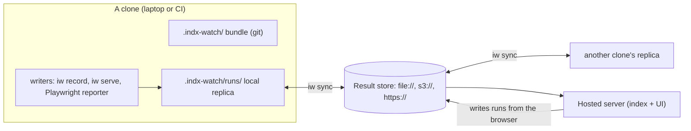
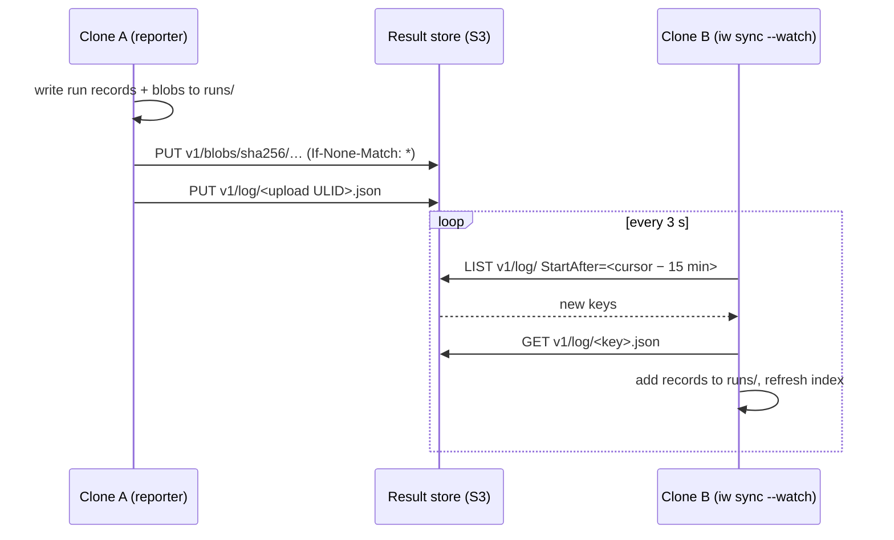

# Sync and the result store

Definitions sync through git. Results — runs, judgements, waivers, deployments, bundle snapshots and their blobs — sync through a **result store**: a folder or any S3-compatible bucket, optionally fronted by a hosted INDX Watch server. This page specifies the store layout, the record format, the merge rules and `iw sync`. Why it is split this way: [ADR 0002](../adr/0002-two-sync-channels.md), [ADR 0003](../adr/0003-storage-only-store-protocol.md). Prior art and S3 facts: [platform notes](../research/platform-notes.md#s3-and-conditional-writes).

## Pieces



- Every writer appends records to the **local replica** first (`.indx-watch/runs/`). Writing never needs the network.
- `iw sync` pushes local records and blobs the store does not have, and pulls records the replica does not have.
- The hosted server is a client like any other; its UI writes go straight to its store.

## Local replica layout

```text
.indx-watch/runs/
├── records/2026-11/run_01JF7Z3K0W8N2Q4R6S8T0V2X4Y.json   # one file per record, by record ID, grouped by the month of the ID's ULID time
└── blobs/sha256/87/8760bc67a01b22044c4098fddeb3a749cd395c4757fab3740aa626cd0da51e1b
```

Sync bookkeeping lives in `.indx-watch/cache/sync/<store-hash>.json` and `.indx-watch/cache/writer-id`. Deleting `cache/` is always safe.

## Store layout

Any `ObjectStore` (fs, S3, R2 binding, HTTP) exposes the same keys under the store URL's prefix:

```text
<prefix>/
├── indx-watch-store.json               # {"format":"indx-watch-store","version":1,"project":"prj_…"}
├── v1/log/01JF7Z9A2B4C6D8E0F2G4H6J8K.json   # log objects: one per upload, key = upload ULID
├── v1/blobs/sha256/87/8760bc67…1e1b     # content-addressed blobs
└── v1/snapshots/…                        # (v0.2) compacted log snapshots
```

| Object | Rule |
|---|---|
| `indx-watch-store.json` | Created by the first writer with a conditional create. A store bound to another project ID is refused (exit 4). |
| Log object | Key = a ULID generated **at upload time**. Body = `{"v":1,"writer":"<writer-id>","records":[…]}`, at most 1,000 records or 5 MB. Never overwritten. |
| Blob | Key = SHA-256 of the content. Written only if absent. Verified on read. |

Writes use `If-None-Match: *` (on GCS: `x-goog-if-generation-match: 0`), so nothing is ever overwritten; ULID keys and content hashes make collisions practically impossible anyway. Store URLs:

| URL | Adapter | Credentials |
|---|---|---|
| `file:///abs/path` or `file://../rel` (relative to the bundle) | `fs` | file system permissions |
| `s3://bucket/prefix` + `[store].endpoint`/`region` | `s3` (S3, R2, MinIO, GCS interop) | `AWS_ACCESS_KEY_ID` / `AWS_SECRET_ACCESS_KEY` / `AWS_SESSION_TOKEN`; with `AWS_PROFILE` (incl. SSO), credentials come from `aws configure export-credentials --format process` |
| `https://watch.example.com` | `http` → the hosted server's [store endpoints](#store-http-endpoints) | `IW_ACCESS_TOKEN`, or `cloudflared access token -app=<url>`, sent as `cf-access-token`; in CI an Access service token (`CF_ACCESS_CLIENT_ID` / `CF_ACCESS_CLIENT_SECRET`) |
| (Workers only) | `r2` binding | Worker binding |

### Store HTTP endpoints

A hosted server exposes the same layout over HTTP (behind Cloudflare Access): `GET`/`HEAD /api/store/objects/<key>` (404 when absent), `PUT /api/store/objects/<key>` (201; always create-only: 412 when the key exists, with or without `If-None-Match`; 400 for keys outside the layout, invalid manifests or log objects, records of another project, and blobs whose content does not match their key), `GET /api/store/list?prefix=&startAfter=&limit=` → `{ "keys": [{ "key", "size", "etag"? }], "truncated" }`. Types: [`packages/server/src/contract.ts`](../../packages/server/src/contract.ts).

## Records

Every record is a JSON object that starts with `kind` and `id`, followed by the envelope. The Zod schemas in [`packages/bundle/src/schema/records.ts`](../../packages/bundle/src/schema/records.ts) are the field-level reference and are published as `schemas/v1/record.json`.

| Field | |
|---|---|
| `kind` | `run`, `judgement`, `waiver`, `deployment`, `bundle`, `retraction` (`file` is reserved for workspace mode) |
| `id` | `{prefix}_{ULID}`, generated at creation (offline) |
| `v` | `1` |
| `project` | project machine ID |
| `at` | creation time (RFC 3339) |
| `actor`, `source` | [security.md](security.md#identity) |

**Canonical record JSON.** Writers validate a record with its strict schema and store `JSON.stringify` of the parsed result (keys in schema order, defaults materialized, no whitespace). Those exact bytes go into the replica, log objects and archives. Readers accept unknown extra fields (from newer tools) and keep the bytes they received; two records with the same ID are compared by these bytes.

### Run record

```json
{
  "v": 1, "kind": "run", "id": "run_01JF7Z3K0W8N2Q4R6S8T0V2X4Y", "project": "prj_01JF3Q8M5X2V7K9D4R6T1W0Y00",
  "at": "2026-11-19T04:13:40Z",
  "actor": { "kind": "ci", "id": "github:octocat", "name": "octocat", "via": "github" },
  "source": "playwright",
  "test_case": { "id": "tc_01JF3Q8M5X2V7K9D4R6T1W0Y33", "key": "TC-3", "version": "tcv:3f9a1c2b7e10" },
  "fixtures": [ { "id": "fx_01JF3Q8M5X2V7K9D4R6T1W0Y41", "key": "FX-1", "version": "fxv:91be03d2a4c8", "rows": ["SUMMER10"] } ],
  "release": "v1.2.0", "environment": "staging",
  "build": { "commit": "a1b2c3d4e5f60718293a4b5c6d7e8f9012345678", "ref": "refs/heads/main", "dirty": false },
  "ci": { "provider": "github", "url": "https://github.com/INDXDev/indx-watch/actions/runs/1/attempts/1", "run_id": "1", "run_attempt": 1, "job": "e2e", "pr": 12 },
  "started_at": "2026-11-19T04:13:31Z", "ended_at": "2026-11-19T04:13:40Z",
  "reported": null,
  "locale": "en",
  "steps": [ { "index": 1, "status": "pass", "note": "", "evidence": ["8760bc67…"] } ],
  "evidence": [ { "sha256": "8760bc67…", "name": "step-1.png", "media_type": "image/png", "size": 8295, "kind": "screenshot", "step": 1 } ],
  "judgements": [ { "id": "jdg_01JF7Z…", "kind": "assert", "verdict": "pass", "confidence": 1, "reason": "", "test": "coupon.spec.ts › valid coupon reduces the total" } ],
  "automation": { "framework": "playwright", "project": "chromium", "group": "github:1:1" }
}
```

- `reported`: what the executor reported for the whole run (`blocked`, `skipped`, or `null`). Only used by decision-policy rule 2.
- The verdict is **not stored**; it is computed ([concepts](concepts.md#decision-policy)).

### Other records

| Kind | Fields (besides the envelope) | Meaning |
|---|---|---|
| `judgement` | `run` (run ID), `judgement` (as in the run: `id`, `kind`, `verdict`, `confidence`, `diff_ratio`, `reason`, `test`, `flaky`, `by`, `at`, and from v0.2 `locale`) | A later judgement, e.g. a human review. |
| `waiver` | `release`, `test_case` (ID + key), `reason`, `version` (test case version it applies to), `run`, `revokes` (waiver ID) | Accept a known failure of that version; a later waiver with `revokes` cancels one. |
| `deployment` | `environment`, `build`, `release`, `url` | A build was deployed to an environment (`iw deployment add`). |
| `bundle` | `commit`, `commit_time`, `ref`, `sha256` (blob: `.tar` of the definition files), `definitions_hash` (SHA-256 over the sorted lines `<path> <sha256>\n` of every definition file — excluding `cache/`, `runs/` and dot-files — to skip unchanged snapshots), `files` (count), `dirty` and `message` (*v0.2*, [snapshots from people](#snapshots-from-people-v02)) | A snapshot of definitions for hosted viewers in git mode. |
| `retraction` | `target` (record ID), `reason` | Hides a record recorded by mistake; nothing is deleted. |
| `file` | reserved | Workspace mode (v0.2). |

## Merge rules

| Data | Rule |
|---|---|
| Records | Set union by `id`. Records are immutable. Two different bodies with the same ID: keep the one whose log key sorts first and report a warning. |
| Verdict changes | Never edit; append a `judgement` record. Verdict = decision policy over all judgements of the run. |
| Waivers | Latest non-revoked waiver per (release, test case) by `at`, ties broken by `id`. |
| Bundle snapshots | Latest by `commit_time`, then `at`, per `ref`, so an outdated checkout cannot roll the hosted view back. |
| Retractions | A retracted record is ignored by the model; push never uploads a retracted record again. |
| Blobs | Content-addressed; identical by definition. |

Because every operation is a union of immutable items, sync is idempotent, order-independent and safe to interrupt at any point.

## `iw sync` algorithm

**Push**

1. Run the secret scan; refuse if it reports errors.
2. Collect local records not in the pushed set (`cache/sync/<store>.json`). Records that fail the secret scan are held back with a warning (`held` in the result). This step is part of the sync engine, so the background sync of `iw serve` and the Playwright reporter's push hold them back too.
3. Upload every blob they reference that the store does not have (`HEAD`, then conditional `PUT`), plus the blobs of fixture pointer files in the bundle.
4. Upload records in log objects of ≤ 1,000 records, keyed by a fresh ULID, *after* their blobs.
5. Add their IDs to the pushed set.
6. With `--snapshot` (the GitHub Action passes it on the default branch): if the definitions hash differs from the last pushed snapshot and the working tree is clean, upload the bundle tarball and a `bundle` record. Plain local `iw sync` never publishes snapshots.

**Pull**

1. List `v1/log/` with `StartAfter` = the ULID of (cursor time − 15 minutes) — the **lookback window** that absorbs clock skew and slow uploads between writers.
2. Fetch log objects not yet seen (tracked by key for the lookback window), write their records into the local replica if absent, mark them as pushed. Unreadable log objects (corrupt, or from a newer format) are skipped with a warning and remembered as seen; unknown top-level fields are accepted. Records of another project are ignored with a warning.
3. Advance the cursor to min(greatest key seen, ULID of the reader's current time), so one writer with a clock running ahead cannot push every reader's cursor into the future. When no key has been seen, the cursor stays unset.
4. Every 24 hours (or with `--full`, or when `cache/` was deleted), list the whole log once to catch writers whose clocks were wrong by more than the window and to rebuild the pushed set.
5. Blobs are fetched per `[store].evidence`: `on-demand` (when a page, report or command needs them — read-through from `iw serve`), `all`, or `none`.

**Watch** (`iw sync --watch`): push within ~300 ms of a local write (file watcher on `runs/records/`), poll the store every 3 s (`--interval`). With the `http` adapter, the server can answer list requests by long-polling (v0.2).



### Snapshots from people *(v0.2)*

Besides CI (`iw sync --snapshot` on the default branch), a person can publish a snapshot with `iw push` or by uploading files in the hosted web app ([web.md](web.md#upload)). These `bundle` records carry `dirty: true` when the working tree had uncommitted changes, an optional `message`, and `commit_time` set to the upload time when there is no clean commit, so the newest upload wins under the "by `commit_time`, then `at`" order the hosted server uses. A browser upload has `source = "manual"` and no `commit`.

## Workspace mode (v0.2)

For teams without git, definitions will also sync through the store, Drive-style ([roadmap T-209](../roadmap.md#v02--agents-and-sharing)). Design notes for that work: versions are keyed by `file` record IDs (not content hashes, so reverts do not create cycles); entities are tracked by the `id` inside each file, not by path; concurrent edits get a field-level three-way merge against the common base, and unresolvable fields produce `<name>.conflict-<sha8>.toml` files that make `iw check` fail until resolved. v0.1 tools reject `[store] mode = "workspace"`.

## The hosted server and the index

The server keeps an index (SQLite on Node, D1 on Cloudflare) of records and the current definitions. It ingests:

- its own writes, immediately;
- uploads through `/api/store/*`, on receipt;
- writes made directly to the bucket (e.g. CI using S3 credentials), by running the pull algorithm against its own store at most every 5 s on read requests and from a scheduled trigger. Each ingest handles at most 50 log objects, saves its cursor in the index, and holds a lease row so only one runs at a time; a fresh deploy on a large bucket catches up over several invocations.

Records written by the hosted server itself carry an Access-verified actor. Records written directly to the bucket are trusted as written; see the [threat model](security.md#threat-model).

`iw reindex` (or deleting the index) rebuilds it from the store; nothing is lost.

## Acceptance criteria

- [x] Two clones configured with the same `file://` or MinIO store: a run recorded in clone A appears in clone B's `iw status` within 5 s while B runs `iw sync --watch`.
- [x] Sync is idempotent: running `iw sync` twice in a row transfers nothing the second time.
- [x] A record uploaded with a key 10 minutes older than the reader's cursor is still pulled (lookback test with a fake clock).
- [x] Interrupting a push after blobs but before the log object, then re-running, leaves no record without its blobs.
- [x] A store whose `indx-watch-store.json` names another project is refused with exit code 4.
- [x] A reader whose store contains a log key 1 day in the future still pulls records written afterwards by correctly clocked writers.
- [x] `iw sync` without `--snapshot` never writes a `bundle` record.
- [x] The adapter contract test suite passes for `memory`, `fs`, `http`, and `s3` (against MinIO when available, otherwise an S3-compatible fake).
